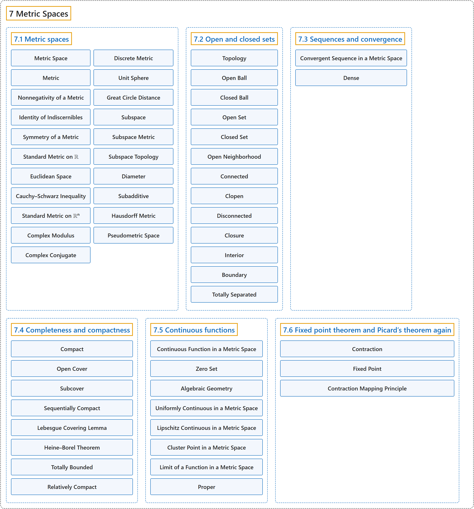

# 7 Metric Spaces

## Classification

## Glossary

| Term | Definition | 中文翻译 | Source |
|---|---|---|---|
| **7 Metric Spaces** 度量空间 | (No definition) | （无定义） | [Lebl, 2026, chapter 7](https://www.jirka.org/ra/html/ms_chapter.html) |
| **[7.1 Metric spaces](7-1-metric-spaces.md)** 度量空间 | (No definition) | （无定义） | [Lebl, 2026, section 7.1](https://www.jirka.org/ra/html/sec_metric.html) |
| **[7.2 Open and closed sets](7-2-open-and-closed-sets.md)** 开集与闭集 | (No definition) | （无定义） | [Lebl, 2026, section 7.2](https://www.jirka.org/ra/html/sec_mettop.html) |
| **[7.3 Sequences and convergence](7-3-sequences-and-convergence.md)** 序列与收敛 | (No definition) | （无定义） | [Lebl, 2026, section 7.3](https://www.jirka.org/ra/html/sec_metseqs.html) |
| **[7.4 Completeness and compactness](7-4-completeness-and-compactness.md)** 完备性与紧性 | (No definition) | （无定义） | [Lebl, 2026, section 7.4](https://www.jirka.org/ra/html/sec_metcompact.html) |
| **[7.5 Continuous functions](7-5-continuous-functions.md)** 连续函数 | (No definition) | （无定义） | [Lebl, 2026, section 7.5](https://www.jirka.org/ra/html/sec_metcont.html) |
| **[7.6 Fixed point theorem and Picard’s theorem again](7-6-fixed-point-theorem-and-picards-theorem-again.md)** 不动点定理与再论皮卡定理 | (No definition) | （无定义） | [Lebl, 2026, section 7.6](https://www.jirka.org/ra/html/sec_metpicard.html) |

## References

Lebl, J. (2026). *Basic analysis I & II: Introduction to real analysis* (May 22, 2026 edition). Retrieved October 29, 2026, from <https://www.jirka.org/ra/html/>
