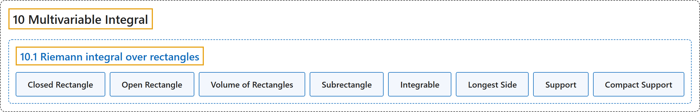

# 10.1 Riemann integral over rectangles

## Classification

## Glossary

| Term | Definition | 中文翻译 | Source |
|---|---|---|---|
| **10.1 Riemann integral over rectangles** 矩形上的黎曼积分 | (No definition) | （无定义） | [Lebl, 2026, section 10.1](https://www.jirka.org/ra/html/sec_rirect.html) |
| **Closed Rectangle** 闭矩形 | "Let $(a_1,a_2,\ldots,a_n)$ and $(b_1,b_2,\ldots,b_n)$ be such that $a_k \leq b_k$ for all $k$. The set **$[a_1,b_1] \times [a_2,b_2] \times \cdots \times [a_n,b_n]$** is called a **closed rectangle**." | 设 $(a_1,a_2,\ldots,a_n)$ 与 $(b_1,b_2,\ldots,b_n)$ 对所有 $k$ 满足 $a_k \leq b_k$。集合 **$[a_1,b_1] \times [a_2,b_2] \times \cdots \times [a_n,b_n]$** 称为**闭矩形**。 | [Lebl, 2026, Definition 10.1.1](https://www.jirka.org/ra/html/sec_rirect.html#sec_rirect-3-2) |
| **Open Rectangle** 开矩形 | "If $a_k < b_k$ for all $k$, then the set **$(a_1,b_1) \times (a_2,b_2) \times \cdots \times (a_n,b_n)$** is called an **open rectangle**." | 若对所有 $k$ 有 $a_k < b_k$，则集合 **$(a_1,b_1) \times (a_2,b_2) \times \cdots \times (a_n,b_n)$** 称为**开矩形**。 | [Lebl, 2026, Definition 10.1.1](https://www.jirka.org/ra/html/sec_rirect.html#sec_rirect-3-2) |
| **Volume of Rectangles** 矩形的体积 | "For an open or closed rectangle $R := [a_1,b_1] \times [a_2,b_2] \times \cdots \times [a_n,b_n] \subset \mathbb{R}^n$ or $R := (a_1,b_1) \times (a_2,b_2) \times \cdots \times (a_n,b_n) \subset \mathbb{R}^n$, we define the **$n$-dimensional volume** by **$V(R) := (b_1-a_1) (b_2-a_2) \cdots (b_n-a_n)$**." | 对开矩形或闭矩形 $R := [a_1,b_1] \times [a_2,b_2] \times \cdots \times [a_n,b_n] \subset \mathbb{R}^n$ 或 $R := (a_1,b_1) \times (a_2,b_2) \times \cdots \times (a_n,b_n) \subset \mathbb{R}^n$，定义 **$n$ 维体积**为 **$V(R) := (b_1-a_1) (b_2-a_2) \cdots (b_n-a_n)$**。 | [Lebl, 2026, Definition 10.1.1](https://www.jirka.org/ra/html/sec_rirect.html#sec_rirect-3-2) |
| **Subrectangle** 子矩形 | "Picking a set of $n$ integers $j_1,j_2,\ldots,j_n$ where $j_k \in \{ 1,2,\ldots,\ell_k \}$ we get the **subrectangle** **$[x_{1,j_1-1}~,~ x_{1,j_1}] \times [x_{2,j_2-1}~,~ x_{2,j_2}] \times \cdots \times [x_{n,j_n-1}~,~ x_{n,j_n}]$**." | 选取 $n$ 个整数 $j_1,j_2,\ldots,j_n$，其中 $j_k \in \{ 1,2,\ldots,\ell_k \}$，就得到**子矩形** **$[x_{1,j_1-1}~,~ x_{1,j_1}] \times [x_{2,j_2-1}~,~ x_{2,j_2}] \times \cdots \times [x_{n,j_n-1}~,~ x_{n,j_n}]$**。 | [Lebl, 2026, Definition 10.1.1](https://www.jirka.org/ra/html/sec_rirect.html#sec_rirect-3-2) |
| **Integrable** 可积 | "Let $R \subset \mathbb{R}^n$ be a closed rectangle and $f \colon R \to \mathbb{R}$ a bounded function such that **$\underline{\int_R} f(x)\,dx = \overline{\int_R} f(x)\,dx$**. Then $f$ is said to be Riemann integrable, and we sometimes say simply **integrable**." | 设 $R \subset \mathbb{R}^n$ 是闭矩形，$f \colon R \to \mathbb{R}$ 是满足 **$\underline{\int_R} f(x)\,dx = \overline{\int_R} f(x)\,dx$** 的有界函数，则称 $f$ 黎曼可积，有时简称**可积**。 | [Lebl, 2026, Definition 10.1.7](https://www.jirka.org/ra/html/sec_rirect.html#sec_rirect-5-3) |
| **Longest Side** 最长边 | "We say a rectangle $R = [a_1,b_1] \times [a_2,b_2] \times \cdots \times [a_n,b_n]$ has **longest side at most $\alpha$** if **$b_k-a_k \leq \alpha$ for all $k=1,2,\ldots,n$**." | 若**对所有 $k=1,2,\ldots,n$ 有 $b_k-a_k \leq \alpha$**，则称矩形 $R = [a_1,b_1] \times [a_2,b_2] \times \cdots \times [a_n,b_n]$ 的**最长边至多为 $\alpha$**。 | [Lebl, 2026, section 10.1](https://www.jirka.org/ra/html/sec_rirect.html#sec_rirect-6-2) |
| **Support** 支集 | "Let $U \subset \mathbb{R}^n$ be an open set and $f \colon U \to \mathbb{R}$ be a function. The **support** of $f$ is the set **$\operatorname{supp} (f) := \overline{ \{ x \in U : f(x) \neq 0 \} }$**, where the closure is with respect to the subspace topology on $U$." | 设 $U \subset \mathbb{R}^n$ 是开集，$f \colon U \to \mathbb{R}$ 是函数。$f$ 的**支集**是集合 **$\operatorname{supp} (f) := \overline{ \{ x \in U : f(x) \neq 0 \} }$**，其中闭包取 $U$ 上的子空间拓扑。 | [Lebl, 2026, section 10.1](https://www.jirka.org/ra/html/sec_rirect.html#sec_rirect-7-2) |
| **Compact Support** 紧支集 | "A function $f$ is said to have **compact support** if **$\operatorname{supp}(f)$ is a compact set**." | 若 **$\operatorname{supp}(f)$ 是紧集**，则称函数 $f$ 具有**紧支集**。 | [Lebl, 2026, section 10.1](https://www.jirka.org/ra/html/sec_rirect.html#sec_rirect-7-3) |

## References

Lebl, J. (2026). *Basic analysis I & II: Introduction to real analysis* (May 22, 2026 edition). Retrieved October 29, 2026, from <https://www.jirka.org/ra/html/>
