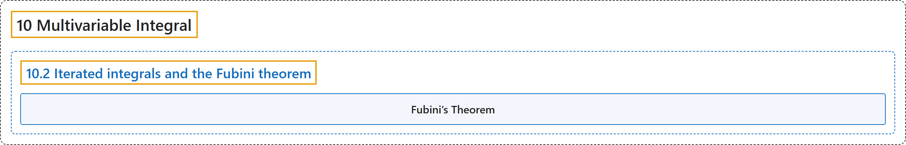

# 10.2 Iterated integrals and the Fubini theorem

## Classification

## Glossary

| Term | Definition | 中文翻译 | Source |
|---|---|---|---|
| **10.2 Iterated integrals and the Fubini theorem** 累次积分与富比尼定理 | (No definition) | （无定义） | [Lebl, 2026, section 10.2](https://www.jirka.org/ra/html/sec_iteratedints.html) |
| **Fubini’s Theorem** 富比尼定理 | "Let $R \times S \subset \mathbb{R}^n \times \mathbb{R}^m$ be a closed rectangle and $f \colon R \times S \to \mathbb{R}$ be integrable. The functions $g \colon R \to \mathbb{R}$ and $h \colon R \to \mathbb{R}$ defined by $g(x) := \underline{\int_S} f_x \qquad \text{and} \qquad h(x) := \overline{\int_S} f_x$ are integrable on $R$ and **$\int_R g = \int_R h = \int_{R \times S} f$**." | 设 $R \times S \subset \mathbb{R}^n \times \mathbb{R}^m$ 是闭矩形，$f \colon R \times S \to \mathbb{R}$ 可积。由 $g(x) := \underline{\int_S} f_x \qquad \text{and} \qquad h(x) := \overline{\int_S} f_x$ 定义的函数 $g \colon R \to \mathbb{R}$ 与 $h \colon R \to \mathbb{R}$ 在 $R$ 上可积，且 **$\int_R g = \int_R h = \int_{R \times S} f$**。 | [Lebl, 2026, Theorem 10.2.2](https://www.jirka.org/ra/html/sec_iteratedints.html#mv_fubinivA) |

## References

Lebl, J. (2026). *Basic analysis I & II: Introduction to real analysis* (May 22, 2026 edition). Retrieved October 29, 2026, from <https://www.jirka.org/ra/html/>
