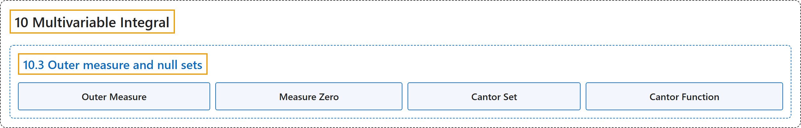

# 10.3 Outer measure and null sets

## Classification

## Glossary

| Term | Definition | 中文翻译 | Source |
|---|---|---|---|
| **10.3 Outer measure and null sets** 外测度与零测集 | (No definition) | （无定义） | [Lebl, 2026, section 10.3](https://www.jirka.org/ra/html/sec_outermeasure.html) |
| **Outer Measure** 外测度 | "Define the **outer measure** of a set $S \subset \mathbb{R}^n$ as **$m^*(S) := \inf\, \sum_{j=1}^\infty V(R_j)$, where the infimum is taken over all sequences $\{ R_j \}_{j=1}^\infty$ of open rectangles such that $S \subset \bigcup_{j=1}^\infty R_j$**, and we are allowing both the sum and the infimum to be $\infty$." | 定义集合 $S \subset \mathbb{R}^n$ 的**外测度**为 **$m^*(S) := \inf\, \sum_{j=1}^\infty V(R_j)$，其中下确界取遍所有满足 $S \subset \bigcup_{j=1}^\infty R_j$ 的开矩形序列 $\{ R_j \}_{j=1}^\infty$**，并允许和与下确界取 $\infty$。 | [Lebl, 2026, Definition 10.3.1](https://www.jirka.org/ra/html/sec_outermeasure.html#sec_outermeasure-3-3) |
| **Measure Zero** 零测度 | "In particular, $S$ is of **measure zero** or a **null set** if **$m^*(S) = 0$**." | 特别地，若 **$m^*(S) = 0$**，则称 $S$ **测度为零**，或称为**零测集**。 | [Lebl, 2026, Definition 10.3.1](https://www.jirka.org/ra/html/sec_outermeasure.html#sec_outermeasure-3-3) |
| **Cantor Set** 康托尔集 | "Any $x \in [0,1]$ can be expanded in ternary: $x = \sum_{n=1}^\infty d_n 3^{-n} , \qquad \text{where } d_n=0, 1, \text{ or } 2.$ Define the **Cantor set** $C$ as **$C := \Bigl\{ x \in [0,1] : x = \sum_{n=1}^\infty d_n 3^{-n}, \text{ where } d_n = 0 \text{ or } d_n = 2 \text{ for all } n \Bigr\}$**." | 任何 $x \in [0,1]$ 都可以展开成三进制：$x = \sum_{n=1}^\infty d_n 3^{-n} , \qquad \text{where } d_n=0, 1, \text{ or } 2.$ 定义**康托尔集** $C$ 为 **$C := \Bigl\{ x \in [0,1] : x = \sum_{n=1}^\infty d_n 3^{-n}, \text{ where } d_n = 0 \text{ or } d_n = 2 \text{ for all } n \Bigr\}$**。 | [Lebl, 2026, Example 10.3.8](https://www.jirka.org/ra/html/sec_outermeasure.html#example_cantor) |
| **Cantor Function** 康托尔函数 | "Let us construct the **Cantor function**, called also the **Devil’s staircase**. Let $C$ be the Cantor set. If $d_n \neq 1$ for all $n$, then let $c_n := \frac{d_n}{2}$ for all $n$. Otherwise, let $k$ be the smallest integer such that $d_k = 1$. Let $c_n := \frac{d_n}{2}$ if $n < k$, $c_k := 1$, and $c_n := 0$ if $n > k$. Define **$\varphi(x) := \sum_{n=1}^\infty c_n \, 2^{-n}$**." | 来构造**康托尔函数**，也称**魔鬼阶梯**。设 $C$ 是康托尔集。若对所有 $n$ 有 $d_n \neq 1$，令 $c_n := \frac{d_n}{2}$；否则设 $k$ 是使 $d_k = 1$ 的最小整数，令 $n < k$ 时 $c_n := \frac{d_n}{2}$，$c_k := 1$，$n > k$ 时 $c_n := 0$。定义 **$\varphi(x) := \sum_{n=1}^\infty c_n \, 2^{-n}$**。 | [Lebl, 2026, Exercise 10.3.12](https://www.jirka.org/ra/html/sec_outermeasure.html#sec_outermeasure-6-12) |

## References

Lebl, J. (2026). *Basic analysis I & II: Introduction to real analysis* (May 22, 2026 edition). Retrieved October 29, 2026, from <https://www.jirka.org/ra/html/>
