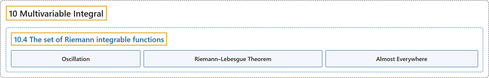

# 10.4 The set of Riemann integrable functions

## Classification

## Glossary

| Term | Definition | 中文翻译 | Source |
|---|---|---|---|
| **10.4 The set of Riemann integrable functions** 黎曼可积函数集 | (No definition) | （无定义） | [Lebl, 2026, section 10.4](https://www.jirka.org/ra/html/sec_riemannlebesgue.html) |
| **Oscillation** 振幅 | "Therefore, the limit as $\delta \to 0$ from the right exists, and we define the **oscillation** of $f$ at $x$ as **$o(f,x) := \lim_{\delta \to 0^+} o(f,x,\delta) = \inf_{\delta > 0} o(f,x,\delta)$**." | 因此当 $\delta \to 0$ 时右极限存在，定义 $f$ 在 $x$ 处的**振幅**为 **$o(f,x) := \lim_{\delta \to 0^+} o(f,x,\delta) = \inf_{\delta > 0} o(f,x,\delta)$**。 | [Lebl, 2026, section 10.4](https://www.jirka.org/ra/html/sec_riemannlebesgue.html#sec_riemannlebesgue-3-2) |
| **Riemann–Lebesgue Theorem** 黎曼–勒贝格定理 | "Let $R \subset \mathbb{R}^n$ be a closed rectangle and $f \colon R \to \mathbb{R}$ bounded. Then **$f$ is Riemann integrable if and only if the set of discontinuities of $f$ is of measure zero**." | 设 $R \subset \mathbb{R}^n$ 是闭矩形，$f \colon R \to \mathbb{R}$ 有界，则 **$f$ 黎曼可积当且仅当 $f$ 的间断点集测度为零**。 | [Lebl, 2026, Theorem 10.4.3](https://www.jirka.org/ra/html/sec_riemannlebesgue.html#sec_riemannlebesgue-4-3) |
| **Almost Everywhere** 几乎处处 | "Show that if $\int_R f = 0$, then **there is a measure zero set $E \subset R$ such that $f(x) = 0$ for all $x \in R \setminus E$** (one says “$f=0$ **almost everywhere**”)." | 证明：若 $\int_R f = 0$，则**存在零测集 $E \subset R$，使得对所有 $x \in R \setminus E$ 有 $f(x) = 0$**（称“$f=0$ **几乎处处**成立”）。 | [Lebl, 2026, Exercise 10.4.13](https://www.jirka.org/ra/html/sec_riemannlebesgue.html#sec_riemannlebesgue-5-13) |

## References

Lebl, J. (2026). *Basic analysis I & II: Introduction to real analysis* (May 22, 2026 edition). Retrieved October 29, 2026, from <https://www.jirka.org/ra/html/>
