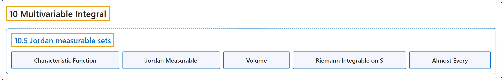

# 10.5 Jordan measurable sets

## Classification

## Glossary

| Term | Definition | 中文翻译 | Source |
|---|---|---|---|
| **10.5 Jordan measurable sets** 若尔当可测集 | (No definition) | （无定义） | [Lebl, 2026, section 10.5](https://www.jirka.org/ra/html/sec_jordansets.html) |
| **Characteristic Function** 特征函数 | "Given a set $S \subset \mathbb{R}^n$, its **characteristic function** or **indicator function** $\chi_S \colon \mathbb{R}^n \to \mathbb{R}$ is defined by **$\chi_S(x) := \begin{cases} 1 & \text{if } x \in S, \\ 0 & \text{if } x \notin S. \end{cases}$**" | 给定集合 $S \subset \mathbb{R}^n$，它的**特征函数**或**指示函数** $\chi_S \colon \mathbb{R}^n \to \mathbb{R}$ 定义为 **$\chi_S(x) := \begin{cases} 1 & \text{if } x \in S, \\ 0 & \text{if } x \notin S. \end{cases}$** | [Lebl, 2026, section 10.5](https://www.jirka.org/ra/html/sec_jordansets.html#sec_jordansets-3-2) |
| **Jordan Measurable** 若尔当可测 | "A bounded set $S$ is **Jordan measurable** if **for some closed rectangle $R$ such that $S \subset R$, the function $\chi_S$ is Riemann integrable**, that is, $\chi_S \in \mathcal{R}(R)$." | 若**对某个满足 $S \subset R$ 的闭矩形 $R$，函数 $\chi_S$ 黎曼可积**，即 $\chi_S \in \mathcal{R}(R)$，则称有界集 $S$ **若尔当可测**。 | [Lebl, 2026, section 10.5](https://www.jirka.org/ra/html/sec_jordansets.html#sec_jordansets-3-2) |
| **Volume** 体积 | "We define the **$n$-dimensional volume** of the bounded Jordan measurable set $S$ as **$V(S) := \int_R \chi_S$**, where $R$ is any closed rectangle containing $S$." | 定义有界若尔当可测集 $S$ 的 **$n$ 维体积**为 **$V(S) := \int_R \chi_S$**，其中 $R$ 是任何包含 $S$ 的闭矩形。 | [Lebl, 2026, section 10.5](https://www.jirka.org/ra/html/sec_jordansets.html#sec_jordansets-3-2) |
| **Riemann Integrable on S** 在 S 上黎曼可积 | "Let $S \subset \mathbb{R}^n$ be a bounded Jordan measurable set. A bounded function $f \colon S \to \mathbb{R}$ is said to be **Riemann integrable on $S$**, or $f \in \mathcal{R}(S)$, if **for a closed rectangle $R$ such that $S \subset R$, the function $\widetilde{f} \colon R \to \mathbb{R}$ defined by $\widetilde{f}(x) := \begin{cases} f(x) & \text{if } x \in S, \\ 0 & \text{otherwise}, \end{cases}$ is in $\mathcal{R}(R)$**." | 设 $S \subset \mathbb{R}^n$ 是有界若尔当可测集。若**对满足 $S \subset R$ 的闭矩形 $R$，由 $\widetilde{f}(x) := \begin{cases} f(x) & \text{if } x \in S, \\ 0 & \text{otherwise}, \end{cases}$ 定义的函数 $\widetilde{f} \colon R \to \mathbb{R}$ 属于 $\mathcal{R}(R)$**，则称有界函数 $f \colon S \to \mathbb{R}$ **在 $S$ 上黎曼可积**，记作 $f \in \mathcal{R}(S)$。 | [Lebl, 2026, Definition 10.5.4](https://www.jirka.org/ra/html/sec_jordansets.html#sec_jordansets-4-3) |
| **Almost Every** 几乎每个 | "We say some property holds **for almost every $x$** or **almost everywhere** if **it holds for all $x$ except on a set of measure zero**." | 若某性质**除一个零测集外对所有 $x$ 成立**，就说它**对几乎每个 $x$** 成立，或**几乎处处**成立。 | [Lebl, 2026, section 10.5](https://www.jirka.org/ra/html/sec_jordansets.html#sec_jordansets-4-8) |

## References

Lebl, J. (2026). *Basic analysis I & II: Introduction to real analysis* (May 22, 2026 edition). Retrieved October 29, 2026, from <https://www.jirka.org/ra/html/>
