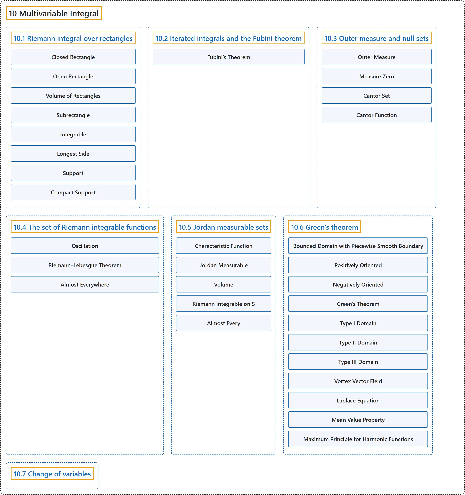

# 10 Multivariable Integral

## Classification

## Glossary

| Term | Definition | 中文翻译 | Source |
|---|---|---|---|
| **10 Multivariable Integral** 多变量积分 | (No definition) | （无定义） | [Lebl, 2026, chapter 10](https://www.jirka.org/ra/html/mi_chapter.html) |
| **[10.1 Riemann integral over rectangles](10-1-riemann-integral-over-rectangles.md)** 矩形上的黎曼积分 | (No definition) | （无定义） | [Lebl, 2026, section 10.1](https://www.jirka.org/ra/html/sec_rirect.html) |
| **[10.2 Iterated integrals and the Fubini theorem](10-2-iterated-integrals-and-the-fubini-theorem.md)** 累次积分与富比尼定理 | (No definition) | （无定义） | [Lebl, 2026, section 10.2](https://www.jirka.org/ra/html/sec_iteratedints.html) |
| **[10.3 Outer measure and null sets](10-3-outer-measure-and-null-sets.md)** 外测度与零测集 | (No definition) | （无定义） | [Lebl, 2026, section 10.3](https://www.jirka.org/ra/html/sec_outermeasure.html) |
| **[10.4 The set of Riemann integrable functions](10-4-the-set-of-riemann-integrable-functions.md)** 黎曼可积函数集 | (No definition) | （无定义） | [Lebl, 2026, section 10.4](https://www.jirka.org/ra/html/sec_riemannlebesgue.html) |
| **[10.5 Jordan measurable sets](10-5-jordan-measurable-sets.md)** 若尔当可测集 | (No definition) | （无定义） | [Lebl, 2026, section 10.5](https://www.jirka.org/ra/html/sec_jordansets.html) |
| **[10.6 Green’s theorem](10-6-greens-theorem.md)** 格林定理 | (No definition) | （无定义） | [Lebl, 2026, section 10.6](https://www.jirka.org/ra/html/sec_mvgreenstheorem.html) |
| **[10.7 Change of variables](10-7-change-of-variables.md)** 变量替换 | (No definition) | （无定义） | [Lebl, 2026, section 10.7](https://www.jirka.org/ra/html/sec_mvchangeofvars.html) |

## References

Lebl, J. (2026). *Basic analysis I & II: Introduction to real analysis* (May 22, 2026 edition). Retrieved October 29, 2026, from <https://www.jirka.org/ra/html/>
