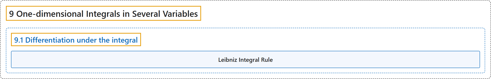

# 9.1 Differentiation under the integral

## Classification

## Glossary

| Term | Definition | 中文翻译 | Source |
|---|---|---|---|
| **9.1 Differentiation under the integral** 积分号下求导 | (No definition) | （无定义） | [Lebl, 2026, section 9.1](https://www.jirka.org/ra/html/sec_diffunderint.html) |
| **Leibniz Integral Rule** 莱布尼茨积分法则 | "Suppose $f \colon [a,b] \times [c,d] \to \mathbb{R}$ is a continuous function, such that $\frac{\partial f}{\partial y}$ exists for all $(x,y) \in [a,b] \times [c,d]$ and is continuous. Define $g \colon [c,d] \to \mathbb{R}$ by $g(y) := \int_a^b f(x,y) \,dx$. Then **$g$ is continuously differentiable and $g'(y) = \int_a^b \frac{\partial f}{\partial y}(x,y) \,dx$**." | 设 $f \colon [a,b] \times [c,d] \to \mathbb{R}$ 连续，且对所有 $(x,y) \in [a,b] \times [c,d]$，$\frac{\partial f}{\partial y}$ 存在并连续。定义 $g \colon [c,d] \to \mathbb{R}$ 为 $g(y) := \int_a^b f(x,y) \,dx$，则 **$g$ 连续可微，且 $g'(y) = \int_a^b \frac{\partial f}{\partial y}(x,y) \,dx$**。 | [Lebl, 2026, Theorem 9.1.1](https://www.jirka.org/ra/html/sec_diffunderint.html#sec_diffunderint-6) |

## References

Lebl, J. (2026). *Basic analysis I & II: Introduction to real analysis* (May 22, 2026 edition). Retrieved October 29, 2026, from <https://www.jirka.org/ra/html/>
