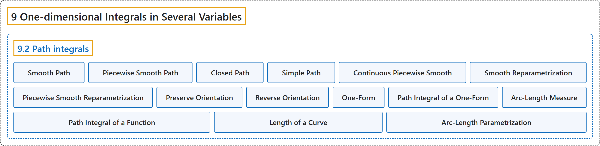

# 9.2 Path integrals

## Classification

## Glossary

| Term | Definition | 中文翻译 | Source |
|---|---|---|---|
| **9.2 Path integrals** 路径积分 | (No definition) | （无定义） | [Lebl, 2026, section 9.2](https://www.jirka.org/ra/html/sec_pathintegral.html) |
| **Smooth Path** 光滑路径 | "A continuously differentiable function $\gamma \colon [a,b] \to \mathbb{R}^n$ is called a **smooth path** or a **continuously differentiable path** if **$\gamma$ is continuously differentiable and $\gamma'(t) \neq 0$ for all $t \in [a,b]$**." | 若 **$\gamma$ 连续可微，且对所有 $t \in [a,b]$ 有 $\gamma'(t) \neq 0$**，则连续可微函数 $\gamma \colon [a,b] \to \mathbb{R}^n$ 称为**光滑路径**或**连续可微路径**。 | [Lebl, 2026, Definition 9.2.1](https://www.jirka.org/ra/html/sec_pathintegral.html#sec_pathintegral-3-3) |
| **Piecewise Smooth Path** 分段光滑路径 | "The function $\gamma \colon [a,b] \to \mathbb{R}^n$ is called a **piecewise smooth path** or a **piecewise continuously differentiable path** if **there exist finitely many points $t_0 = a < t_1 < t_2 < \cdots < t_k = b$ such that the restriction $\gamma|_{[t_{j-1},t_j]}$ is a smooth path for every $j=1,2,\ldots,k$**." | 若**存在有限个点 $t_0 = a < t_1 < t_2 < \cdots < t_k = b$，使得对每个 $j=1,2,\ldots,k$，限制 $\gamma|_{[t_{j-1},t_j]}$ 都是光滑路径**，则函数 $\gamma \colon [a,b] \to \mathbb{R}^n$ 称为**分段光滑路径**或**分段连续可微路径**。 | [Lebl, 2026, Definition 9.2.1](https://www.jirka.org/ra/html/sec_pathintegral.html#sec_pathintegral-3-3) |
| **Closed Path** 闭路径 | "A path $\gamma$ is a **closed path** if **$\gamma(a) = \gamma(b)$**, that is, the path starts and ends at the same point." | 若 **$\gamma(a) = \gamma(b)$**，即路径的起点与终点相同，则路径 $\gamma$ 是**闭路径**。 | [Lebl, 2026, Definition 9.2.1](https://www.jirka.org/ra/html/sec_pathintegral.html#sec_pathintegral-3-3) |
| **Simple Path** 简单路径 | "A path $\gamma$ is a **simple path** if either **1) $\gamma$ is a one-to-one function, or 2) $\gamma|_{[a,b)}$ is one-to-one and $\gamma(a)=\gamma(b)$** ($\gamma$ is a simple closed path)." | 若 **1) $\gamma$ 是一对一函数，或 2) $\gamma|_{[a,b)}$ 是一对一的且 $\gamma(a)=\gamma(b)$**（$\gamma$ 是简单闭路径），则路径 $\gamma$ 是**简单路径**。 | [Lebl, 2026, Definition 9.2.1](https://www.jirka.org/ra/html/sec_pathintegral.html#sec_pathintegral-3-3) |
| **Continuous Piecewise Smooth** 连续分段光滑 | "For general functions, many authors also allow **finitely many discontinuities**, when they use the term **piecewise smooth**, and so one may say that we defined a piecewise smooth path to be a **continuous piecewise smooth** function." | 对一般函数，许多作者在使用**分段光滑**一词时也允许**有限个间断点**，所以可以说，我们把分段光滑路径定义成了**连续分段光滑**函数。 | [Lebl, 2026, section 9.2](https://www.jirka.org/ra/html/sec_pathintegral.html#sec_pathintegral-3-5) |
| **Smooth Reparametrization** 光滑重参数化 | "Let $\gamma \colon [a,b] \to \mathbb{R}^n$ be a smooth path and **$h \colon [c,d] \to [a,b]$ a continuously differentiable bijective function such that $h'(t) \neq 0$ for all $t \in [c,d]$**. Then the composition $\gamma \circ h$ is called a **smooth reparametrization** of $\gamma$." | 设 $\gamma \colon [a,b] \to \mathbb{R}^n$ 是光滑路径，**$h \colon [c,d] \to [a,b]$ 是连续可微的双射，且对所有 $t \in [c,d]$ 有 $h'(t) \neq 0$**，则复合 $\gamma \circ h$ 称为 $\gamma$ 的**光滑重参数化**。 | [Lebl, 2026, Definition 9.2.5](https://www.jirka.org/ra/html/sec_pathintegral.html#sec_pathintegral-3-11) |
| **Piecewise Smooth Reparametrization** 分段光滑重参数化 | "Let $\gamma$ be a piecewise smooth path, and **$h$ a piecewise smooth bijective function with nonzero one-sided limits of $h'$**. The composition $\gamma \circ h$ is called a **piecewise smooth reparametrization** of $\gamma$." | 设 $\gamma$ 是分段光滑路径，**$h$ 是分段光滑的双射，且 $h'$ 的单侧极限非零**，则复合 $\gamma \circ h$ 称为 $\gamma$ 的**分段光滑重参数化**。 | [Lebl, 2026, Definition 9.2.5](https://www.jirka.org/ra/html/sec_pathintegral.html#sec_pathintegral-3-11) |
| **Preserve Orientation** 保持定向 | "If **$h$ is strictly increasing**, then $h$ is said to **preserve orientation**." | 若 **$h$ 严格递增**，则称 $h$ **保持定向**。 | [Lebl, 2026, Definition 9.2.5](https://www.jirka.org/ra/html/sec_pathintegral.html#sec_pathintegral-3-11) |
| **Reverse Orientation** 反转定向 | "If **$h$ does not preserve orientation**, then $h$ is said to **reverse orientation**." | 若 **$h$ 不保持定向**，则称 $h$ **反转定向**。 | [Lebl, 2026, Definition 9.2.5](https://www.jirka.org/ra/html/sec_pathintegral.html#sec_pathintegral-3-11) |
| **One-Form** 一形式 | "Let $(x_1,x_2,\ldots,x_n) \in \mathbb{R}^n$ be our coordinates. Given $n$ real-valued continuous functions $\omega_1,\omega_2,\ldots,\omega_n$ defined on a set $S \subset \mathbb{R}^n$, we define a **one-form** to be **an object of the form $\omega = \omega_1 \,dx_1 + \omega_2 \,dx_2 + \cdots + \omega_n \,dx_n$**." | 设 $(x_1,x_2,\ldots,x_n) \in \mathbb{R}^n$ 为坐标。给定定义在集合 $S \subset \mathbb{R}^n$ 上的 $n$ 个实值连续函数 $\omega_1,\omega_2,\ldots,\omega_n$，定义**一形式**为**形如 $\omega = \omega_1 \,dx_1 + \omega_2 \,dx_2 + \cdots + \omega_n \,dx_n$ 的对象**。 | [Lebl, 2026, Definition 9.2.7](https://www.jirka.org/ra/html/sec_pathintegral.html#sec_pathintegral-4-2) |
| **Path Integral of a One-Form** 一形式的路径积分 | "Let $\gamma \colon [a,b] \to \mathbb{R}^n$ be a smooth path and let $\omega = \omega_1 \,dx_1 + \omega_2 \,dx_2 + \cdots + \omega_n \,dx_n$ be a one-form defined on the direct image $\gamma\bigl([a,b]\bigr)$. Write $\gamma = (\gamma_1,\gamma_2,\ldots,\gamma_n)$. Define: **$\int_{\gamma} \omega := \int_a^b \left( \sum_{j=1}^n \omega_j\bigl(\gamma(t)\bigr) \gamma_j'(t) \right) dt$**." | 设 $\gamma \colon [a,b] \to \mathbb{R}^n$ 是光滑路径，$\omega = \omega_1 \,dx_1 + \omega_2 \,dx_2 + \cdots + \omega_n \,dx_n$ 是定义在正像 $\gamma\bigl([a,b]\bigr)$ 上的一形式，记 $\gamma = (\gamma_1,\gamma_2,\ldots,\gamma_n)$。定义：**$\int_{\gamma} \omega := \int_a^b \left( \sum_{j=1}^n \omega_j\bigl(\gamma(t)\bigr) \gamma_j'(t) \right) dt$**。 | [Lebl, 2026, Definition 9.2.9](https://www.jirka.org/ra/html/sec_pathintegral.html#sec_pathintegral-4-4) |
| **Arc-Length Measure** 弧长测度 | "Next, we integrate a function against the **arc-length measure $ds$**. The geometric picture we have in mind is **the area under the graph of the function over a path**." | 接下来，把函数对**弧长测度 $ds$** 积分。我们心中的几何图景是**路径上方函数图像之下的面积**。 | [Lebl, 2026, section 9.2](https://www.jirka.org/ra/html/sec_pathintegral.html#sec_pathintegral-5-2) |
| **Path Integral of a Function** 函数的路径积分 | "Suppose $\gamma \colon [a,b] \to \mathbb{R}^n$ is a smooth path, and $f$ is a continuous function defined on the image $\gamma\bigl([a,b]\bigr)$. Then define **$\int_{\gamma} f \,ds := \int_a^b f\bigl( \gamma(t) \bigr) \bigl\lVert \gamma'(t) \bigr\rVert \, dt$**." | 设 $\gamma \colon [a,b] \to \mathbb{R}^n$ 是光滑路径，$f$ 是定义在像 $\gamma\bigl([a,b]\bigr)$ 上的连续函数。定义 **$\int_{\gamma} f \,ds := \int_a^b f\bigl( \gamma(t) \bigr) \bigl\lVert \gamma'(t) \bigr\rVert \, dt$**。 | [Lebl, 2026, Definition 9.2.14](https://www.jirka.org/ra/html/sec_pathintegral.html#sec_pathintegral-5-6) |
| **Length of a Curve** 曲线长度 | "Suppose $\Gamma \subset \mathbb{R}^n$ is parametrized by a simple piecewise smooth path $\gamma \colon [a,b] \to \mathbb{R}^n$, that is, $\gamma\bigl( [a,b] \bigr) = \Gamma$. We define the **length** by **$\ell(\Gamma) := \int_{\Gamma} ds = \int_{\gamma} ds$**." | 设 $\Gamma \subset \mathbb{R}^n$ 由简单分段光滑路径 $\gamma \colon [a,b] \to \mathbb{R}^n$ 参数化，即 $\gamma\bigl( [a,b] \bigr) = \Gamma$。定义**长度**为 **$\ell(\Gamma) := \int_{\Gamma} ds = \int_{\gamma} ds$**。 | [Lebl, 2026, Definition 9.2.17](https://www.jirka.org/ra/html/sec_pathintegral.html#sec_pathintegral-5-12) |
| **Arc-Length Parametrization** 弧长参数化 | "A simple piecewise smooth path $\gamma \colon [0,r] \to \mathbb{R}^n$ is said to be an **arc-length parametrization** if **for all $t \in [0,r]$, we have $\ell\bigl( \gamma\bigl([0,t]\bigr) \bigr) = t$**." | 若**对所有 $t \in [0,r]$ 有 $\ell\bigl( \gamma\bigl([0,t]\bigr) \bigr) = t$**，则简单分段光滑路径 $\gamma \colon [0,r] \to \mathbb{R}^n$ 称为**弧长参数化**。 | [Lebl, 2026, section 9.2](https://www.jirka.org/ra/html/sec_pathintegral.html#sec_pathintegral-5-15) |

## References

Lebl, J. (2026). *Basic analysis I & II: Introduction to real analysis* (May 22, 2026 edition). Retrieved October 29, 2026, from <https://www.jirka.org/ra/html/>
