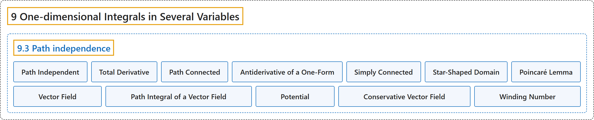

# 9.3 Path independence

## Classification

## Glossary

| Term | Definition | 中文翻译 | Source |
|---|---|---|---|
| **9.3 Path independence** 路径无关性 | (No definition) | （无定义） | [Lebl, 2026, section 9.3](https://www.jirka.org/ra/html/sec_pathind.html) |
| **Path Independent** 路径无关 | "Let $U \subset \mathbb{R}^n$ be an open set and $\omega$ a one-form defined on $U$. The integral of $\omega$ is said to be **path independent** if **for every pair of points $x,y \in U$ and every pair of piecewise smooth paths $\gamma \colon [a,b] \to U$ and $\beta \colon [c,d] \to U$ such that $\gamma(a) = \beta(c) = x$ and $\gamma(b) = \beta(d) = y$, we have $\int_\gamma \omega = \int_\beta \omega$**." | 设 $U \subset \mathbb{R}^n$ 是开集，$\omega$ 是定义在 $U$ 上的一形式。若**对每对点 $x,y \in U$ 以及每对满足 $\gamma(a) = \beta(c) = x$、$\gamma(b) = \beta(d) = y$ 的分段光滑路径 $\gamma \colon [a,b] \to U$ 与 $\beta \colon [c,d] \to U$，都有 $\int_\gamma \omega = \int_\beta \omega$**，则称 $\omega$ 的积分**与路径无关**。 | [Lebl, 2026, section 9.3](https://www.jirka.org/ra/html/sec_pathind.html#sec_pathind-3-2) |
| **Total Derivative** 全微分 | "Let $U \subset \mathbb{R}^n$ be an open set and $f \colon U \to \mathbb{R}$ a continuously differentiable function. The one-form **$df := \frac{\partial f}{\partial x_1} \, dx_1 + \frac{\partial f}{\partial x_2} \, dx_2 + \cdots + \frac{\partial f}{\partial x_n} \, dx_n$** is called the **total derivative** of $f$." | 设 $U \subset \mathbb{R}^n$ 是开集，$f \colon U \to \mathbb{R}$ 连续可微。一形式 **$df := \frac{\partial f}{\partial x_1} \, dx_1 + \frac{\partial f}{\partial x_2} \, dx_2 + \cdots + \frac{\partial f}{\partial x_n} \, dx_n$** 称为 $f$ 的**全微分**。 | [Lebl, 2026, Definition 9.3.2](https://www.jirka.org/ra/html/sec_pathind.html#sec_pathind-3-4) |
| **Path Connected** 道路连通 | "An open set $U \subset \mathbb{R}^n$ is said to be **path connected** if **for every two points $x$ and $y$ in $U$, there exists a piecewise smooth path starting at $x$ and ending at $y$**." | 若**对 $U$ 中任意两点 $x$ 与 $y$，都存在从 $x$ 出发、到 $y$ 结束的分段光滑路径**，则称开集 $U \subset \mathbb{R}^n$ **道路连通**。 | [Lebl, 2026, Definition 9.3.2](https://www.jirka.org/ra/html/sec_pathind.html#sec_pathind-3-4) |
| **Antiderivative of a One-Form** 一形式的原函数 | "There is an easier local criterion, a differential equation, that guarantees path independence, or in other words it guarantees an **antiderivative** **$f$ whose total derivative is the given one-form $\omega$**." | 有一个更简单的局部判别准则——一个微分方程——它保证路径无关，换言之，它保证存在一个**原函数**，即**全微分恰为给定一形式 $\omega$ 的 $f$**。 | [Lebl, 2026, section 9.3](https://www.jirka.org/ra/html/sec_pathind.html#sec_pathind-3-12) |
| **Simply Connected** 单连通 | "We can find the antiderivative in every **simply connected** domain, which informally is **a connected open set where every path between two points can be “continuously deformed” into any other path between those two points**." | 在每个**单连通**区域上都能找到原函数；单连通区域非正式地说就是**这样的连通开集：两点之间的每条路径都能“连续形变”为这两点之间的任何其他路径**。 | [Lebl, 2026, section 9.3](https://www.jirka.org/ra/html/sec_pathind.html#sec_pathind-3-12) |
| **Star-Shaped Domain** 星形域 | "Let $U \subset \mathbb{R}^n$ be an open set and $p \in U$. We say $U$ is a **star-shaped domain** with respect to $p$ if **for every other point $x \in U$, the line segment $[p,x]$ is in $U$**, that is, if $(1-t)p + tx \in U$ for all $t \in [0,1]$." | 设 $U \subset \mathbb{R}^n$ 是开集，$p \in U$。若**对 $U$ 中任何其他点 $x$，线段 $[p,x]$ 都在 $U$ 中**，即对所有 $t \in [0,1]$ 有 $(1-t)p + tx \in U$，则称 $U$ 是关于 $p$ 的**星形域**。 | [Lebl, 2026, Definition 9.3.5](https://www.jirka.org/ra/html/sec_pathind.html#sec_pathind-3-13) |
| **Poincaré Lemma** 庞加莱引理 | "Let $U \subset \mathbb{R}^n$ be a star-shaped domain and $\omega$ a continuously differentiable one-form defined on $U$. Suppose that **for every $j$ and $k$, $\frac{\partial \omega_j}{\partial x_k} = \frac{\partial \omega_k}{\partial x_j}$**. Then **there exists a twice continuously differentiable function $f \colon U \to \mathbb{R}$ such that $df = \omega$**." | 设 $U \subset \mathbb{R}^n$ 是星形域，$\omega$ 是定义在 $U$ 上的连续可微一形式。若**对每个 $j$ 和 $k$ 有 $\frac{\partial \omega_j}{\partial x_k} = \frac{\partial \omega_k}{\partial x_j}$**，则**存在二次连续可微函数 $f \colon U \to \mathbb{R}$ 使得 $df = \omega$**。 | [Lebl, 2026, Theorem 9.3.6](https://www.jirka.org/ra/html/sec_pathind.html#sec_pathind-3-15) |
| **Vector Field** 向量场 | "Let $U \subset \mathbb{R}^n$ be a set. A **continuous function $v \colon U \to \mathbb{R}^n$** is called a **vector field**." | 设 $U \subset \mathbb{R}^n$ 是集合。**连续函数 $v \colon U \to \mathbb{R}^n$** 称为**向量场**。 | [Lebl, 2026, Definition 9.3.8](https://www.jirka.org/ra/html/sec_pathind.html#sec_pathind-4-3) |
| **Path Integral of a Vector Field** 向量场的路径积分 | "Given a smooth path $\gamma \colon [a,b] \to \mathbb{R}^n$ with $\gamma\bigl([a,b]\bigr) \subset U$, we define the **path integral of the vector field $v$** as **$\int_{\gamma} v \cdot d\gamma := \int_a^b v\bigl(\gamma(t)\bigr) \cdot \gamma'(t) \, dt$**, where the dot in the definition is the standard dot product." | 给定满足 $\gamma\bigl([a,b]\bigr) \subset U$ 的光滑路径 $\gamma \colon [a,b] \to \mathbb{R}^n$，定义**向量场 $v$ 的路径积分**为 **$\int_{\gamma} v \cdot d\gamma := \int_a^b v\bigl(\gamma(t)\bigr) \cdot \gamma'(t) \, dt$**，其中的点是标准点积。 | [Lebl, 2026, Definition 9.3.8](https://www.jirka.org/ra/html/sec_pathind.html#sec_pathind-4-3) |
| **Potential** 势函数 | "For example, path independence for integration of vector fields is simply that $\int_x^y v \cdot d\gamma$ is path independent if and only if **$v = \nabla f$**, that is, $v$ is the gradient of a function. The **function $f$** is then called a **potential** for $v$." | 例如，向量场积分的路径无关性就是：$\int_x^y v \cdot d\gamma$ 与路径无关，当且仅当 **$v = \nabla f$**，即 $v$ 是某个函数的梯度。这时**函数 $f$** 称为 $v$ 的**势函数**。 | [Lebl, 2026, section 9.3](https://www.jirka.org/ra/html/sec_pathind.html#sec_pathind-4-4) |
| **Conservative Vector Field** 保守向量场 | "A vector field $v$ **whose path integrals are path independent** is called a **conservative vector field**." | **路径积分与路径无关**的向量场 $v$ 称为**保守向量场**。 | [Lebl, 2026, section 9.3](https://www.jirka.org/ra/html/sec_pathind.html#sec_pathind-4-5) |
| **Winding Number** 环绕数 | "The number $\ell$ is called the **winding number** it measures **how many times $\gamma$ winds around the origin in the counterclockwise direction**." | 数 $\ell$ 称为**环绕数**，它度量 **$\gamma$ 沿逆时针方向绕原点转了多少圈**。 | [Lebl, 2026, Exercise 9.3.10](https://www.jirka.org/ra/html/sec_pathind.html#sec_pathind-5-10) |

## References

Lebl, J. (2026). *Basic analysis I & II: Introduction to real analysis* (May 22, 2026 edition). Retrieved October 29, 2026, from <https://www.jirka.org/ra/html/>
