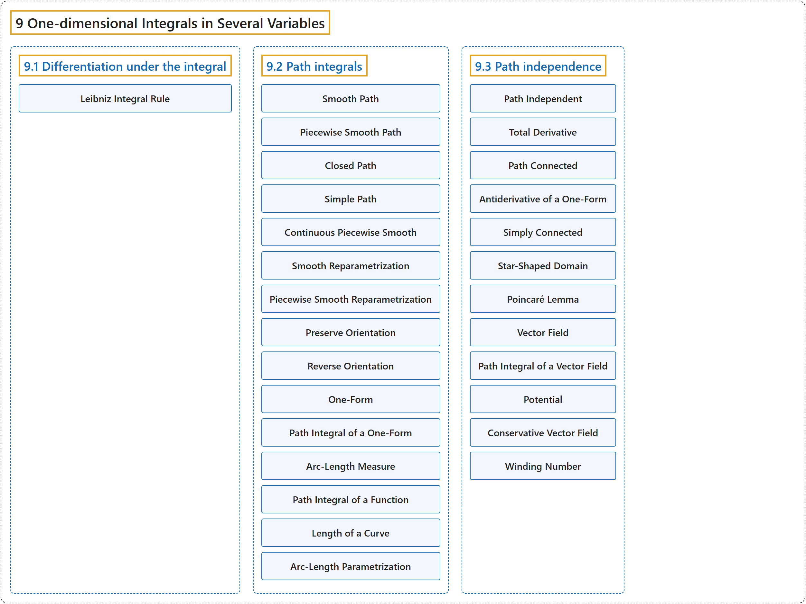

# 9 One-dimensional Integrals in Several Variables

## Classification

## Glossary

| Term | Definition | 中文翻译 | Source |
|---|---|---|---|
| **9 One-dimensional Integrals in Several Variables** 多变量中的一维积分 | (No definition) | （无定义） | [Lebl, 2026, chapter 9](https://www.jirka.org/ra/html/path_chapter.html) |
| **[9.1 Differentiation under the integral](9-1-differentiation-under-the-integral.md)** 积分号下求导 | (No definition) | （无定义） | [Lebl, 2026, section 9.1](https://www.jirka.org/ra/html/sec_diffunderint.html) |
| **[9.2 Path integrals](9-2-path-integrals.md)** 路径积分 | (No definition) | （无定义） | [Lebl, 2026, section 9.2](https://www.jirka.org/ra/html/sec_pathintegral.html) |
| **[9.3 Path independence](9-3-path-independence.md)** 路径无关性 | (No definition) | （无定义） | [Lebl, 2026, section 9.3](https://www.jirka.org/ra/html/sec_pathind.html) |

## References

Lebl, J. (2026). *Basic analysis I & II: Introduction to real analysis* (May 22, 2026 edition). Retrieved October 29, 2026, from <https://www.jirka.org/ra/html/>
