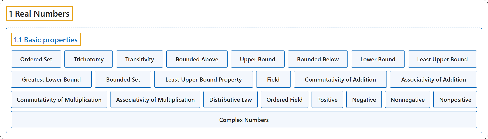

# 1.1 Basic properties

## Classification

## Glossary

| Term | Definition | 中文翻译 | Source |
|---|---|---|---|
| **1.1 Basic properties** 基本性质 | (No definition) | （无定义） | [Lebl, 2026, section 1.1](https://www.jirka.org/ra/html/sec_basicpropsrn.html) |
| **Ordered Set** 有序集 | "An **ordered set** is **a set $S$ together with a relation $<$** such that (trichotomy) For all $x, y \in S$, exactly one of $x < y$, $x=y$, or $y < x$ holds. (transitivity) If $x,y,z \in S$ are such that $x < y$ and $y < z$, then $x < z$." | **有序集**是**一个集合 $S$ 连同一个关系 $<$**，满足：（三歧性）对所有 $x, y \in S$，$x < y$、$x=y$、$y < x$ 中恰有一个成立。（传递性）若 $x,y,z \in S$ 满足 $x < y$ 且 $y < z$，则 $x < z$。 | [Lebl, 2026, Definition 1.1.1](https://www.jirka.org/ra/html/sec_basicpropsrn.html#sec_basicpropsrn-4) |
| **Trichotomy** 三歧性 | "(**trichotomy**) For all $x, y \in S$, **exactly one of $x < y$, $x=y$, or $y < x$ holds**." | （**三歧性**）对所有 $x, y \in S$，**$x < y$、$x=y$、$y < x$ 中恰有一个成立**。 | [Lebl, 2026, Definition 1.1.1](https://www.jirka.org/ra/html/sec_basicpropsrn.html#sec_basicpropsrn-4-1-2-1) |
| **Transitivity** 传递性 | "(**transitivity**) If $x,y,z \in S$ are such that $x < y$ and $y < z$, **then $x < z$**." | （**传递性**）若 $x,y,z \in S$ 满足 $x < y$ 且 $y < z$，**则 $x < z$**。 | [Lebl, 2026, Definition 1.1.1](https://www.jirka.org/ra/html/sec_basicpropsrn.html#sec_basicpropsrn-4-1-2-2) |
| **Bounded Above** 上有界 | "If there exists a $b \in S$ such that **$x \leq b$ for all $x \in E$**, then we say $E$ is **bounded above** and $b$ is an upper bound of $E$." | 若存在 $b \in S$ 使得**对所有 $x \in E$ 有 $x \leq b$**，则称 $E$ **上有界**，$b$ 是 $E$ 的一个上界。 | [Lebl, 2026, Definition 1.1.2](https://www.jirka.org/ra/html/sec_basicpropsrn.html#sec_basicpropsrn-7-1-2-1) |
| **Upper Bound** 上界 | "If there exists a **$b \in S$ such that $x \leq b$ for all $x \in E$**, then we say $E$ is bounded above and $b$ is an **upper bound** of $E$." | 若存在 **$b \in S$ 使得对所有 $x \in E$ 有 $x \leq b$**，则称 $E$ 上有界，$b$ 是 $E$ 的一个**上界**。 | [Lebl, 2026, Definition 1.1.2](https://www.jirka.org/ra/html/sec_basicpropsrn.html#sec_basicpropsrn-7-1-2-1) |
| **Bounded Below** 下有界 | "If there exists a $b \in S$ such that **$x \geq b$ for all $x \in E$**, then we say $E$ is **bounded below** and $b$ is a lower bound of $E$." | 若存在 $b \in S$ 使得**对所有 $x \in E$ 有 $x \geq b$**，则称 $E$ **下有界**，$b$ 是 $E$ 的一个下界。 | [Lebl, 2026, Definition 1.1.2](https://www.jirka.org/ra/html/sec_basicpropsrn.html#sec_basicpropsrn-7-1-2-2) |
| **Lower Bound** 下界 | "If there exists a **$b \in S$ such that $x \geq b$ for all $x \in E$**, then we say $E$ is bounded below and $b$ is a **lower bound** of $E$." | 若存在 **$b \in S$ 使得对所有 $x \in E$ 有 $x \geq b$**，则称 $E$ 下有界，$b$ 是 $E$ 的一个**下界**。 | [Lebl, 2026, Definition 1.1.2](https://www.jirka.org/ra/html/sec_basicpropsrn.html#sec_basicpropsrn-7-1-2-2) |
| **Least Upper Bound** 最小上界（上确界） | "If there exists **an upper bound $b_0$ of $E$ such that $b_0 \leq b$ for all upper bounds $b$ of $E$**, then $b_0$ is called the **least upper bound** or the **supremum** of $E$." | 若存在 **$E$ 的一个上界 $b_0$，使得对 $E$ 的所有上界 $b$ 有 $b_0 \leq b$**，则 $b_0$ 称为 $E$ 的**最小上界**或**上确界**。 | [Lebl, 2026, Definition 1.1.2](https://www.jirka.org/ra/html/sec_basicpropsrn.html#sec_basicpropsrn-7-1-2-3) |
| **Greatest Lower Bound** 最大下界（下确界） | "Similarly, if there exists **a lower bound $b_0$ of $E$ such that $b_0 \geq b$ for all lower bounds $b$ of $E$**, then $b_0$ is called the **greatest lower bound** or the **infimum** of $E$." | 类似地，若存在 **$E$ 的一个下界 $b_0$，使得对 $E$ 的所有下界 $b$ 有 $b_0 \geq b$**，则 $b_0$ 称为 $E$ 的**最大下界**或**下确界**。 | [Lebl, 2026, Definition 1.1.2](https://www.jirka.org/ra/html/sec_basicpropsrn.html#sec_basicpropsrn-7-1-2-4) |
| **Bounded Set** 有界集 | "When a set $E$ is **both bounded above and bounded below**, we say simply that $E$ is **bounded**." | 当集合 $E$ **既上有界又下有界**时，我们简单地说 $E$ 是**有界的**。 | [Lebl, 2026, Definition 1.1.2](https://www.jirka.org/ra/html/sec_basicpropsrn.html#sec_basicpropsrn-7) |
| **Least-Upper-Bound Property** 最小上界性 | "An ordered set $S$ has the **least-upper-bound property** if **every nonempty subset $E \subset S$ that is bounded above has a least upper bound**, that is, $\sup\, E$ exists in $S$." | 有序集 $S$ 具有**最小上界性**，如果 **$S$ 的每个上有界的非空子集 $E \subset S$ 都有最小上界**，即 $\sup\, E$ 在 $S$ 中存在。 | [Lebl, 2026, Definition 1.1.3](https://www.jirka.org/ra/html/sec_basicpropsrn.html#defn_lub) |
| **Field** 域 | "A set $F$ is called a **field** if it has **two operations defined on it, addition $x+y$ and multiplication $xy$**, and if it satisfies the following axioms:" | 集合 $F$ 称为**域**，如果它上面**定义了两种运算：加法 $x+y$ 和乘法 $xy$**，并且满足以下公理： | [Lebl, 2026, Definition 1.1.5](https://www.jirka.org/ra/html/sec_basicpropsrn.html#sec_basicpropsrn-18) |
| **Commutativity of Addition** 加法交换律 | "(**commutativity of addition**) **$x+y = y+x$** for all $x,y \in F$." | （**加法交换律**）对所有 $x,y \in F$，**$x+y = y+x$**。 | [Lebl, 2026, Definition 1.1.5](https://www.jirka.org/ra/html/sec_basicpropsrn.html#sec_basicpropsrn-18) |
| **Associativity of Addition** 加法结合律 | "(**associativity of addition**) **$(x+y)+z = x+(y+z)$** for all $x,y,z \in F$." | （**加法结合律**）对所有 $x,y,z \in F$，**$(x+y)+z = x+(y+z)$**。 | [Lebl, 2026, Definition 1.1.5](https://www.jirka.org/ra/html/sec_basicpropsrn.html#sec_basicpropsrn-18) |
| **Commutativity of Multiplication** 乘法交换律 | "(**commutativity of multiplication**) **$xy = yx$** for all $x,y \in F$." | （**乘法交换律**）对所有 $x,y \in F$，**$xy = yx$**。 | [Lebl, 2026, Definition 1.1.5](https://www.jirka.org/ra/html/sec_basicpropsrn.html#sec_basicpropsrn-18) |
| **Associativity of Multiplication** 乘法结合律 | "(**associativity of multiplication**) **$(xy)z = x(yz)$** for all $x,y,z \in F$." | （**乘法结合律**）对所有 $x,y,z \in F$，**$(xy)z = x(yz)$**。 | [Lebl, 2026, Definition 1.1.5](https://www.jirka.org/ra/html/sec_basicpropsrn.html#sec_basicpropsrn-18) |
| **Distributive Law** 分配律 | "(**distributive law**) **$x(y+z) = xy+xz$** for all $x,y,z \in F$." | （**分配律**）对所有 $x,y,z \in F$，**$x(y+z) = xy+xz$**。 | [Lebl, 2026, Definition 1.1.5](https://www.jirka.org/ra/html/sec_basicpropsrn.html#sec_basicpropsrn-18) |
| **Ordered Field** 有序域 | "A field $F$ is said to be an **ordered field** if **$F$ is also an ordered set** such that For $x,y,z \in F$, $x < y$ implies $x+z < y+z$. For $x,y \in F$, $x > 0$ and $y > 0$ implies $xy > 0$." | 域 $F$ 称为**有序域**，如果 **$F$ 同时是一个有序集**，并且：对 $x,y,z \in F$，$x < y$ 蕴含 $x+z < y+z$；对 $x,y \in F$，$x > 0$ 且 $y > 0$ 蕴含 $xy > 0$。 | [Lebl, 2026, Definition 1.1.7](https://www.jirka.org/ra/html/sec_basicpropsrn.html#sec_basicpropsrn-21) |
| **Positive** 正 | "If **$x > 0$**, we say $x$ is **positive**." | 若 **$x > 0$**，则称 $x$ 是**正的**。 | [Lebl, 2026, Definition 1.1.7](https://www.jirka.org/ra/html/sec_basicpropsrn.html#sec_basicpropsrn-21) |
| **Negative** 负 | "If **$x < 0$**, we say $x$ is **negative**." | 若 **$x < 0$**，则称 $x$ 是**负的**。 | [Lebl, 2026, Definition 1.1.7](https://www.jirka.org/ra/html/sec_basicpropsrn.html#sec_basicpropsrn-21) |
| **Nonnegative** 非负 | "We also say $x$ is **nonnegative** if **$x \geq 0$**, and $x$ is nonpositive if $x \leq 0$." | 若 **$x \geq 0$**，我们也称 $x$ 是**非负的**；若 $x \leq 0$，则称 $x$ 是非正的。 | [Lebl, 2026, Definition 1.1.7](https://www.jirka.org/ra/html/sec_basicpropsrn.html#sec_basicpropsrn-21) |
| **Nonpositive** 非正 | "We also say $x$ is nonnegative if $x \geq 0$, and $x$ is **nonpositive** if **$x \leq 0$**." | 若 $x \geq 0$，我们也称 $x$ 是非负的；若 **$x \leq 0$**，则称 $x$ 是**非正的**。 | [Lebl, 2026, Definition 1.1.7](https://www.jirka.org/ra/html/sec_basicpropsrn.html#sec_basicpropsrn-21) |
| **Complex Numbers** 复数 | "The reader may have heard about the **complex numbers**, usually denoted by $\mathbb{C}$. That is, $\mathbb{C}$ is **the set of numbers of the form $x + iy$, where $x$ and $y$ are real numbers, and $i$ is the imaginary number, a number such that $i^2 = -1$**." | 读者也许听说过**复数**，通常记作 $\mathbb{C}$，即 $\mathbb{C}$ 是**形如 $x + iy$ 的数构成的集合，其中 $x$、$y$ 是实数，$i$ 是虚数单位，满足 $i^2 = -1$**。 | [Lebl, 2026, Example 1.1.10](https://www.jirka.org/ra/html/sec_basicpropsrn.html#example_complexfield) |

## References

Lebl, J. (2026). *Basic analysis I & II: Introduction to real analysis* (May 22, 2026 edition). Retrieved October 29, 2026, from <https://www.jirka.org/ra/html/>
