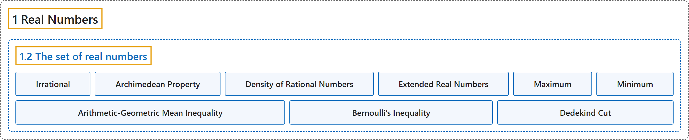

# 1.2 The set of real numbers

## Classification

## Glossary

| Term | Definition | 中文翻译 | Source |
|---|---|---|---|
| **1.2 The set of real numbers** 实数集 | (No definition) | （无定义） | [Lebl, 2026, section 1.2](https://www.jirka.org/ra/html/sec_setofreals.html) |
| **Irrational** 无理数 | "The set $\mathbb{R} \setminus \mathbb{Q}$ is called the set of **irrational numbers**." | 集合 $\mathbb{R} \setminus \mathbb{Q}$ 称为**无理数**集。 | [Lebl, 2026, section 1.2](https://www.jirka.org/ra/html/sec_setofreals.html#sec_setofreals-3-13) |
| **Archimedean Property** 阿基米德性质 | "(**Archimedean property**) If $x, y \in \mathbb{R}$ and $x > 0$, then **there exists an $n \in \mathbb{N}$ such that $nx > y$**." | （**阿基米德性质**）若 $x, y \in \mathbb{R}$ 且 $x > 0$，则**存在 $n \in \mathbb{N}$ 使得 $nx > y$**。 | [Lebl, 2026, Theorem 1.2.4](https://www.jirka.org/ra/html/sec_setofreals.html#thm_arch_i) |
| **Density of Rational Numbers** 有理数的稠密性 | "(**$\mathbb{Q}$ is dense in $\mathbb{R}$**) If $x, y \in \mathbb{R}$ and $x < y$, then **there exists an $r \in \mathbb{Q}$ such that $x < r < y$**." | （**$\mathbb{Q}$ 在 $\mathbb{R}$ 中稠密**）若 $x, y \in \mathbb{R}$ 且 $x < y$，则**存在 $r \in \mathbb{Q}$ 使得 $x < r < y$**。 | [Lebl, 2026, Theorem 1.2.4](https://www.jirka.org/ra/html/sec_setofreals.html#thm_arch_ii) |
| **Extended Real Numbers** 扩展实数 | "The statements in the definition above follow naturally if, instead of working in the ordered set $\mathbb{R}$, we take suprema and infima in the ordered set **$\mathbb{R}^* := \mathbb{R} \cup \{ -\infty , \infty\}$**, where we let $-\infty < \infty$ and $-\infty < x$ and $x < \infty$ for all $x \in \mathbb{R}$. The set $\mathbb{R}^*$ is called the set of **extended real numbers**." | 如果不在有序集 $\mathbb{R}$ 中，而是在有序集 **$\mathbb{R}^* := \mathbb{R} \cup \{ -\infty , \infty\}$** 中取上确界和下确界，其中令 $-\infty < \infty$，并且对所有 $x \in \mathbb{R}$ 有 $-\infty < x$ 和 $x < \infty$，那么上面定义中的说法就自然成立。集合 $\mathbb{R}^*$ 称为**扩展实数**集。 | [Lebl, 2026, section 1.2](https://www.jirka.org/ra/html/sec_setofreals.html#sec_setofreals-5-14) |
| **Maximum** 最大值 | "When a set $A$ of real numbers is **bounded above and $\sup\, A \in A$**, we can use the word **maximum** and the notation $\max\, A$ to denote the supremum." | 当实数集 $A$ **上有界且 $\sup\, A \in A$** 时，我们可以用**最大值**一词和记号 $\max\, A$ 来表示上确界。 | [Lebl, 2026, section 1.2](https://www.jirka.org/ra/html/sec_setofreals.html#sec_setofreals-6-2) |
| **Minimum** 最小值 | "Similarly for infimum: When $A$ is **bounded below and $\inf\, A \in A$**, we can use the word **minimum** and the notation $\min\, A$." | 下确界也类似：当 $A$ **下有界且 $\inf\, A \in A$** 时，我们可以用**最小值**一词和记号 $\min\, A$。 | [Lebl, 2026, section 1.2](https://www.jirka.org/ra/html/sec_setofreals.html#sec_setofreals-6-2) |
| **Arithmetic-Geometric Mean Inequality** 算术–几何平均不等式 | "Prove the **arithmetic-geometric mean inequality**. For two positive real numbers $x,y$, **$\sqrt{xy} \leq \frac{x+y}{2}$**. Furthermore, equality occurs if and only if $x=y$." | 证明**算术–几何平均不等式**：对两个正实数 $x,y$，**$\sqrt{xy} \leq \frac{x+y}{2}$**。此外，等号成立当且仅当 $x=y$。 | [Lebl, 2026, Exercise 1.2.7](https://www.jirka.org/ra/html/sec_setofreals.html#sec_setofreals-7-7) |
| **Bernoulli’s Inequality** 伯努利不等式 | "Prove **Bernoulli’s inequality**: **If $1+x > 0$, then for all $n \in \mathbb{N}$, we have $(1+x)^n \geq 1+nx$.**" | 证明**伯努利不等式**：**若 $1+x > 0$，则对所有 $n \in \mathbb{N}$ 有 $(1+x)^n \geq 1+nx$。** | [Lebl, 2026, Exercise 1.2.13](https://www.jirka.org/ra/html/sec_setofreals.html#exercise_bernoulliineq) |
| **Dedekind Cut** 戴德金分割 | "Let $A \subset \mathbb{Q}$ be **a nonempty set that is bounded above such that whenever $x \in A$ and $t \in \mathbb{Q}$ with $t < x$, then $t \in A$. Further suppose $\sup\, A \notin A$.** A set such as $A$ is called a **Dedekind cut**." | 设 $A \subset \mathbb{Q}$ 是**上有界的非空集合，且只要 $x \in A$、$t \in \mathbb{Q}$、$t < x$，就有 $t \in A$；再设 $\sup\, A \notin A$。**像 $A$ 这样的集合称为**戴德金分割**。 | [Lebl, 2026, Exercise 1.2.15](https://www.jirka.org/ra/html/sec_setofreals.html#exercise_Dedekind) |

## References

Lebl, J. (2026). *Basic analysis I & II: Introduction to real analysis* (May 22, 2026 edition). Retrieved October 29, 2026, from <https://www.jirka.org/ra/html/>
