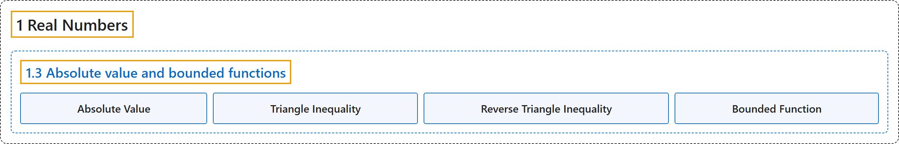

# 1.3 Absolute value and bounded functions

## Classification

## Glossary

| Term | Definition | 中文翻译 | Source |
|---|---|---|---|
| **1.3 Absolute value and bounded functions** 绝对值与有界函数 | (No definition) | （无定义） | [Lebl, 2026, section 1.3](https://www.jirka.org/ra/html/sec_absval.html) |
| **Absolute Value** 绝对值 | "You want to think of the **absolute value** as **the “size” of a real number**. Here is the formal definition: $\lvert x \rvert := \begin{cases} x & \text{if } x \geq 0, \\ -x & \text{if } x < 0 . \end{cases}$" | 可以把**绝对值**看作**一个实数的“大小”**。正式定义如下：$\lvert x \rvert := \begin{cases} x & \text{if } x \geq 0, \\ -x & \text{if } x < 0 . \end{cases}$ | [Lebl, 2026, section 1.3](https://www.jirka.org/ra/html/sec_absval.html#sec_absval-3) |
| **Triangle Inequality** 三角不等式 | "**$\lvert x+y \rvert \leq \lvert x \rvert+\lvert y \rvert$** for all $x, y \in \mathbb{R}$." | 对所有 $x, y \in \mathbb{R}$，**$\lvert x+y \rvert \leq \lvert x \rvert+\lvert y \rvert$**。 | [Lebl, 2026, Proposition 1.3.2](https://www.jirka.org/ra/html/sec_absval.html#sec_absval-7) |
| **Reverse Triangle Inequality** 反向三角不等式 | "(**reverse triangle inequality**) **$\bigl\lvert \, \lvert x \rvert-\lvert y \rvert \, \bigr\rvert \leq \lvert x-y \rvert$**." | （**反向三角不等式**）**$\bigl\lvert \, \lvert x \rvert-\lvert y \rvert \, \bigr\rvert \leq \lvert x-y \rvert$**。 | [Lebl, 2026, Corollary 1.3.3](https://www.jirka.org/ra/html/sec_absval.html#sec_absval-10-1-2-1) |
| **Bounded Function** 有界函数 | "Suppose $f \colon D \to \mathbb{R}$ is a function. We say $f$ is **bounded** if **there exists a number $M$ such that $\bigl\lvert f(x) \bigr\rvert \leq M$ for all $x \in D$**." | 设 $f \colon D \to \mathbb{R}$ 是一个函数。称 $f$ 是**有界的**，如果**存在一个数 $M$，使得对所有 $x \in D$ 有 $\bigl\lvert f(x) \bigr\rvert \leq M$**。 | [Lebl, 2026, Definition 1.3.6](https://www.jirka.org/ra/html/sec_absval.html#sec_absval-17) |

## References

Lebl, J. (2026). *Basic analysis I & II: Introduction to real analysis* (May 22, 2026 edition). Retrieved October 29, 2026, from <https://www.jirka.org/ra/html/>
