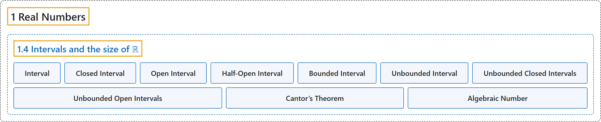

# 1.4 Intervals and the size of ℝ

## Classification

## Glossary

| Term | Definition | 中文翻译 | Source |
|---|---|---|---|
| **1.4 Intervals and the size of ℝ** 区间与 ℝ 的大小 | (No definition) | （无定义） | [Lebl, 2026, section 1.4](https://www.jirka.org/ra/html/sec_intandsizeR.html) |
| **Interval** 区间 | "You have surely seen the notation for intervals before, but let us give a formal definition here. For $a, b \in \mathbb{R}$ such that $a < b$, we define $[a,b] := \{ x \in \mathbb{R} : a \leq x \leq b \}$, $(a,b) := \{ x \in \mathbb{R} : a < x < b \}$, $(a,b] := \{ x \in \mathbb{R} : a < x \leq b \}$, $[a,b) := \{ x \in \mathbb{R} : a \leq x < b \}$." | 你一定见过区间的记号，这里给出正式定义。对满足 $a < b$ 的 $a, b \in \mathbb{R}$，定义 $[a,b] := \{ x \in \mathbb{R} : a \leq x \leq b \}$，$(a,b) := \{ x \in \mathbb{R} : a < x < b \}$，$(a,b] := \{ x \in \mathbb{R} : a < x \leq b \}$，$[a,b) := \{ x \in \mathbb{R} : a \leq x < b \}$。 | [Lebl, 2026, section 1.4](https://www.jirka.org/ra/html/sec_intandsizeR.html#sec_intandsizeR-3) |
| **Closed Interval** 闭区间 | "The interval $[a,b]$ is called a **closed interval** and $(a,b)$ is called an open interval." | 区间 $[a,b]$ 称为**闭区间**，$(a,b)$ 称为开区间。 | [Lebl, 2026, section 1.4](https://www.jirka.org/ra/html/sec_intandsizeR.html#sec_intandsizeR-3) |
| **Open Interval** 开区间 | "The interval $[a,b]$ is called a closed interval and $(a,b)$ is called an **open interval**." | 区间 $[a,b]$ 称为闭区间，$(a,b)$ 称为**开区间**。 | [Lebl, 2026, section 1.4](https://www.jirka.org/ra/html/sec_intandsizeR.html#sec_intandsizeR-3) |
| **Half-Open Interval** 半开区间 | "The intervals of the form **$(a,b]$ and $[a,b)$** are called **half-open intervals**." | 形如 **$(a,b]$ 和 $[a,b)$** 的区间称为**半开区间**。 | [Lebl, 2026, section 1.4](https://www.jirka.org/ra/html/sec_intandsizeR.html#sec_intandsizeR-3) |
| **Bounded Interval** 有界区间 | "The intervals above are **bounded intervals**, since **both $a$ and $b$ are real numbers**." | 上面的区间是**有界区间**，因为 **$a$ 和 $b$ 都是实数**。 | [Lebl, 2026, section 1.4](https://www.jirka.org/ra/html/sec_intandsizeR.html#sec_intandsizeR-4) |
| **Unbounded Interval** 无界区间 | "We define **unbounded intervals**, $[a,\infty) := \{ x \in \mathbb{R} : a \leq x \}$, $(a,\infty) := \{ x \in \mathbb{R} : a < x \}$, $(-\infty,b] := \{ x \in \mathbb{R} : x \leq b \}$, $(-\infty,b) := \{ x \in \mathbb{R} : x < b \}$." | 定义**无界区间**：$[a,\infty) := \{ x \in \mathbb{R} : a \leq x \}$，$(a,\infty) := \{ x \in \mathbb{R} : a < x \}$，$(-\infty,b] := \{ x \in \mathbb{R} : x \leq b \}$，$(-\infty,b) := \{ x \in \mathbb{R} : x < b \}$。 | [Lebl, 2026, section 1.4](https://www.jirka.org/ra/html/sec_intandsizeR.html#sec_intandsizeR-4) |
| **Unbounded Closed Intervals** 无界闭区间 | "The intervals $[a,\infty)$, $(-\infty,b]$, and $\mathbb{R}$ are sometimes called **unbounded closed intervals**, and $(a,\infty)$, $(-\infty,b)$, and $\mathbb{R}$ are sometimes called unbounded open intervals." | 区间 $[a,\infty)$、$(-\infty,b]$ 和 $\mathbb{R}$ 有时称为**无界闭区间**，$(a,\infty)$、$(-\infty,b)$ 和 $\mathbb{R}$ 有时称为无界开区间。 | [Lebl, 2026, section 1.4](https://www.jirka.org/ra/html/sec_intandsizeR.html#sec_intandsizeR-4) |
| **Unbounded Open Intervals** 无界开区间 | "The intervals $[a,\infty)$, $(-\infty,b]$, and $\mathbb{R}$ are sometimes called unbounded closed intervals, and $(a,\infty)$, $(-\infty,b)$, and $\mathbb{R}$ are sometimes called **unbounded open intervals**." | 区间 $[a,\infty)$、$(-\infty,b]$ 和 $\mathbb{R}$ 有时称为无界闭区间，$(a,\infty)$、$(-\infty,b)$ 和 $\mathbb{R}$ 有时称为**无界开区间**。 | [Lebl, 2026, section 1.4](https://www.jirka.org/ra/html/sec_intandsizeR.html#sec_intandsizeR-4) |
| **Cantor’s Theorem** 康托尔定理 | "**$\mathbb{R}$ is uncountable.**" | **$\mathbb{R}$ 是不可数的。** | [Lebl, 2026, Theorem 1.4.2](https://www.jirka.org/ra/html/sec_intandsizeR.html#sec_intandsizeR-11) |
| **Algebraic Number** 代数数 | "A number $x$ is **algebraic** if **$x$ is a root of a nonzero polynomial with integer coefficients**, in other words, $a_n x^n + a_{n-1} x^{n-1} + \cdots + a_1 x + a_0 = 0$ where $a_0,a_1,\ldots,a_n \in \mathbb{Z}$, but not all zero." | 数 $x$ 称为**代数的**，如果 **$x$ 是某个整系数非零多项式的根**，换句话说，$a_n x^n + a_{n-1} x^{n-1} + \cdots + a_1 x + a_0 = 0$，其中 $a_0,a_1,\ldots,a_n \in \mathbb{Z}$ 不全为零。 | [Lebl, 2026, Exercise 1.4.9](https://www.jirka.org/ra/html/sec_intandsizeR.html#sec_intandsizeR-14-9) |

## References

Lebl, J. (2026). *Basic analysis I & II: Introduction to real analysis* (May 22, 2026 edition). Retrieved October 29, 2026, from <https://www.jirka.org/ra/html/>
