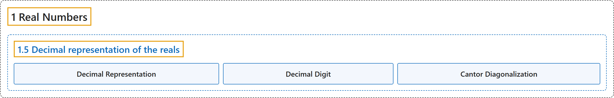

# 1.5 Decimal representation of the reals

## Classification

## Glossary

| Term | Definition | 中文翻译 | Source |
|---|---|---|---|
| **1.5 Decimal representation of the reals** 实数的十进制表示 | (No definition) | （无定义） | [Lebl, 2026, section 1.5](https://www.jirka.org/ra/html/sec_decimals.html) |
| **Decimal Representation** 十进制表示 | "We often think of real numbers as their **decimal representations**." | 我们常把实数看作它们的**十进制表示**。 | [Lebl, 2026, section 1.5](https://www.jirka.org/ra/html/sec_decimals.html#sec_decimals-3) |
| **Decimal Digit** 十进制数字 | "By a (**decimal**) **digit**, we mean **an integer between $0$ and $9$**." | 所谓（**十进制**）**数字**，是指**介于 $0$ 和 $9$ 之间的整数**。 | [Lebl, 2026, section 1.5](https://www.jirka.org/ra/html/sec_decimals.html#sec_decimals-3) |
| **Cantor Diagonalization** 康托尔对角线法 | "This proof may seem shorter, but it is because we already did the hard part above and we are left with **a slick trick to prove that $\mathbb{R}$ is uncountable**. This trick is called **Cantor diagonalization** and finds use in other proofs as well." | 这个证明看起来更短，但那是因为难的部分上面已经做完了，剩下的是**一个证明 $\mathbb{R}$ 不可数的巧妙技巧**。这个技巧称为**康托尔对角线法**，在别的证明中也有用。 | [Lebl, 2026, section 1.5](https://www.jirka.org/ra/html/sec_decimals.html#sec_decimals-11) |

## References

Lebl, J. (2026). *Basic analysis I & II: Introduction to real analysis* (May 22, 2026 edition). Retrieved October 29, 2026, from <https://www.jirka.org/ra/html/>
