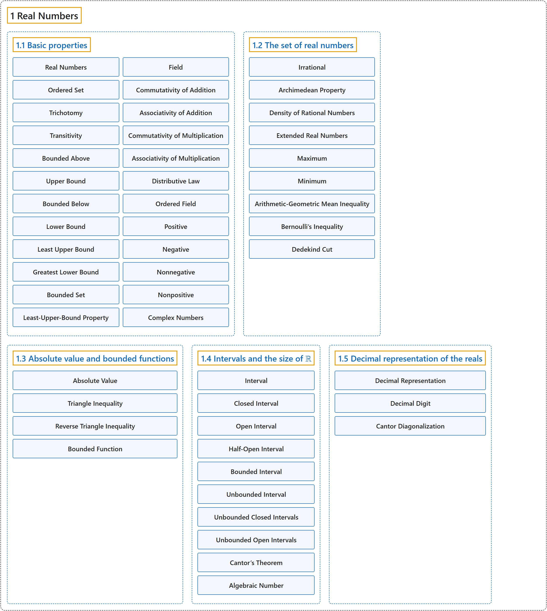

# 1 Real Numbers

## Classification

## Glossary

| Term | Definition | 中文翻译 | Source |
|---|---|---|---|
| **1 Real Numbers** 实数 | (No definition) | （无定义） | [Lebl, 2026, chapter 1](https://www.jirka.org/ra/html/rn_chapter.html) |
| **[1.1 Basic properties](1-1-basic-properties.md)** 基本性质 | (No definition) | （无定义） | [Lebl, 2026, section 1.1](https://www.jirka.org/ra/html/sec_basicpropsrn.html) |
| **[1.2 The set of real numbers](1-2-the-set-of-real-numbers.md)** 实数集 | (No definition) | （无定义） | [Lebl, 2026, section 1.2](https://www.jirka.org/ra/html/sec_setofreals.html) |
| **[1.3 Absolute value and bounded functions](1-3-absolute-value-and-bounded-functions.md)** 绝对值与有界函数 | (No definition) | （无定义） | [Lebl, 2026, section 1.3](https://www.jirka.org/ra/html/sec_absval.html) |
| **[1.4 Intervals and the size of ℝ](1-4-intervals-and-the-size-of-r.md)** 区间与 ℝ 的大小 | (No definition) | （无定义） | [Lebl, 2026, section 1.4](https://www.jirka.org/ra/html/sec_intandsizeR.html) |
| **[1.5 Decimal representation of the reals](1-5-decimal-representation-of-the-reals.md)** 实数的十进制表示 | (No definition) | （无定义） | [Lebl, 2026, section 1.5](https://www.jirka.org/ra/html/sec_decimals.html) |

## References

Lebl, J. (2026). *Basic analysis I & II: Introduction to real analysis* (May 22, 2026 edition). Retrieved October 29, 2026, from <https://www.jirka.org/ra/html/>
