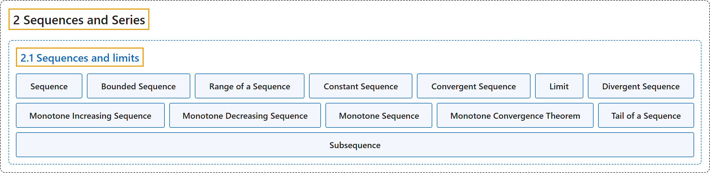

# 2.1 Sequences and limits

## Classification

## Glossary

| Term | Definition | 中文翻译 | Source |
|---|---|---|---|
| **2.1 Sequences and limits** 序列与极限 | (No definition) | （无定义） | [Lebl, 2026, section 2.1](https://www.jirka.org/ra/html/sec_seqsandlims.html) |
| **Sequence** 序列 | "A **sequence** (of real numbers) is **a function $x \colon \mathbb{N} \to \mathbb{R}$**." | （实数）**序列**是**一个函数 $x \colon \mathbb{N} \to \mathbb{R}$**。 | [Lebl, 2026, Definition 2.1.1](https://www.jirka.org/ra/html/sec_seqsandlims.html#sec_seqsandlims-2-3) |
| **Bounded Sequence** 有界序列 | "A sequence $\{ x_n \}_{n=1}^\infty$ is **bounded** if **the underlying function is bounded**." | 若**其所对应的函数有界**，则序列 $\{ x_n \}_{n=1}^\infty$ 是**有界的**。 | [Lebl, 2026, Definition 2.1.1](https://www.jirka.org/ra/html/sec_seqsandlims.html#sec_seqsandlims-2-3) |
| **Range of a Sequence** 序列的值域 | "For example, the sequence $\bigl\{ {(-1)}^n \bigr\}_{n=1}^\infty$ is the sequence $-1,1,-1,1,-1,1,\ldots$, whereas **the set of values**, the **range of the sequence**, is just the set $\{ -1, 1 \}$." | 例如，序列 $\bigl\{ {(-1)}^n \bigr\}_{n=1}^\infty$ 是 $-1,1,-1,1,-1,1,\ldots$，而**它的取值构成的集合**，即**序列的值域**，只是集合 $\{ -1, 1 \}$。 | [Lebl, 2026, section 2.1](https://www.jirka.org/ra/html/sec_seqsandlims.html#sec_seqsandlims-2-5) |
| **Constant Sequence** 常数序列 | "Another example of a sequence is the **constant sequence**. That is a sequence $\{ c \}_{n=1}^\infty = c,c,c,c,\ldots$ consisting of **a single constant $c \in \mathbb{R}$ repeating indefinitely**." | 序列的另一个例子是**常数序列**，即由**单个常数 $c \in \mathbb{R}$ 无限重复**构成的序列 $\{ c \}_{n=1}^\infty = c,c,c,c,\ldots$。 | [Lebl, 2026, section 2.1](https://www.jirka.org/ra/html/sec_seqsandlims.html#sec_seqsandlims-2-6) |
| **Convergent Sequence** 收敛序列 | "A sequence $\{ x_n \}_{n=1}^\infty$ is said to **converge** to a number $x \in \mathbb{R}$ if **for every $\epsilon > 0$, there exists an $M \in \mathbb{N}$ such that $\lvert x_n - x \rvert < \epsilon$ for all $n \geq M$**." | 若**对每个 $\epsilon > 0$，存在 $M \in \mathbb{N}$，使得对所有 $n \geq M$ 有 $\lvert x_n - x \rvert < \epsilon$**，则称序列 $\{ x_n \}_{n=1}^\infty$ **收敛**到数 $x \in \mathbb{R}$。 | [Lebl, 2026, Definition 2.1.2](https://www.jirka.org/ra/html/sec_seqsandlims.html#sec_seqsandlims-2-7) |
| **Limit** 极限 | "The number $x$ is called a **limit** of the sequence." | 数 $x$ 称为该序列的**极限**。 | [Lebl, 2026, Definition 2.1.2](https://www.jirka.org/ra/html/sec_seqsandlims.html#sec_seqsandlims-2-7) |
| **Divergent Sequence** 发散序列 | "A sequence that converges is said to be convergent. **Otherwise**, we say the sequence **diverges** or that it is **divergent**." | 收敛的序列称为收敛序列。**否则**，就说该序列**发散**，或称它是**发散的**。 | [Lebl, 2026, Definition 2.1.2](https://www.jirka.org/ra/html/sec_seqsandlims.html#sec_seqsandlims-2-7) |
| **Monotone Increasing Sequence** 单调递增序列 | "A sequence $\{ x_n \}_{n=1}^\infty$ is **monotone increasing** if **$x_n \leq x_{n+1}$ for all $n \in \mathbb{N}$**." | 若**对所有 $n \in \mathbb{N}$ 有 $x_n \leq x_{n+1}$**，则序列 $\{ x_n \}_{n=1}^\infty$ 是**单调递增的**。 | [Lebl, 2026, Definition 2.1.9](https://www.jirka.org/ra/html/sec_seqsandlims.html#sec_seqsandlims-3-3) |
| **Monotone Decreasing Sequence** 单调递减序列 | "A sequence $\{ x_n \}_{n=1}^\infty$ is **monotone decreasing** if **$x_n \geq x_{n+1}$ for all $n \in \mathbb{N}$**." | 若**对所有 $n \in \mathbb{N}$ 有 $x_n \geq x_{n+1}$**，则序列 $\{ x_n \}_{n=1}^\infty$ 是**单调递减的**。 | [Lebl, 2026, Definition 2.1.9](https://www.jirka.org/ra/html/sec_seqsandlims.html#sec_seqsandlims-3-3) |
| **Monotone Sequence** 单调序列 | "If a sequence is **either monotone increasing or monotone decreasing**, we can simply say the sequence is **monotone**." | 若序列**单调递增或单调递减**，就可以简单地说该序列是**单调的**。 | [Lebl, 2026, Definition 2.1.9](https://www.jirka.org/ra/html/sec_seqsandlims.html#sec_seqsandlims-3-3) |
| **Monotone Convergence Theorem** 单调收敛定理 | "A monotone sequence $\{ x_n \}_{n=1}^\infty$ is **bounded if and only if it is convergent**." | 单调序列 $\{ x_n \}_{n=1}^\infty$ **有界当且仅当它收敛**。 | [Lebl, 2026, Theorem 2.1.10](https://www.jirka.org/ra/html/sec_seqsandlims.html#thm_monotoneconv) |
| **Tail of a Sequence** 序列的尾 | "For a sequence $\{ x_n \}_{n=1}^\infty$, the $K$-tail (where $K \in \mathbb{N}$), or just the **tail**, of $\{ x_n \}_{n=1}^\infty$ is **the sequence starting at $K+1$**, usually written as $\{ x_{n+K} \}_{n=1}^\infty \qquad \text{or} \qquad \{ x_n \}_{n=K+1}^\infty .$" | 对序列 $\{ x_n \}_{n=1}^\infty$，它的 $K$ 尾（$K \in \mathbb{N}$），或简称**尾**，是**从第 $K+1$ 项开始的序列**，通常写作 $\{ x_{n+K} \}_{n=1}^\infty \qquad \text{or} \qquad \{ x_n \}_{n=K+1}^\infty .$ | [Lebl, 2026, Definition 2.1.14](https://www.jirka.org/ra/html/sec_seqsandlims.html#sec_seqsandlims-4-2) |
| **Subsequence** 子序列 | "Let $\{ x_n \}_{n=1}^\infty$ be a sequence. Let $\{ n_i \}_{i=1}^\infty$ be **a strictly increasing sequence of natural numbers**, that is, $n_i < n_{i+1}$ for all $i \in \mathbb{N}$ (in other words $n_1 < n_2 < n_3 < \cdots$). The sequence $\{ x_{n_i} \}_{i=1}^\infty$ is called a **subsequence** of $\{ x_n \}_{n=1}^\infty$." | 设 $\{ x_n \}_{n=1}^\infty$ 是序列，$\{ n_i \}_{i=1}^\infty$ 是**严格递增的自然数序列**，即对所有 $i \in \mathbb{N}$ 有 $n_i < n_{i+1}$（换言之 $n_1 < n_2 < n_3 < \cdots$）。序列 $\{ x_{n_i} \}_{i=1}^\infty$ 称为 $\{ x_n \}_{n=1}^\infty$ 的**子序列**。 | [Lebl, 2026, Definition 2.1.16](https://www.jirka.org/ra/html/sec_seqsandlims.html#sec_seqsandlims-5-3) |

## References

Lebl, J. (2026). *Basic analysis I & II: Introduction to real analysis* (May 22, 2026 edition). Retrieved October 29, 2026, from <https://www.jirka.org/ra/html/>
