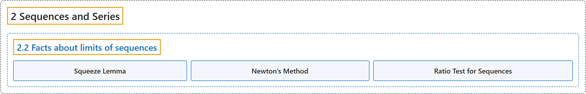

# 2.2 Facts about limits of sequences

## Classification

## Glossary

| Term | Definition | 中文翻译 | Source |
|---|---|---|---|
| **2.2 Facts about limits of sequences** 序列极限的性质 | (No definition) | （无定义） | [Lebl, 2026, section 2.2](https://www.jirka.org/ra/html/sec_factslimsseqs.html) |
| **Squeeze Lemma** 夹逼引理 | "Let $\{ a_n \}_{n=1}^\infty$, $\{ b_n \}_{n=1}^\infty$, and $\{ x_n \}_{n=1}^\infty$ be sequences such that **$a_n \leq x_n \leq b_n$ for all $n \in \mathbb{N}$**. Suppose $\{ a_n \}_{n=1}^\infty$ and $\{ b_n \}_{n=1}^\infty$ converge and $\lim_{n\to \infty} a_n = \lim_{n\to \infty} b_n$. Then **$\{ x_n \}_{n=1}^\infty$ converges** and $\lim_{n\to \infty} x_n = \lim_{n\to \infty} a_n = \lim_{n\to \infty} b_n$." | 设 $\{ a_n \}_{n=1}^\infty$、$\{ b_n \}_{n=1}^\infty$ 和 $\{ x_n \}_{n=1}^\infty$ 是满足**对所有 $n \in \mathbb{N}$ 有 $a_n \leq x_n \leq b_n$** 的序列。若 $\{ a_n \}_{n=1}^\infty$ 与 $\{ b_n \}_{n=1}^\infty$ 收敛且 $\lim_{n\to \infty} a_n = \lim_{n\to \infty} b_n$，则 **$\{ x_n \}_{n=1}^\infty$ 收敛**，且 $\lim_{n\to \infty} x_n = \lim_{n\to \infty} a_n = \lim_{n\to \infty} b_n$。 | [Lebl, 2026, Lemma 2.2.1](https://www.jirka.org/ra/html/sec_factslimsseqs.html#squeeze_lemma) |
| **Newton’s Method** 牛顿法 | "You may have seen the sequence above before. It is **Newton’s method** for **finding the square root of 2**." | 你也许见过上面的序列。它就是**求 2 的平方根**的**牛顿法**。 | [Lebl, 2026, section 2.2](https://www.jirka.org/ra/html/sec_factslimsseqs.html#sec_factslimsseqs-5-4) |
| **Ratio Test for Sequences** 序列的比值判别法 | "Let $\{ x_n \}_{n=1}^\infty$ be a sequence such that $x_n \neq 0$ for all $n$ and such that the limit $L := \lim_{n\to\infty} \frac{\lvert x_{n+1} \rvert}{\lvert x_n \rvert}$ exists. **If $L < 1$, then $\{ x_n \}_{n=1}^\infty$ converges and $\lim_{n\to\infty} x_n = 0$. If $L > 1$, then $\{ x_n \}_{n=1}^\infty$ is unbounded** (hence diverges)." | 设序列 $\{ x_n \}_{n=1}^\infty$ 对所有 $n$ 满足 $x_n \neq 0$，且极限 $L := \lim_{n\to\infty} \frac{\lvert x_{n+1} \rvert}{\lvert x_n \rvert}$ 存在。**若 $L < 1$，则 $\{ x_n \}_{n=1}^\infty$ 收敛且 $\lim_{n\to\infty} x_n = 0$；若 $L > 1$，则 $\{ x_n \}_{n=1}^\infty$ 无界**（因而发散）。 | [Lebl, 2026, Lemma 2.2.12](https://www.jirka.org/ra/html/sec_factslimsseqs.html#seq_ratiotest) |

## References

Lebl, J. (2026). *Basic analysis I & II: Introduction to real analysis* (May 22, 2026 edition). Retrieved October 29, 2026, from <https://www.jirka.org/ra/html/>
