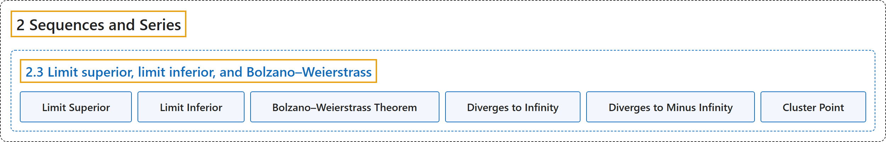

# 2.3 Limit superior, limit inferior, and Bolzano–Weierstrass

## Classification

## Glossary

| Term | Definition | 中文翻译 | Source |
|---|---|---|---|
| **2.3 Limit superior, limit inferior, and Bolzano–Weierstrass** 上极限、下极限与波尔查诺–魏尔斯特拉斯定理 | (No definition) | （无定义） | [Lebl, 2026, section 2.3](https://www.jirka.org/ra/html/sec_bw.html) |
| **Limit Superior** 上极限 | "Let $\{ x_n \}_{n=1}^\infty$ be a bounded sequence. Define the sequences $\{ a_n \}_{n=1}^\infty$ and $\{ b_n \}_{n=1}^\infty$ by **$a_n := \sup \{ x_k : k \geq n \}$** and $b_n := \inf \{ x_k : k \geq n \}$. Define, if the limits exist, **$\limsup_{n \to \infty} x_n := \lim_{n \to \infty} a_n$**, $\liminf_{n \to \infty} x_n := \lim_{n \to \infty} b_n$." | 设 $\{ x_n \}_{n=1}^\infty$ 是有界序列。用 **$a_n := \sup \{ x_k : k \geq n \}$** 和 $b_n := \inf \{ x_k : k \geq n \}$ 定义序列 $\{ a_n \}_{n=1}^\infty$ 与 $\{ b_n \}_{n=1}^\infty$。若极限存在，定义 **$\limsup_{n \to \infty} x_n := \lim_{n \to \infty} a_n$**，$\liminf_{n \to \infty} x_n := \lim_{n \to \infty} b_n$。 | [Lebl, 2026, Definition 2.3.1](https://www.jirka.org/ra/html/sec_bw.html#liminflimsup_def) |
| **Limit Inferior** 下极限 | "Let $\{ x_n \}_{n=1}^\infty$ be a bounded sequence. Define the sequences $\{ a_n \}_{n=1}^\infty$ and $\{ b_n \}_{n=1}^\infty$ by $a_n := \sup \{ x_k : k \geq n \}$ and **$b_n := \inf \{ x_k : k \geq n \}$**. Define, if the limits exist, $\limsup_{n \to \infty} x_n := \lim_{n \to \infty} a_n$, **$\liminf_{n \to \infty} x_n := \lim_{n \to \infty} b_n$**." | 设 $\{ x_n \}_{n=1}^\infty$ 是有界序列。用 $a_n := \sup \{ x_k : k \geq n \}$ 和 **$b_n := \inf \{ x_k : k \geq n \}$** 定义序列 $\{ a_n \}_{n=1}^\infty$ 与 $\{ b_n \}_{n=1}^\infty$。若极限存在，定义 $\limsup_{n \to \infty} x_n := \lim_{n \to \infty} a_n$，**$\liminf_{n \to \infty} x_n := \lim_{n \to \infty} b_n$**。 | [Lebl, 2026, Definition 2.3.1](https://www.jirka.org/ra/html/sec_bw.html#liminflimsup_def) |
| **Bolzano–Weierstrass Theorem** 波尔查诺–魏尔斯特拉斯定理 | "Suppose a sequence $\{ x_n \}_{n=1}^\infty$ of real numbers is **bounded**. Then **there exists a convergent subsequence** $\{ x_{n_i} \}_{i=1}^\infty$." | 设实数序列 $\{ x_n \}_{n=1}^\infty$ **有界**，则**存在收敛的子序列** $\{ x_{n_i} \}_{i=1}^\infty$。 | [Lebl, 2026, Theorem 2.3.8](https://www.jirka.org/ra/html/sec_bw.html#thm_bwseq) |
| **Diverges to Infinity** 发散到无穷 | "We say $\{ x_n \}_{n=1}^\infty$ **diverges to infinity** if **for every $K \in \mathbb{R}$, there exists an $M \in \mathbb{N}$ such that for all $n \geq M$, we have $x_n > K$**." | 若**对每个 $K \in \mathbb{R}$，存在 $M \in \mathbb{N}$，使得对所有 $n \geq M$ 有 $x_n > K$**，则称 $\{ x_n \}_{n=1}^\infty$ **发散到无穷**。 | [Lebl, 2026, Definition 2.3.9](https://www.jirka.org/ra/html/sec_bw.html#sec_bw-6-3) |
| **Diverges to Minus Infinity** 发散到负无穷 | "Similarly, if **for every $K \in \mathbb{R}$ there exists an $M \in \mathbb{N}$ such that for all $n \geq M$, we have $x_n < K$**, we say $\{ x_n \}_{n=1}^\infty$ **diverges to minus infinity**." | 类似地，若**对每个 $K \in \mathbb{R}$，存在 $M \in \mathbb{N}$，使得对所有 $n \geq M$ 有 $x_n < K$**，则称 $\{ x_n \}_{n=1}^\infty$ **发散到负无穷**。 | [Lebl, 2026, Definition 2.3.9](https://www.jirka.org/ra/html/sec_bw.html#sec_bw-6-3) |
| **Cluster Point** 聚点 | "If $S \subset \mathbb{R}$ is a set, then $x \in \mathbb{R}$ is a **cluster point** if **for every $\epsilon > 0$, the set $(x-\epsilon,x+\epsilon) \cap S \setminus \{ x \}$ is not empty**." | 设 $S \subset \mathbb{R}$ 是集合。若**对每个 $\epsilon > 0$，集合 $(x-\epsilon,x+\epsilon) \cap S \setminus \{ x \}$ 非空**，则 $x \in \mathbb{R}$ 是一个**聚点**。 | [Lebl, 2026, Exercise 2.3.9](https://www.jirka.org/ra/html/sec_bw.html#sec_bw-7-9) |

## References

Lebl, J. (2026). *Basic analysis I & II: Introduction to real analysis* (May 22, 2026 edition). Retrieved October 29, 2026, from <https://www.jirka.org/ra/html/>
