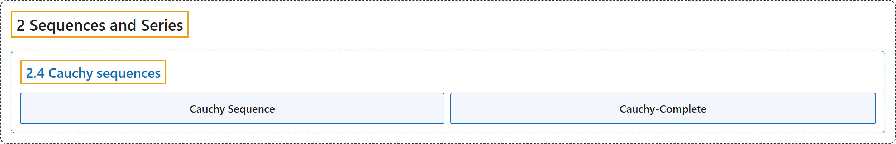

# 2.4 Cauchy sequences

## Classification

## Glossary

| Term | Definition | 中文翻译 | Source |
|---|---|---|---|
| **2.4 Cauchy sequences** 柯西序列 | (No definition) | （无定义） | [Lebl, 2026, section 2.4](https://www.jirka.org/ra/html/sec_cauchy.html) |
| **Cauchy Sequence** 柯西序列 | "A sequence $\{ x_n \}_{n=1}^\infty$ is a **Cauchy sequence** if **for every $\epsilon > 0$ there exists an $M \in \mathbb{N}$ such that for all $n \geq M$ and all $k \geq M$, we have $\lvert x_n - x_k \rvert < \epsilon$**." | 若**对每个 $\epsilon > 0$，存在 $M \in \mathbb{N}$，使得对所有 $n \geq M$ 和所有 $k \geq M$ 有 $\lvert x_n - x_k \rvert < \epsilon$**，则序列 $\{ x_n \}_{n=1}^\infty$ 是**柯西序列**。 | [Lebl, 2026, Definition 2.4.1](https://www.jirka.org/ra/html/sec_cauchy.html#sec_cauchy-4) |
| **Cauchy-Complete** 柯西完备 | "We say a set is **Cauchy-complete** (or sometimes just **complete**) if **every Cauchy sequence converges to something in the set**." | 若**每个柯西序列都收敛到集合中的某个元素**，则称该集合是**柯西完备的**（有时简称**完备的**）。 | [Lebl, 2026, Remark 2.4.6](https://www.jirka.org/ra/html/sec_cauchy.html#sec_cauchy-12) |

## References

Lebl, J. (2026). *Basic analysis I & II: Introduction to real analysis* (May 22, 2026 edition). Retrieved October 29, 2026, from <https://www.jirka.org/ra/html/>
