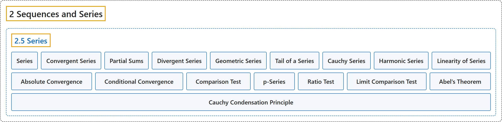

# 2.5 Series

## Classification

## Glossary

| Term | Definition | 中文翻译 | Source |
|---|---|---|---|
| **2.5 Series** 级数 | (No definition) | （无定义） | [Lebl, 2026, section 2.5](https://www.jirka.org/ra/html/sec_series.html) |
| **Series** 级数 | "Given a sequence $\{ x_n \}_{n=1}^\infty$, we write the formal object $\sum_{n=1}^\infty x_n$ and call it a **series**." | 给定序列 $\{ x_n \}_{n=1}^\infty$，我们写出形式对象 $\sum_{n=1}^\infty x_n$，并称之为**级数**。 | [Lebl, 2026, Definition 2.5.1](https://www.jirka.org/ra/html/sec_series.html#sec_series-3-2) |
| **Convergent Series** 收敛级数 | "A series **converges** if **the sequence $\{ s_k \}_{k=1}^\infty$ defined by $s_k := \sum_{n=1}^k x_n = x_1 + x_2 + \cdots + x_k$ converges**." | 若**由 $s_k := \sum_{n=1}^k x_n = x_1 + x_2 + \cdots + x_k$ 定义的序列 $\{ s_k \}_{k=1}^\infty$ 收敛**，则级数**收敛**。 | [Lebl, 2026, Definition 2.5.1](https://www.jirka.org/ra/html/sec_series.html#sec_series-3-2) |
| **Partial Sums** 部分和 | "The **numbers $s_k$** are called **partial sums**." | **数 $s_k$** 称为**部分和**。 | [Lebl, 2026, Definition 2.5.1](https://www.jirka.org/ra/html/sec_series.html#sec_series-3-2) |
| **Divergent Series** 发散级数 | "If **the sequence $\{ s_k \}_{k=1}^\infty$ diverges**, we say the series is **divergent**." | 若**序列 $\{ s_k \}_{k=1}^\infty$ 发散**，则称该级数是**发散的**。 | [Lebl, 2026, Definition 2.5.1](https://www.jirka.org/ra/html/sec_series.html#sec_series-3-2) |
| **Geometric Series** 几何级数 | "Suppose $-1 < r < 1$. Then the **geometric series** **$\sum_{n=0}^\infty r^n$** converges, and $\sum_{n=0}^\infty r^n = \frac{1}{1-r}$." | 设 $-1 < r < 1$，则**几何级数** **$\sum_{n=0}^\infty r^n$** 收敛，且 $\sum_{n=0}^\infty r^n = \frac{1}{1-r}$。 | [Lebl, 2026, Proposition 2.5.5](https://www.jirka.org/ra/html/sec_series.html#geometric_prop) |
| **Tail of a Series** 级数的尾 | "**As with sequences**, we can talk about a **tail of a series**." | **和序列一样**，我们可以谈论**级数的尾**。 | [Lebl, 2026, section 2.5](https://www.jirka.org/ra/html/sec_series.html#sec_series-3-9) |
| **Cauchy Series** 柯西级数 | "A series $\sum_{n=1}^\infty x_n$ is said to be **Cauchy** or a **Cauchy series** if **the sequence of partial sums $\{ s_n \}_{n=1}^\infty$ is a Cauchy sequence**." | 若**部分和序列 $\{ s_n \}_{n=1}^\infty$ 是柯西序列**，则称级数 $\sum_{n=1}^\infty x_n$ 是**柯西的**，或称为**柯西级数**。 | [Lebl, 2026, Definition 2.5.7](https://www.jirka.org/ra/html/sec_series.html#sec_series-4-2) |
| **Harmonic Series** 调和级数 | "The series **$\sum_{n=1}^\infty 1/n$ diverges** (despite the fact that $\lim_{n\to\infty} 1/n = 0$). This is the famous **harmonic series**." | 级数 **$\sum_{n=1}^\infty 1/n$ 发散**（尽管 $\lim_{n\to\infty} 1/n = 0$）。这就是著名的**调和级数**。 | [Lebl, 2026, Example 2.5.11](https://www.jirka.org/ra/html/sec_series.html#example_harmonicseries) |
| **Linearity of Series** 级数的线性 | "Let $\alpha \in \mathbb{R}$ and $\sum_{n=1}^\infty x_n$ and $\sum_{n=1}^\infty y_n$ be convergent series. Then **$\sum_{n=1}^\infty \alpha x_n$ is a convergent series** and $\sum_{n=1}^\infty \alpha x_n = \alpha \sum_{n=1}^\infty x_n$. **$\sum_{n=1}^\infty ( x_n + y_n )$ is a convergent series** and $\sum_{n=1}^\infty ( x_n + y_n ) = \left( \sum_{n=1}^\infty x_n \right) + \left( \sum_{n=1}^\infty y_n \right)$." | 设 $\alpha \in \mathbb{R}$，$\sum_{n=1}^\infty x_n$ 与 $\sum_{n=1}^\infty y_n$ 是收敛级数，则 **$\sum_{n=1}^\infty \alpha x_n$ 是收敛级数**，且 $\sum_{n=1}^\infty \alpha x_n = \alpha \sum_{n=1}^\infty x_n$；**$\sum_{n=1}^\infty ( x_n + y_n )$ 是收敛级数**，且 $\sum_{n=1}^\infty ( x_n + y_n ) = \left( \sum_{n=1}^\infty x_n \right) + \left( \sum_{n=1}^\infty y_n \right)$。 | [Lebl, 2026, Proposition 2.5.12](https://www.jirka.org/ra/html/sec_series.html#sec_series-5-8) |
| **Absolute Convergence** 绝对收敛 | "A series $\sum_{n=1}^\infty x_n$ **converges absolutely** if **the series $\sum_{n=1}^\infty \lvert x_n \rvert$ converges**." | 若**级数 $\sum_{n=1}^\infty \lvert x_n \rvert$ 收敛**，则称级数 $\sum_{n=1}^\infty x_n$ **绝对收敛**。 | [Lebl, 2026, Definition 2.5.14](https://www.jirka.org/ra/html/sec_series.html#sec_series-6-6) |
| **Conditional Convergence** 条件收敛 | "If a series **converges, but does not converge absolutely**, we say it **converges conditionally**." | 若级数**收敛但不绝对收敛**，则称它**条件收敛**。 | [Lebl, 2026, Definition 2.5.14](https://www.jirka.org/ra/html/sec_series.html#sec_series-6-6) |
| **Comparison Test** 比较判别法 | "Let $\sum_{n=1}^\infty x_n$ and $\sum_{n=1}^\infty y_n$ be series such that **$0 \leq x_n \leq y_n$ for all $n \in \mathbb{N}$**. **If $\sum_{n=1}^\infty y_n$ converges, then so does $\sum_{n=1}^\infty x_n$. If $\sum_{n=1}^\infty x_n$ diverges, then so does $\sum_{n=1}^\infty y_n$.**" | 设 $\sum_{n=1}^\infty x_n$ 与 $\sum_{n=1}^\infty y_n$ 是满足**对所有 $n \in \mathbb{N}$ 有 $0 \leq x_n \leq y_n$** 的级数。**若 $\sum_{n=1}^\infty y_n$ 收敛，则 $\sum_{n=1}^\infty x_n$ 也收敛；若 $\sum_{n=1}^\infty x_n$ 发散，则 $\sum_{n=1}^\infty y_n$ 也发散。** | [Lebl, 2026, Proposition 2.5.16](https://www.jirka.org/ra/html/sec_series.html#sec_series-7-3) |
| **p-Series** p 级数 | "For $p \in \mathbb{R}$, the series **$\sum_{n=1}^\infty \frac{1}{n^p}$ converges if and only if $p > 1$**." | 对 $p \in \mathbb{R}$，级数 **$\sum_{n=1}^\infty \frac{1}{n^p}$ 收敛当且仅当 $p > 1$**。 | [Lebl, 2026, Proposition 2.5.17](https://www.jirka.org/ra/html/sec_series.html#sec_series-7-6) |
| **Ratio Test** 比值判别法 | "Let $\sum_{n=1}^\infty x_n$ be a series, $x_n \neq 0$ for all $n$, and such that $L := \lim_{n\to\infty} \frac{\lvert x_{n+1} \rvert}{\lvert x_n \rvert}$ exists. **If $L < 1$, then $\sum_{n=1}^\infty x_n$ converges absolutely. If $L > 1$, then $\sum_{n=1}^\infty x_n$ diverges.**" | 设 $\sum_{n=1}^\infty x_n$ 是级数，对所有 $n$ 有 $x_n \neq 0$，且 $L := \lim_{n\to\infty} \frac{\lvert x_{n+1} \rvert}{\lvert x_n \rvert}$ 存在。**若 $L < 1$，则 $\sum_{n=1}^\infty x_n$ 绝对收敛；若 $L > 1$，则 $\sum_{n=1}^\infty x_n$ 发散。** | [Lebl, 2026, Proposition 2.5.19](https://www.jirka.org/ra/html/sec_series.html#sec_series-8-3) |
| **Limit Comparison Test** 极限比较判别法 | "Prove the **limit comparison test**. That is, prove that if $a_n > 0$ and $b_n > 0$ for all $n$, and **$0 < \lim_{n\to\infty} \frac{a_n}{b_n} < \infty$**, then **either $\sum_{n=1}^\infty a_n$ and $\sum_{n=1}^\infty b_n$ both converge or both diverge**." | 证明**极限比较判别法**：若对所有 $n$ 有 $a_n > 0$ 和 $b_n > 0$，且 **$0 < \lim_{n\to\infty} \frac{a_n}{b_n} < \infty$**，则 **$\sum_{n=1}^\infty a_n$ 与 $\sum_{n=1}^\infty b_n$ 要么都收敛，要么都发散**。 | [Lebl, 2026, Exercise 2.5.11](https://www.jirka.org/ra/html/sec_series.html#sec_series-9-11) |
| **Abel’s Theorem** 阿贝尔定理 | "Suppose $\sum_{n=1}^\infty x_n$ is a series **whose sequence of partial sums is bounded**, $\{ \lambda_n \}_{n=1}^\infty$ is a sequence with $\lim_{n\to\infty} \lambda_n = 0$, and $\sum_{n=1}^\infty \lvert \lambda_{n+1} - \lambda_n \rvert$ is convergent. Then **$\sum_{n=1}^\infty \lambda_n x_n$ is convergent**." | 设级数 $\sum_{n=1}^\infty x_n$ **的部分和序列有界**，$\{ \lambda_n \}_{n=1}^\infty$ 是满足 $\lim_{n\to\infty} \lambda_n = 0$ 的序列，且 $\sum_{n=1}^\infty \lvert \lambda_{n+1} - \lambda_n \rvert$ 收敛，则 **$\sum_{n=1}^\infty \lambda_n x_n$ 收敛**。 | [Lebl, 2026, Exercise 2.5.17](https://www.jirka.org/ra/html/sec_series.html#sec_series-9-17) |
| **Cauchy Condensation Principle** 柯西凝聚判别法 | "Suppose $\{ x_n\}_{n=1}^\infty$ is a decreasing sequence of positive numbers. Prove the **Cauchy condensation principle**: **$\sum_{n=1}^\infty x_n \qquad \text{converges if and only if} \qquad \sum_{n=1}^\infty 2^n x_{2^n} \qquad \text{converges}.$**" | 设 $\{ x_n\}_{n=1}^\infty$ 是递减的正数序列。证明**柯西凝聚判别法**：**$\sum_{n=1}^\infty x_n \qquad \text{converges if and only if} \qquad \sum_{n=1}^\infty 2^n x_{2^n} \qquad \text{converges}.$** | [Lebl, 2026, Exercise 2.5.15](https://www.jirka.org/ra/html/sec_series.html#exercise_cauchycondensation) |

## References

Lebl, J. (2026). *Basic analysis I & II: Introduction to real analysis* (May 22, 2026 edition). Retrieved October 29, 2026, from <https://www.jirka.org/ra/html/>
