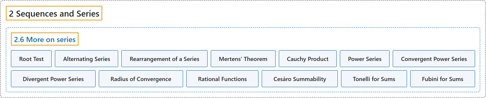

# 2.6 More on series

## Classification

## Glossary

| Term | Definition | 中文翻译 | Source |
|---|---|---|---|
| **2.6 More on series** 级数续论 | (No definition) | （无定义） | [Lebl, 2026, section 2.6](https://www.jirka.org/ra/html/sec_moreonseries.html) |
| **Root Test** 根值判别法 | "Let $\sum_{n=1}^\infty x_n$ be a series and let $L := \limsup_{n\to\infty} {\lvert x_n \rvert}^{1/n}$. **If $L < 1$, then $\sum_{n=1}^\infty x_n$ converges absolutely. If $L > 1$, then $\sum_{n=1}^\infty x_n$ diverges.**" | 设 $\sum_{n=1}^\infty x_n$ 是级数，令 $L := \limsup_{n\to\infty} {\lvert x_n \rvert}^{1/n}$。**若 $L < 1$，则 $\sum_{n=1}^\infty x_n$ 绝对收敛；若 $L > 1$，则 $\sum_{n=1}^\infty x_n$ 发散。** | [Lebl, 2026, Proposition 2.6.1](https://www.jirka.org/ra/html/sec_moreonseries.html#sec_moreonseries-3-3) |
| **Alternating Series** 交错级数 | "Let $\{ x_n \}_{n=1}^\infty$ be **a monotone decreasing sequence of positive real numbers** such that $\lim_{n\to\infty} x_n = 0$. Then **$\sum_{n=1}^\infty {(-1)}^n x_n$** converges." | 设 $\{ x_n \}_{n=1}^\infty$ 是满足 $\lim_{n\to\infty} x_n = 0$ 的**单调递减正实数序列**，则 **$\sum_{n=1}^\infty {(-1)}^n x_n$** 收敛。 | [Lebl, 2026, Proposition 2.6.2](https://www.jirka.org/ra/html/sec_moreonseries.html#sec_moreonseries-4-3) |
| **Rearrangement of a Series** 级数的重排 | "Consider a series $\sum_{n=1}^\infty x_n$. Given **a bijective function $\sigma \colon \mathbb{N} \to \mathbb{N}$**, the corresponding **rearrangement** is the series: **$\sum_{k=1}^\infty x_{\sigma(k)}$**." | 考虑级数 $\sum_{n=1}^\infty x_n$。给定**双射 $\sigma \colon \mathbb{N} \to \mathbb{N}$**，相应的**重排**是级数 **$\sum_{k=1}^\infty x_{\sigma(k)}$**。 | [Lebl, 2026, section 2.6](https://www.jirka.org/ra/html/sec_moreonseries.html#sec_moreonseries-5-3) |
| **Mertens’ Theorem** 梅尔滕斯定理 | "Suppose $\sum_{n=0}^\infty a_n$ and $\sum_{n=0}^\infty b_n$ are two convergent series, converging to $A$ and $B$, respectively. Suppose **at least one of the series converges absolutely**. Define $c_n := a_0 b_n + a_1 b_{n-1} + \cdots + a_n b_0 = \sum_{i=0}^n a_i b_{n-i}$. Then **the series $\sum_{n=0}^\infty c_n$ converges to $AB$**." | 设 $\sum_{n=0}^\infty a_n$ 与 $\sum_{n=0}^\infty b_n$ 是两个收敛级数，分别收敛到 $A$ 和 $B$，且**至少有一个绝对收敛**。定义 $c_n := a_0 b_n + a_1 b_{n-1} + \cdots + a_n b_0 = \sum_{i=0}^n a_i b_{n-i}$，则**级数 $\sum_{n=0}^\infty c_n$ 收敛到 $AB$**。 | [Lebl, 2026, Theorem 2.6.5](https://www.jirka.org/ra/html/sec_moreonseries.html#sec_moreonseries-6-3) |
| **Cauchy Product** 柯西乘积 | "The series **$\sum_{n=0}^\infty c_n$** is called the **Cauchy product** of $\sum_{n=0}^\infty a_n$ and $\sum_{n=0}^\infty b_n$." | 级数 **$\sum_{n=0}^\infty c_n$** 称为 $\sum_{n=0}^\infty a_n$ 与 $\sum_{n=0}^\infty b_n$ 的**柯西乘积**。 | [Lebl, 2026, section 2.6](https://www.jirka.org/ra/html/sec_moreonseries.html#sec_moreonseries-6-4) |
| **Power Series** 幂级数 | "Fix $x_0 \in \mathbb{R}$. A **power series** about $x_0$ is **a series of the form $\sum_{n=0}^\infty a_n {(x-x_0)}^n$**." | 固定 $x_0 \in \mathbb{R}$。关于 $x_0$ 的**幂级数**是**形如 $\sum_{n=0}^\infty a_n {(x-x_0)}^n$ 的级数**。 | [Lebl, 2026, section 2.6](https://www.jirka.org/ra/html/sec_moreonseries.html#sec_moreonseries-7-2) |
| **Convergent Power Series** 收敛的幂级数 | "A power series is said to be **convergent** if **there is at least one $x \neq x_0$ that makes the series converge**." | 若**至少有一个 $x \neq x_0$ 使级数收敛**，则称幂级数是**收敛的**。 | [Lebl, 2026, section 2.6](https://www.jirka.org/ra/html/sec_moreonseries.html#sec_moreonseries-7-3) |
| **Divergent Power Series** 发散的幂级数 | "If the series **does not converge for any point $x \neq x_0$**, we say that the series is **divergent**." | 若级数**在任何点 $x \neq x_0$ 处都不收敛**，则称该级数是**发散的**。 | [Lebl, 2026, section 2.6](https://www.jirka.org/ra/html/sec_moreonseries.html#sec_moreonseries-7-3) |
| **Radius of Convergence** 收敛半径 | "The **number $\rho$** is called the **radius of convergence** of the power series." | **数 $\rho$** 称为幂级数的**收敛半径**。 | [Lebl, 2026, section 2.6](https://www.jirka.org/ra/html/sec_moreonseries.html#sec_moreonseries-7-9) |
| **Rational Functions** 有理函数 | "We can also expand **rational functions** (that is, **ratios of polynomials**) as power series, although we will not completely prove this fact here." | 我们也可以把**有理函数**（即**多项式之比**）展开成幂级数，不过这里不完整证明这一点。 | [Lebl, 2026, section 2.6](https://www.jirka.org/ra/html/sec_moreonseries.html#sec_moreonseries-7-21) |
| **Cesàro Summability** 切萨罗可和性 | "Let $\sum_{n=1}^\infty a_n$ be a series and let $s_n$ be the $n$th partial sum. The series is said to be **Cesàro summable** to $a$ if **$a = \lim_{n\to \infty} \frac{s_1 + s_2 + \cdots + s_n}{n}$**." | 设 $\sum_{n=1}^\infty a_n$ 是级数，$s_n$ 是第 $n$ 个部分和。若 **$a = \lim_{n\to \infty} \frac{s_1 + s_2 + \cdots + s_n}{n}$**，则称该级数**切萨罗可和**于 $a$。 | [Lebl, 2026, section 2.6](https://www.jirka.org/ra/html/sec_moreonseries.html#sec_moreonseries-8-11) |
| **Tonelli for Sums** 求和的托内利定理 | "(Tonelli) Suppose **$x_{k,\ell} \geq 0$ for all $k,\ell$**. Show that **the three series i), ii), iii) either all diverge (to $\infty$) or they all converge to the same number**." | （托内利）设**对所有 $k,\ell$ 有 $x_{k,\ell} \geq 0$**。证明**三个级数 i)、ii)、iii) 要么都发散（到 $\infty$），要么都收敛到同一个数**。 | [Lebl, 2026, Exercise 2.6.15](https://www.jirka.org/ra/html/sec_moreonseries.html#exercise_tonellifubiniforsums) |
| **Fubini for Sums** 求和的富比尼定理 | "(Fubini) Suppose **i) converges absolutely**. Show that **ii) and iii) converge and they both converge to the same number as i)**." | （富比尼）设 **i) 绝对收敛**。证明 **ii) 与 iii) 收敛，并且都收敛到与 i) 相同的数**。 | [Lebl, 2026, Exercise 2.6.15](https://www.jirka.org/ra/html/sec_moreonseries.html#exercise_tonellifubiniforsums) |

## References

Lebl, J. (2026). *Basic analysis I & II: Introduction to real analysis* (May 22, 2026 edition). Retrieved October 29, 2026, from <https://www.jirka.org/ra/html/>
