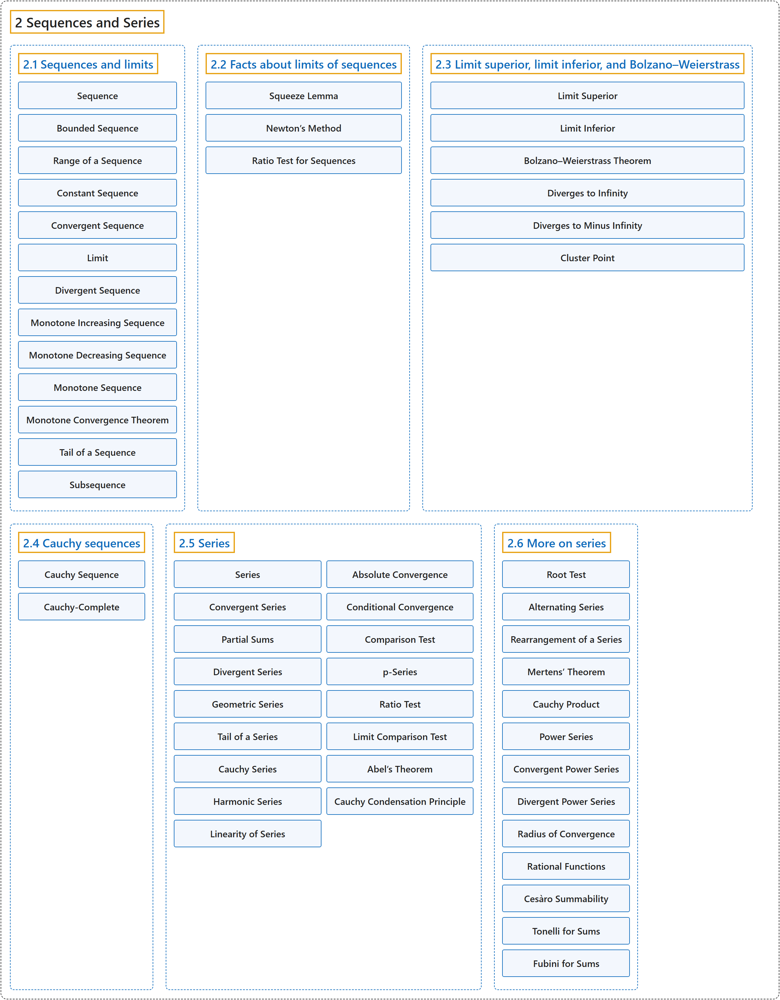

# 2 Sequences and Series

## Classification

## Glossary

| Term | Definition | 中文翻译 | Source |
|---|---|---|---|
| **2 Sequences and Series** 序列与级数 | (No definition) | （无定义） | [Lebl, 2026, chapter 2](https://www.jirka.org/ra/html/seq_chapter.html) |
| **[2.1 Sequences and limits](2-1-sequences-and-limits.md)** 序列与极限 | (No definition) | （无定义） | [Lebl, 2026, section 2.1](https://www.jirka.org/ra/html/sec_seqsandlims.html) |
| **[2.2 Facts about limits of sequences](2-2-facts-about-limits-of-sequences.md)** 序列极限的性质 | (No definition) | （无定义） | [Lebl, 2026, section 2.2](https://www.jirka.org/ra/html/sec_factslimsseqs.html) |
| **[2.3 Limit superior, limit inferior, and Bolzano–Weierstrass](2-3-limit-superior-limit-inferior-and-bolzano-weierstrass.md)** 上极限、下极限与波尔查诺–魏尔斯特拉斯定理 | (No definition) | （无定义） | [Lebl, 2026, section 2.3](https://www.jirka.org/ra/html/sec_bw.html) |
| **[2.4 Cauchy sequences](2-4-cauchy-sequences.md)** 柯西序列 | (No definition) | （无定义） | [Lebl, 2026, section 2.4](https://www.jirka.org/ra/html/sec_cauchy.html) |
| **[2.5 Series](2-5-series.md)** 级数 | (No definition) | （无定义） | [Lebl, 2026, section 2.5](https://www.jirka.org/ra/html/sec_series.html) |
| **[2.6 More on series](2-6-more-on-series.md)** 级数续论 | (No definition) | （无定义） | [Lebl, 2026, section 2.6](https://www.jirka.org/ra/html/sec_moreonseries.html) |

## References

Lebl, J. (2026). *Basic analysis I & II: Introduction to real analysis* (May 22, 2026 edition). Retrieved October 29, 2026, from <https://www.jirka.org/ra/html/>
