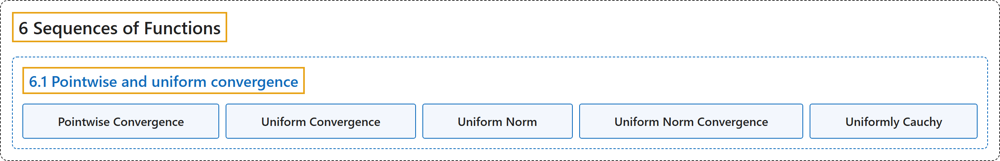

# 6.1 Pointwise and uniform convergence

## Classification

## Glossary

| Term | Definition | 中文翻译 | Source |
|---|---|---|---|
| **6.1 Pointwise and uniform convergence** 逐点收敛与一致收敛 | (No definition) | （无定义） | [Lebl, 2026, section 6.1](https://www.jirka.org/ra/html/sec_puconv.html) |
| **Pointwise Convergence** 逐点收敛 | "For every $n \in \mathbb{N}$, let $f_n \colon S \to \mathbb{R}$ be a function. The sequence $\{ f_n \}_{n=1}^\infty$ **converges pointwise** to $f \colon S \to \mathbb{R}$ if **for every $x \in S$, we have $f(x) = \lim_{n\to\infty} f_n(x)$**." | 对每个 $n \in \mathbb{N}$，设 $f_n \colon S \to \mathbb{R}$ 是函数。若**对每个 $x \in S$ 有 $f(x) = \lim_{n\to\infty} f_n(x)$**，则称序列 $\{ f_n \}_{n=1}^\infty$ **逐点收敛**到 $f \colon S \to \mathbb{R}$。 | [Lebl, 2026, Definition 6.1.1](https://www.jirka.org/ra/html/sec_puconv.html#sec_puconv-3-2) |
| **Uniform Convergence** 一致收敛 | "Let $f_n \colon S \to \mathbb{R}$ and $f \colon S \to \mathbb{R}$ be functions. The sequence $\{ f_n \}_{n=1}^\infty$ **converges uniformly** to $f$ if **for every $\epsilon > 0$, there exists an $N \in \mathbb{N}$ such that for all $n \geq N$, $\bigl\lvert f_n(x) - f(x) \bigr\rvert < \epsilon \qquad \text{for all } x \in S.$**" | 设 $f_n \colon S \to \mathbb{R}$ 与 $f \colon S \to \mathbb{R}$ 是函数。若**对每个 $\epsilon > 0$，存在 $N \in \mathbb{N}$，使得对所有 $n \geq N$ 有 $\bigl\lvert f_n(x) - f(x) \bigr\rvert < \epsilon \qquad \text{for all } x \in S.$**，则称序列 $\{ f_n \}_{n=1}^\infty$ **一致收敛**到 $f$。 | [Lebl, 2026, Definition 6.1.6](https://www.jirka.org/ra/html/sec_puconv.html#sec_puconv-4-2) |
| **Uniform Norm** 一致范数 | "Let $f \colon S \to \mathbb{R}$ be a bounded function. Define **$\lVert f \rVert_S := \sup \Bigl\{ \bigl\lvert f(x) \bigr\rvert : x \in S \Bigr\}$**. We call $\lVert \cdot \rVert_S$ the **uniform norm**." | 设 $f \colon S \to \mathbb{R}$ 是有界函数。定义 **$\lVert f \rVert_S := \sup \Bigl\{ \bigl\lvert f(x) \bigr\rvert : x \in S \Bigr\}$**。称 $\lVert \cdot \rVert_S$ 为**一致范数**。 | [Lebl, 2026, Definition 6.1.9](https://www.jirka.org/ra/html/sec_puconv.html#def_unifnorm) |
| **Uniform Norm Convergence** 一致范数收敛 | "Sometimes it is said that $\{ f_n \}_{n=1}^\infty$ **converges to $f$ in uniform norm** instead of converges uniformly if **$\lVert f_n-f \rVert_S \to 0$**." | 若 **$\lVert f_n-f \rVert_S \to 0$**，有时说 $\{ f_n \}_{n=1}^\infty$ **按一致范数收敛**到 $f$，而不说一致收敛。 | [Lebl, 2026, section 6.1](https://www.jirka.org/ra/html/sec_puconv.html#sec_puconv-5-7) |
| **Uniformly Cauchy** 一致柯西 | "Let $f_n \colon S \to \mathbb{R}$ be bounded functions. The sequence is **Cauchy in the uniform norm** or **uniformly Cauchy** if **for every $\epsilon > 0$, there exists an $N \in \mathbb{N}$ such that for all $m,k \geq N$, $\lVert f_m-f_k \rVert_S < \epsilon$**." | 设 $f_n \colon S \to \mathbb{R}$ 是有界函数。若**对每个 $\epsilon > 0$，存在 $N \in \mathbb{N}$，使得对所有 $m,k \geq N$ 有 $\lVert f_m-f_k \rVert_S < \epsilon$**，则称该序列**按一致范数是柯西的**，或**一致柯西**。 | [Lebl, 2026, Definition 6.1.12](https://www.jirka.org/ra/html/sec_puconv.html#sec_puconv-5-10) |

## References

Lebl, J. (2026). *Basic analysis I & II: Introduction to real analysis* (May 22, 2026 edition). Retrieved October 29, 2026, from <https://www.jirka.org/ra/html/>
