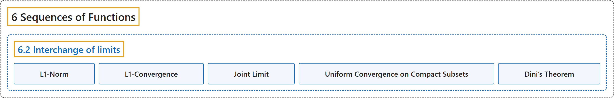

# 6.2 Interchange of limits

## Classification

## Glossary

| Term | Definition | 中文翻译 | Source |
|---|---|---|---|
| **6.2 Interchange of limits** 极限交换 | (No definition) | （无定义） | [Lebl, 2026, section 6.2](https://www.jirka.org/ra/html/sec_liminter.html) |
| **L1-Norm** L1 范数 | "Suppose $f \colon [0,1] \to \mathbb{R}$ is Riemann integrable. For the following two exercises define the number **$\lVert f \rVert_{L^1} := \int_0^1 \bigl\lvert f(x) \bigr\rvert\,dx$**. The number is called the **$L^1$-norm** and defines another very common type of convergence called the $L^1$-convergence." | 设 $f \colon [0,1] \to \mathbb{R}$ 黎曼可积。为下面两道习题定义数 **$\lVert f \rVert_{L^1} := \int_0^1 \bigl\lvert f(x) \bigr\rvert\,dx$**。这个数称为 **$L^1$ 范数**，它定义了另一种很常见的收敛，称为 $L^1$ 收敛。 | [Lebl, 2026, Exercises 6.2](https://www.jirka.org/ra/html/sec_liminter.html#sec_liminter-7-9) |
| **L1-Convergence** L1 收敛 | "The number is called the $L^1$-norm and defines **another very common type of convergence** called the **$L^1$-convergence**. It is, however, a bit more subtle." | 这个数称为 $L^1$ 范数，它定义了**另一种很常见的收敛**，称为 **$L^1$ 收敛**。不过它要微妙一些。 | [Lebl, 2026, Exercises 6.2](https://www.jirka.org/ra/html/sec_liminter.html#sec_liminter-7-9) |
| **Joint Limit** 联合极限 | "We say $L$ is the **joint limit** of $\{ x_{n,m} \}_{n,m=1}^\infty$ and write $\lim_{(n,m) \to \infty} x_{n,m} = L$, if **for every $\epsilon > 0$, there exists an $M$ such that if $n \geq M$ and $m \geq M$, then $\lvert x_{n,m} - L \rvert < \epsilon$**." | 若**对每个 $\epsilon > 0$，存在 $M$，使得当 $n \geq M$ 且 $m \geq M$ 时 $\lvert x_{n,m} - L \rvert < \epsilon$**，则称 $L$ 是 $\{ x_{n,m} \}_{n,m=1}^\infty$ 的**联合极限**，记作 $\lim_{(n,m) \to \infty} x_{n,m} = L$。 | [Lebl, 2026, Exercises 6.2](https://www.jirka.org/ra/html/sec_liminter.html#sec_liminter-7-15) |
| **Uniform Convergence on Compact Subsets** 紧子集上一致收敛 | "We say that a sequence of functions $f_n \colon \mathbb{R} \to \mathbb{R}$ **converges uniformly on compact subsets** if **for every $k \in \mathbb{N}$, the sequence $\{ f_n \}_{n=1}^\infty$ converges uniformly on $[-k,k]$**." | 若**对每个 $k \in \mathbb{N}$，序列 $\{ f_n \}_{n=1}^\infty$ 在 $[-k,k]$ 上一致收敛**，则称函数序列 $f_n \colon \mathbb{R} \to \mathbb{R}$ **在紧子集上一致收敛**。 | [Lebl, 2026, Exercise 6.2.15](https://www.jirka.org/ra/html/sec_liminter.html#sec_liminter-7-18) |
| **Dini’s Theorem** 迪尼定理 | "Prove **Dini’s theorem**: Let $f_n \colon [a,b] \to \mathbb{R}$ be a sequence of continuous functions such that **$0 \leq f_{n+1}(x) \leq f_n(x) \leq \cdots \leq f_1(x) \qquad \text{for all } n \in \mathbb{N}.$** Suppose $\{ f_n \}_{n=1}^\infty$ converges pointwise to $0$. Show that **$\{ f_n \}_{n=1}^\infty$ converges to zero uniformly**." | 证明**迪尼定理**：设 $f_n \colon [a,b] \to \mathbb{R}$ 是满足 **$0 \leq f_{n+1}(x) \leq f_n(x) \leq \cdots \leq f_1(x) \qquad \text{for all } n \in \mathbb{N}.$** 的连续函数序列，且 $\{ f_n \}_{n=1}^\infty$ 逐点收敛到 $0$。证明 **$\{ f_n \}_{n=1}^\infty$ 一致收敛到零**。 | [Lebl, 2026, Exercise 6.2.10](https://www.jirka.org/ra/html/sec_liminter.html#exercise_dinisthm) |

## References

Lebl, J. (2026). *Basic analysis I & II: Introduction to real analysis* (May 22, 2026 edition). Retrieved October 29, 2026, from <https://www.jirka.org/ra/html/>
