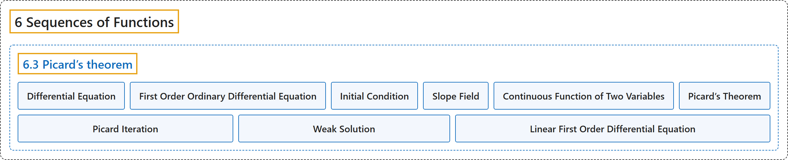

# 6.3 Picard’s theorem

## Classification

## Glossary

| Term | Definition | 中文翻译 | Source |
|---|---|---|---|
| **6.3 Picard’s theorem** 皮卡定理 | (No definition) | （无定义） | [Lebl, 2026, section 6.3](https://www.jirka.org/ra/html/sec_picard.html) |
| **Differential Equation** 微分方程 | "Modern science is described in the language of **differential equations**. That is, **equations involving not only the unknown, but also its derivatives**." | 现代科学是用**微分方程**的语言描述的，即**不仅含有未知函数、还含有其导数的方程**。 | [Lebl, 2026, section 6.3](https://www.jirka.org/ra/html/sec_picard.html#sec_picard-3-2) |
| **First Order Ordinary Differential Equation** 一阶常微分方程 | "The simplest nontrivial form of a differential equation is the **first order ordinary differential equation** **$y' = F(x,y)$**." | 微分方程最简单的非平凡形式是**一阶常微分方程** **$y' = F(x,y)$**。 | [Lebl, 2026, section 6.3](https://www.jirka.org/ra/html/sec_picard.html#sec_picard-3-2) |
| **Initial Condition** 初始条件 | "Generally, we also specify an **initial condition** **$y(x_0)=y_0$**. The solution of the equation is a function $y(x)$ such that $y(x_0)=y_0$ and $y'(x) = F\bigl(x,y(x)\bigr)$." | 通常还要指定一个**初始条件** **$y(x_0)=y_0$**。方程的解是满足 $y(x_0)=y_0$ 且 $y'(x) = F\bigl(x,y(x)\bigr)$ 的函数 $y(x)$。 | [Lebl, 2026, section 6.3](https://www.jirka.org/ra/html/sec_picard.html#sec_picard-3-2) |
| **Slope Field** 斜率场 | "See Figure 6.8 for **a graphical representation of this equation** called a **slope field**." | 这个方程的**图形表示**称为**斜率场**，见图 6.8。 | [Lebl, 2026, section 6.3](https://www.jirka.org/ra/html/sec_picard.html#sec_picard-3-2) |
| **Continuous Function of Two Variables** 二元连续函数 | "Let $U \subset \mathbb{R}^2$ be a set, $F \colon U \to \mathbb{R}$ a function, and $(x,y) \in U$ a point. The function $F$ is **continuous at $(x,y)$** if **for every sequence $\bigl\{ (x_n,y_n) \bigr\}_{n=1}^\infty$ of points in $U$ such that $\lim_{n\to\infty} x_n = x$ and $\lim_{n\to\infty} y_n = y$, we have $\lim_{n \to \infty} F(x_n,y_n) = F(x,y)$**. We say $F$ is **continuous** if it is continuous at all points in $U$." | 设 $U \subset \mathbb{R}^2$ 是集合，$F \colon U \to \mathbb{R}$ 是函数，$(x,y) \in U$ 是一点。若**对 $U$ 中每个满足 $\lim_{n\to\infty} x_n = x$ 且 $\lim_{n\to\infty} y_n = y$ 的点列 $\bigl\{ (x_n,y_n) \bigr\}_{n=1}^\infty$，都有 $\lim_{n \to \infty} F(x_n,y_n) = F(x,y)$**，则称 $F$ **在 $(x,y)$ 处连续**。若 $F$ 在 $U$ 的所有点处连续，就说 $F$ **连续**。 | [Lebl, 2026, Definition 6.3.1](https://www.jirka.org/ra/html/sec_picard.html#sec_picard-4-3) |
| **Picard’s Theorem** 皮卡定理 | "Let $I, J \subset \mathbb{R}$ be closed bounded intervals, let $I^\circ$ and $J^\circ$ be their interiors, and let $(x_0,y_0) \in I^\circ \times J^\circ$. Suppose $F \colon I \times J \to \mathbb{R}$ is **continuous and Lipschitz in the second variable**, that is, there exists an $L \in \mathbb{R}$ such that $\bigl\lvert F(x,y) - F(x,z) \bigr\rvert \leq L \lvert y-z \rvert \qquad \text{for all } y,z \in J, x \in I .$ Then **there exists an $h > 0$ such that $[x_0-h,x_0+h] \subset I$ and a unique differentiable function $f \colon [x_0 - h, x_0 + h] \to J \subset \mathbb{R}$ such that $f'(x) = F\bigl(x,f(x)\bigr)$ and $f(x_0) = y_0$**." | 设 $I, J \subset \mathbb{R}$ 是有界闭区间，$I^\circ$ 与 $J^\circ$ 是它们的内部，$(x_0,y_0) \in I^\circ \times J^\circ$。设 $F \colon I \times J \to \mathbb{R}$ **连续，且关于第二个变量满足利普希茨条件**，即存在 $L \in \mathbb{R}$ 使得 $\bigl\lvert F(x,y) - F(x,z) \bigr\rvert \leq L \lvert y-z \rvert \qquad \text{for all } y,z \in J, x \in I .$ 则**存在 $h > 0$ 使得 $[x_0-h,x_0+h] \subset I$，并存在唯一的可微函数 $f \colon [x_0 - h, x_0 + h] \to J \subset \mathbb{R}$，满足 $f'(x) = F\bigl(x,f(x)\bigr)$ 且 $f(x_0) = y_0$**。 | [Lebl, 2026, Theorem 6.3.2](https://www.jirka.org/ra/html/sec_picard.html#thm_fs_picard) |
| **Picard Iteration** 皮卡迭代 | "The idea of our proof is that we try to plug in approximations to a solution to the right-hand side of (6.2) to get better approximations on the left-hand side of (6.2). We hope that in the end the sequence converges and solves (6.2) and hence (6.1). The technique below is called **Picard iteration**, and **the individual functions $f_k$** are called the **Picard iterates**." | 证明的思路是：把解的近似代入 (6.2) 的右边，在 (6.2) 的左边得到更好的近似，希望最终这个序列收敛，并解出 (6.2)，从而解出 (6.1)。下面的技巧称为**皮卡迭代**，**其中的各个函数 $f_k$** 称为**皮卡迭代函数**。 | [Lebl, 2026, Theorem 6.3.2, proof](https://www.jirka.org/ra/html/sec_picard.html#sec_picard-4-5) |
| **Weak Solution** 弱解 | "It is possible to weaken what we mean by “solution to $y' = F(x,y)$” by **focusing on the integral equation $f(x) = y_0 + \int_{x_0}^x F\bigl(t,f(t)\bigr) \, dt$**. Notice, however, that $f'(0)$ does not exist, so $f$ is only what is called a **weak solution** to the differential equation." | 可以通过**着眼于积分方程 $f(x) = y_0 + \int_{x_0}^x F\bigl(t,f(t)\bigr) \, dt$** 来放宽“$y' = F(x,y)$ 的解”的含义。但请注意，$f'(0)$ 不存在，所以 $f$ 只是该微分方程的所谓**弱解**。 | [Lebl, 2026, Remark 6.3.7](https://www.jirka.org/ra/html/sec_picard.html#sec_picard-5-9) |
| **Linear First Order Differential Equation** 一阶线性微分方程 | "A common type of equation is a **linear first order differential equation**, that is, **an equation of the form $y' + p(x) y = q(x) , \qquad y(x_0) = y_0 .$**" | 一类常见的方程是**一阶线性微分方程**，即**形如 $y' + p(x) y = q(x) , \qquad y(x_0) = y_0 .$ 的方程**。 | [Lebl, 2026, Exercise 6.3.6](https://www.jirka.org/ra/html/sec_picard.html#sec_picard-6-6) |

## References

Lebl, J. (2026). *Basic analysis I & II: Introduction to real analysis* (May 22, 2026 edition). Retrieved October 29, 2026, from <https://www.jirka.org/ra/html/>
