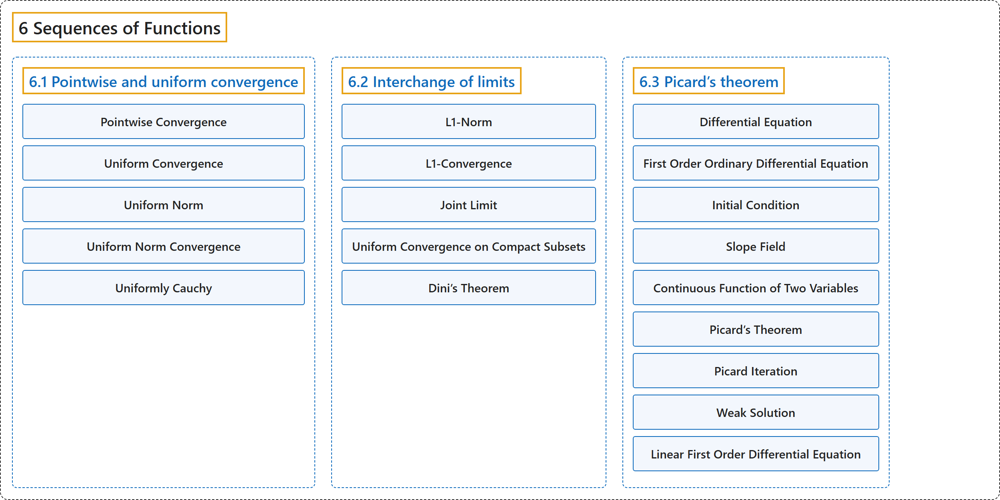

# 6 Sequences of Functions

## Classification

## Glossary

| Term | Definition | 中文翻译 | Source |
|---|---|---|---|
| **6 Sequences of Functions** 函数序列 | (No definition) | （无定义） | [Lebl, 2026, chapter 6](https://www.jirka.org/ra/html/fs_chapter.html) |
| **[6.1 Pointwise and uniform convergence](6-1-pointwise-and-uniform-convergence.md)** 逐点收敛与一致收敛 | (No definition) | （无定义） | [Lebl, 2026, section 6.1](https://www.jirka.org/ra/html/sec_puconv.html) |
| **[6.2 Interchange of limits](6-2-interchange-of-limits.md)** 极限交换 | (No definition) | （无定义） | [Lebl, 2026, section 6.2](https://www.jirka.org/ra/html/sec_liminter.html) |
| **[6.3 Picard’s theorem](6-3-picards-theorem.md)** 皮卡定理 | (No definition) | （无定义） | [Lebl, 2026, section 6.3](https://www.jirka.org/ra/html/sec_picard.html) |

## References

Lebl, J. (2026). *Basic analysis I & II: Introduction to real analysis* (May 22, 2026 edition). Retrieved October 29, 2026, from <https://www.jirka.org/ra/html/>
