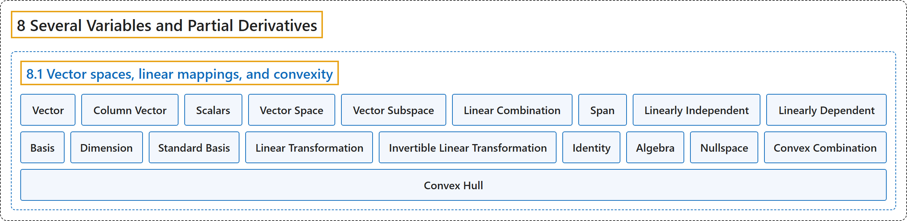

# 8.1 Vector spaces, linear mappings, and convexity

## Classification

## Glossary

| Term | Definition | 中文翻译 | Source |
|---|---|---|---|
| **8.1 Vector spaces, linear mappings, and convexity** 向量空间、线性映射与凸性 | (No definition) | （无定义） | [Lebl, 2026, section 8.1](https://www.jirka.org/ra/html/sec_vectorspaces.html) |
| **Vector** 向量 | "That is, $v \in \mathbb{R}^n$ is a **vector**, which means **$v = (v_1,v_2,\ldots,v_n)$ is an $n$-tuple of real numbers**." | 也就是说，$v \in \mathbb{R}^n$ 是一个**向量**，即 **$v = (v_1,v_2,\ldots,v_n)$ 是由实数构成的 $n$ 元组**。 | [Lebl, 2026, section 8.1](https://www.jirka.org/ra/html/sec_vectorspaces.html#sec_vectorspaces-3-3) |
| **Column Vector** 列向量 | "At times, it is useful to write and treat vectors as **column vectors**, that is, **$n$-by-$1$ matrices**." | 有时把向量写成并当作**列向量**来处理很有用，即 **$n \times 1$ 矩阵**。 | [Lebl, 2026, section 8.1](https://www.jirka.org/ra/html/sec_vectorspaces.html#sec_vectorspaces-3-3) |
| **Scalars** 标量 | "We call **real numbers** **scalars** to distinguish them from vectors." | 我们把**实数**称为**标量**，以区别于向量。 | [Lebl, 2026, section 8.1](https://www.jirka.org/ra/html/sec_vectorspaces.html#sec_vectorspaces-3-3) |
| **Vector Space** 向量空间 | "Let $X$ be a set together with the operations of addition, $+ \colon X \times X \to X$, and multiplication, $\cdot \colon \mathbb{R} \times X \to X$, (we usually write $ax$ instead of $a \cdot x$). The set $X$ is called a **vector space** (or a **real vector space**) if **the following conditions are satisfied**: (Addition is associative) (Addition is commutative) (Additive identity) (Additive inverse) (Distributive law) (Distributive law) (Multiplication is associative) (Multiplicative identity)" | 设集合 $X$ 带有加法运算 $+ \colon X \times X \to X$ 和乘法运算 $\cdot \colon \mathbb{R} \times X \to X$（通常把 $a \cdot x$ 写作 $ax$）。若**满足以下条件**，则集合 $X$ 称为**向量空间**（或**实向量空间**）：（加法结合律）（加法交换律）（加法单位元）（加法逆元）（分配律）（分配律）（乘法结合律）（乘法单位元） | [Lebl, 2026, Definition 8.1.1](https://www.jirka.org/ra/html/sec_vectorspaces.html#sec_vectorspaces-3-9) |
| **Vector Subspace** 向量子空间 | "If $Y \subset X$ is **a subset that is a vector space itself using the same operations**, then $Y$ is called a subspace or a **vector subspace** of $X$." | 若 $Y \subset X$ 是**在相同运算下本身也是向量空间的子集**，则 $Y$ 称为 $X$ 的子空间或**向量子空间**。 | [Lebl, 2026, Definition 8.1.1](https://www.jirka.org/ra/html/sec_vectorspaces.html#sec_vectorspaces-3-9) |
| **Linear Combination** 线性组合 | "Suppose $X$ is a vector space, $x_1, x_2, \ldots, x_m \in X$ are vectors, and $a_1, a_2, \ldots, a_m \in \mathbb{R}$ are scalars. Then **$a_1 x_1 + a_2 x_2 + \cdots + a_m x_m$** is called a **linear combination** of the vectors $x_1, x_2, \ldots, x_m$." | 设 $X$ 是向量空间，$x_1, x_2, \ldots, x_m \in X$ 是向量，$a_1, a_2, \ldots, a_m \in \mathbb{R}$ 是标量，则 **$a_1 x_1 + a_2 x_2 + \cdots + a_m x_m$** 称为向量 $x_1, x_2, \ldots, x_m$ 的**线性组合**。 | [Lebl, 2026, Definition 8.1.7](https://www.jirka.org/ra/html/sec_vectorspaces.html#sec_vectorspaces-4-2) |
| **Span** 张成 | "For a subset $Y \subset X$, let $\operatorname{span}(Y)$, or the **span** of $Y$, be **the set of all linear combinations of all finite subsets of $Y$**. We say $Y$ spans $\operatorname{span}(Y)$." | 对子集 $Y \subset X$，令 $\operatorname{span}(Y)$，即 $Y$ 的**张成**，为 **$Y$ 的所有有限子集的全部线性组合构成的集合**。称 $Y$ 张成 $\operatorname{span}(Y)$。 | [Lebl, 2026, Definition 8.1.7](https://www.jirka.org/ra/html/sec_vectorspaces.html#sec_vectorspaces-4-2) |
| **Linearly Independent** 线性无关 | "A set of vectors $\{ x_1, x_2, \ldots, x_m \} \subset X$ is **linearly independent** if the equation $a_1 x_1 + a_2 x_2 + \cdots + a_m x_m = 0$ **has only the trivial solution $a_1 = a_2 = \cdots = a_m = 0$**." | 若方程 $a_1 x_1 + a_2 x_2 + \cdots + a_m x_m = 0$ **只有平凡解 $a_1 = a_2 = \cdots = a_m = 0$**，则向量组 $\{ x_1, x_2, \ldots, x_m \} \subset X$ 是**线性无关的**。 | [Lebl, 2026, Definition 8.1.12](https://www.jirka.org/ra/html/sec_vectorspaces.html#sec_vectorspaces-4-9) |
| **Linearly Dependent** 线性相关 | "A set that is **not linearly independent** is **linearly dependent**." | **不是线性无关**的集合是**线性相关的**。 | [Lebl, 2026, Definition 8.1.12](https://www.jirka.org/ra/html/sec_vectorspaces.html#sec_vectorspaces-4-9) |
| **Basis** 基 | "A **linearly independent set of vectors $B \subset X$ such that $\operatorname{span}(B) = X$** is called a **basis** of $X$." | **满足 $\operatorname{span}(B) = X$ 的线性无关向量组 $B \subset X$** 称为 $X$ 的**基**。 | [Lebl, 2026, Definition 8.1.12](https://www.jirka.org/ra/html/sec_vectorspaces.html#sec_vectorspaces-4-9) |
| **Dimension** 维数 | "Suppose $d$ is **the largest integer for which $X$ contains a set of $d$ linearly independent vectors**. We then say $d$ is the **dimension** of $X$, and we write $\dim \, X := d$." | 设 $d$ 是**使 $X$ 含有 $d$ 个线性无关向量的最大整数**，则称 $d$ 是 $X$ 的**维数**，记作 $\dim \, X := d$。 | [Lebl, 2026, Definition 8.1.12](https://www.jirka.org/ra/html/sec_vectorspaces.html#sec_vectorspaces-4-9) |
| **Standard Basis** 标准基 | "For $\mathbb{R}^n$, we define the **standard basis** of $\mathbb{R}^n$: **$e_1 := (1,0,0,\ldots,0) , \quad e_2 := (0,1,0,\ldots,0) , \quad \ldots, \quad e_n := (0,0,0,\ldots,1)$**." | 对 $\mathbb{R}^n$，定义 $\mathbb{R}^n$ 的**标准基**：**$e_1 := (1,0,0,\ldots,0) , \quad e_2 := (0,1,0,\ldots,0) , \quad \ldots, \quad e_n := (0,0,0,\ldots,1)$**。 | [Lebl, 2026, section 8.1](https://www.jirka.org/ra/html/sec_vectorspaces.html#sec_vectorspaces-4-16) |
| **Linear Transformation** 线性变换 | "A map $A \colon X \to Y$ of vector spaces $X$ and $Y$ is **linear** (we also say $A$ is a **linear transformation** or a **linear operator**) if for all $a \in \mathbb{R}$ and all $x,y \in X$, **$A(a x) = a A(x) \qquad \text{and} \qquad A(x+y) = A(x)+A(y)$**." | 若对所有 $a \in \mathbb{R}$ 和所有 $x,y \in X$ 有 **$A(a x) = a A(x) \qquad \text{and} \qquad A(x+y) = A(x)+A(y)$**，则向量空间 $X$ 到 $Y$ 的映射 $A \colon X \to Y$ 是**线性的**（也称 $A$ 为**线性变换**或**线性算子**）。 | [Lebl, 2026, Definition 8.1.15](https://www.jirka.org/ra/html/sec_vectorspaces.html#sec_vectorspaces-5-3) |
| **Invertible Linear Transformation** 可逆线性变换 | "If $A$ is **one-to-one and onto**, then we say $A$ is **invertible**, and we denote the inverse by $A^{-1}$." | 若 $A$ **既是一对一的又是映上的**，则称 $A$ **可逆**，其逆记作 $A^{-1}$。 | [Lebl, 2026, Definition 8.1.15](https://www.jirka.org/ra/html/sec_vectorspaces.html#sec_vectorspaces-5-3) |
| **Identity** 恒等算子 | "Finally, denote by $I \in L(X)$ the **identity**: **the linear operator such that $Ix = x$ for all $x$**." | 最后，用 $I \in L(X)$ 表示**恒等算子**：**对所有 $x$ 满足 $Ix = x$ 的线性算子**。 | [Lebl, 2026, Definition 8.1.15](https://www.jirka.org/ra/html/sec_vectorspaces.html#sec_vectorspaces-5-3) |
| **Algebra** 代数 | "As $L(X)$ is **not only a vector space, but also admits a product (composition)**, it is called an **algebra**." | 由于 $L(X)$ **不仅是向量空间，还允许乘积（复合）**，它被称为一个**代数**。 | [Lebl, 2026, section 8.1](https://www.jirka.org/ra/html/sec_vectorspaces.html#sec_vectorspaces-5-5) |
| **Nullspace** 零空间 | "For this reason, one often studies the **nullspace** of $A$, that is, **$\{ x \in X : Ax = 0 \}$**." | 因此人们常研究 $A$ 的**零空间**，即 **$\{ x \in X : Ax = 0 \}$**。 | [Lebl, 2026, section 8.1](https://www.jirka.org/ra/html/sec_vectorspaces.html#sec_vectorspaces-5-10) |
| **Convex Combination** 凸组合 | "A subset $U$ of a vector space is convex if whenever $x,y \in U$, the line segment from $x$ to $y$ lies in $U$. That is, if the **convex combination** **$(1-t)x+ty$** is in $U$ for all $t \in [0,1]$." | 向量空间的子集 $U$ 称为凸的，如果只要 $x,y \in U$，从 $x$ 到 $y$ 的线段就在 $U$ 中，即对所有 $t \in [0,1]$，**凸组合** **$(1-t)x+ty$** 都在 $U$ 中。 | [Lebl, 2026, section 8.1](https://www.jirka.org/ra/html/sec_vectorspaces.html#sec_vectorspaces-6-2) |
| **Convex Hull** 凸包 | "Given a subset $S$ of a vector space $X$, define the **convex hull** of $S$ as **the intersection of all convex sets containing $S$**: $\operatorname{co}(S) := \bigcap \{ C \subset X : S \subset C, \text{ and } C \text{ is convex} \}$." | 给定向量空间 $X$ 的子集 $S$，定义 $S$ 的**凸包**为**包含 $S$ 的所有凸集的交**：$\operatorname{co}(S) := \bigcap \{ C \subset X : S \subset C, \text{ and } C \text{ is convex} \}$。 | [Lebl, 2026, section 8.1](https://www.jirka.org/ra/html/sec_vectorspaces.html#sec_vectorspaces-6-12) |

## References

Lebl, J. (2026). *Basic analysis I & II: Introduction to real analysis* (May 22, 2026 edition). Retrieved October 29, 2026, from <https://www.jirka.org/ra/html/>
