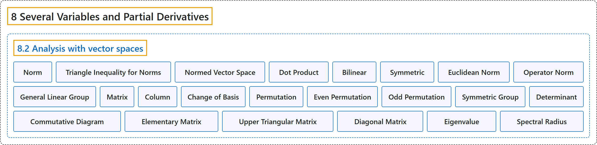

# 8.2 Analysis with vector spaces

## Classification

## Glossary

| Term | Definition | 中文翻译 | Source |
|---|---|---|---|
| **8.2 Analysis with vector spaces** 向量空间上的分析 | (No definition) | （无定义） | [Lebl, 2026, section 8.2](https://www.jirka.org/ra/html/sec_normsmatsdets.html) |
| **Norm** 范数 | "If $X$ is a vector space, then we say a function $\lVert \cdot \rVert \colon X \to \mathbb{R}$ is a **norm** if **$\lVert x \rVert \geq 0$, with $\lVert x \rVert=0$ if and only if $x=0$. $\lVert cx \rVert = \lvert c \rvert \, \lVert x \rVert$ for all $c \in \mathbb{R}$ and $x \in X$. $\lVert x+y \rVert \leq \lVert x \rVert+\lVert y \rVert$ for all $x,y \in X$** (triangle inequality)." | 若 $X$ 是向量空间，函数 $\lVert \cdot \rVert \colon X \to \mathbb{R}$ 满足：**$\lVert x \rVert \geq 0$，且 $\lVert x \rVert=0$ 当且仅当 $x=0$；对所有 $c \in \mathbb{R}$、$x \in X$ 有 $\lVert cx \rVert = \lvert c \rvert \, \lVert x \rVert$；对所有 $x,y \in X$ 有 $\lVert x+y \rVert \leq \lVert x \rVert+\lVert y \rVert$**（三角不等式），则称它为**范数**。 | [Lebl, 2026, Definition 8.2.1](https://www.jirka.org/ra/html/sec_normsmatsdets.html#sec_normsmatsdets-3-3) |
| **Triangle Inequality for Norms** 范数的三角不等式 | "**$\lVert x+y \rVert \leq \lVert x \rVert+\lVert y \rVert$** for all $x,y \in X$ (**triangle inequality**)." | 对所有 $x,y \in X$ 有 **$\lVert x+y \rVert \leq \lVert x \rVert+\lVert y \rVert$**（**三角不等式**）。 | [Lebl, 2026, Definition 8.2.1](https://www.jirka.org/ra/html/sec_normsmatsdets.html#defn_norm_iii) |
| **Normed Vector Space** 赋范向量空间 | "A **vector space equipped with a norm** is called a **normed vector space**." | **配备了范数的向量空间**称为**赋范向量空间**。 | [Lebl, 2026, Definition 8.2.1](https://www.jirka.org/ra/html/sec_normsmatsdets.html#sec_normsmatsdets-3-3) |
| **Dot Product** 点积 | "Before defining the standard norm on $\mathbb{R}^n$, we define the standard scalar **dot product** on $\mathbb{R}^n$. For $x=(x_1,x_2,\ldots,x_n) \in \mathbb{R}^n$ and $y=(y_1,y_2,\ldots,y_n) \in \mathbb{R}^n$ define **$x \cdot y := \sum_{k=1}^n x_k\, y_k$**." | 在定义 $\mathbb{R}^n$ 上的标准范数之前，先定义 $\mathbb{R}^n$ 上的标准数量**点积**。对 $x=(x_1,x_2,\ldots,x_n) \in \mathbb{R}^n$ 和 $y=(y_1,y_2,\ldots,y_n) \in \mathbb{R}^n$，定义 **$x \cdot y := \sum_{k=1}^n x_k\, y_k$**。 | [Lebl, 2026, section 8.2](https://www.jirka.org/ra/html/sec_normsmatsdets.html#sec_normsmatsdets-3-4) |
| **Bilinear** 双线性 | "Dot product is **linear in each variable separately**—in more fancy language, it is **bilinear**." | 点积**对每个变量分别是线性的**——用更花哨的话说，它是**双线性的**。 | [Lebl, 2026, section 8.2](https://www.jirka.org/ra/html/sec_normsmatsdets.html#sec_normsmatsdets-3-4) |
| **Symmetric** 对称 | "It is **symmetric** in the sense that **$x \cdot y = y \cdot x$**." | 它是**对称的**，即 **$x \cdot y = y \cdot x$**。 | [Lebl, 2026, section 8.2](https://www.jirka.org/ra/html/sec_normsmatsdets.html#sec_normsmatsdets-3-4) |
| **Euclidean Norm** 欧几里得范数 | "Define the **euclidean norm** as **$\lVert x \rVert := \lVert x \rVert_{\mathbb{R}^n} := \sqrt{x \cdot x} = \sqrt{(x_1)^2+(x_2)^2 + \cdots + (x_n)^2}$**." | 定义**欧几里得范数**为 **$\lVert x \rVert := \lVert x \rVert_{\mathbb{R}^n} := \sqrt{x \cdot x} = \sqrt{(x_1)^2+(x_2)^2 + \cdots + (x_n)^2}$**。 | [Lebl, 2026, section 8.2](https://www.jirka.org/ra/html/sec_normsmatsdets.html#sec_normsmatsdets-3-4) |
| **Operator Norm** 算子范数 | "Let $A \in L(X,Y)$. Define **$\lVert A \rVert := \sup \bigl\{ \lVert Ax \rVert : x \in X \text{ with } \lVert x \rVert = 1 \bigr\}$**. The number $\lVert A \rVert$ (possibly $\infty$) is called the **operator norm**." | 设 $A \in L(X,Y)$。定义 **$\lVert A \rVert := \sup \bigl\{ \lVert Ax \rVert : x \in X \text{ with } \lVert x \rVert = 1 \bigr\}$**。数 $\lVert A \rVert$（可能为 $\infty$）称为**算子范数**。 | [Lebl, 2026, Definition 8.2.3](https://www.jirka.org/ra/html/sec_normsmatsdets.html#sec_normsmatsdets-3-9) |
| **General Linear Group** 一般线性群 | "Let **$GL(X) \subset L(X)$ be the set of invertible linear operators**. $GL(X)$ is called the **general linear group**, that is where the acronym GL comes from." | 令 **$GL(X) \subset L(X)$ 为可逆线性算子构成的集合**。$GL(X)$ 称为**一般线性群**，缩写 GL 即由此而来。 | [Lebl, 2026, Proposition 8.2.6](https://www.jirka.org/ra/html/sec_normsmatsdets.html#prop_finitedimpropinv) |
| **Matrix** 矩阵 | "Define the numbers $a_{i,j}$ via $A x_j = \sum_{i=1}^m a_{i,j} \, y_i$, and write them as a **matrix**, which we, by slight abuse of notation, also call $A$, **$A = \begin{bmatrix} a_{1,1} & a_{1,2} & \cdots & a_{1,n} \\ a_{2,1} & a_{2,2} & \cdots & a_{2,n} \\ \vdots & \vdots & \ddots & \vdots \\ a_{m,1} & a_{m,2} & \cdots & a_{m,n} \end{bmatrix}$**." | 通过 $A x_j = \sum_{i=1}^m a_{i,j} \, y_i$ 定义数 $a_{i,j}$，并把它们写成一个**矩阵**，稍微滥用记号，也记作 $A$：**$A = \begin{bmatrix} a_{1,1} & a_{1,2} & \cdots & a_{1,n} \\ a_{2,1} & a_{2,2} & \cdots & a_{2,n} \\ \vdots & \vdots & \ddots & \vdots \\ a_{m,1} & a_{m,2} & \cdots & a_{m,n} \end{bmatrix}$**。 | [Lebl, 2026, section 8.2](https://www.jirka.org/ra/html/sec_normsmatsdets.html#sec_normsmatsdets-4-2) |
| **Column** 列 | "The **$j$th column** of the matrix contains precisely **the coefficients that represent $A x_j$** in terms of the basis $\{ y_1,y_2,\ldots,y_m \}$." | 矩阵的**第 $j$ 列**恰好包含**用基 $\{ y_1,y_2,\ldots,y_m \}$ 表示 $A x_j$ 的系数**。 | [Lebl, 2026, section 8.2](https://www.jirka.org/ra/html/sec_normsmatsdets.html#sec_normsmatsdets-4-2) |
| **Change of Basis** 基变换 | "A linear mapping changing one basis to another is represented by a square matrix in which the columns represent vectors of the second basis in terms of the first basis. We call such a linear mapping a **change of basis**." | 把一组基变成另一组基的线性映射，由一个方阵表示，方阵的各列是第二组基的向量在第一组基下的表示。这样的线性映射称为**基变换**。 | [Lebl, 2026, section 8.2](https://www.jirka.org/ra/html/sec_normsmatsdets.html#sec_normsmatsdets-4-4) |
| **Permutation** 置换 | "A **permutation** $\sigma = (\sigma_1,\sigma_2,\ldots,\sigma_n)$ is **a reordering of $(1,2,\ldots,n)$**." | **置换** $\sigma = (\sigma_1,\sigma_2,\ldots,\sigma_n)$ 是 **$(1,2,\ldots,n)$ 的一种重新排列**。 | [Lebl, 2026, section 8.2](https://www.jirka.org/ra/html/sec_normsmatsdets.html#sec_normsmatsdets-5-3) |
| **Even Permutation** 偶置换 | "A permutation is **even** (resp. odd) if it takes **an even (resp. odd) number of transpositions** to get from $(1,2,\ldots,n)$ to $\sigma$." | 若从 $(1,2,\ldots,n)$ 得到 $\sigma$ 需要**偶数（相应地奇数）次对换**，则称该置换为**偶的**（相应地奇的）。 | [Lebl, 2026, section 8.2](https://www.jirka.org/ra/html/sec_normsmatsdets.html#sec_normsmatsdets-5-4) |
| **Odd Permutation** 奇置换 | "A permutation is even (resp. **odd**) if it takes an even (resp. **odd**) number of transpositions to get from $(1,2,\ldots,n)$ to $\sigma$." | 若从 $(1,2,\ldots,n)$ 得到 $\sigma$ 需要偶数（相应地**奇数**）次对换，则称该置换为偶的（相应地**奇的**）。 | [Lebl, 2026, section 8.2](https://www.jirka.org/ra/html/sec_normsmatsdets.html#sec_normsmatsdets-5-4) |
| **Symmetric Group** 对称群 | "Let $S_n$ be **the set of all permutations on $n$ elements** (the **symmetric group**)." | 令 $S_n$ 为 **$n$ 个元素上所有置换构成的集合**（**对称群**）。 | [Lebl, 2026, section 8.2](https://www.jirka.org/ra/html/sec_normsmatsdets.html#sec_normsmatsdets-5-5) |
| **Determinant** 行列式 | "Let $A= [a_{i,j}]$ be a square $n$-by-$n$ matrix. Define the **determinant** of $A$ as **$\det(A) := \sum_{\sigma \in S_n} \operatorname{sgn} (\sigma) \prod_{i=1}^n a_{i,\sigma_i}$**." | 设 $A= [a_{i,j}]$ 是 $n \times n$ 方阵。定义 $A$ 的**行列式**为 **$\det(A) := \sum_{\sigma \in S_n} \operatorname{sgn} (\sigma) \prod_{i=1}^n a_{i,\sigma_i}$**。 | [Lebl, 2026, section 8.2](https://www.jirka.org/ra/html/sec_normsmatsdets.html#sec_normsmatsdets-5-5) |
| **Commutative Diagram** 交换图 | "Such a picture is called **commutative diagram**. In a commutative diagram, **following arrows in any way must end up with the same result**." | 这样的图称为**交换图**。在交换图中，**沿箭头无论怎样走，结果都必须相同**。 | [Lebl, 2026, section 8.2](https://www.jirka.org/ra/html/sec_normsmatsdets.html#sec_normsmatsdets-5-17) |
| **Elementary Matrix** 初等矩阵 | "There are three types of what we call **elementary matrices**. Let $e_1,e_2,\ldots,e_n$ be the standard basis on $\mathbb{R}^n$ as usual. First, for $j = 1,2,\ldots,n$ and $\lambda \in \mathbb{R}$, $\lambda \neq 0$, define the first type of an elementary matrix, an $n$-by-$n$ matrix $E$ by **$Ee_i := \begin{cases} e_i & \text{if } i \neq j , \\ \lambda e_i & \text{if } i = j . \end{cases}$**" | 我们所说的**初等矩阵**有三种类型。像通常一样，令 $e_1,e_2,\ldots,e_n$ 为 $\mathbb{R}^n$ 的标准基。首先，对 $j = 1,2,\ldots,n$ 和 $\lambda \in \mathbb{R}$，$\lambda \neq 0$，定义第一种初等矩阵为 $n \times n$ 矩阵 $E$：**$Ee_i := \begin{cases} e_i & \text{if } i \neq j , \\ \lambda e_i & \text{if } i = j . \end{cases}$** | [Lebl, 2026, section 8.2](https://www.jirka.org/ra/html/sec_normsmatsdets.html#sec_normsmatsdets-5-19) |
| **Upper Triangular Matrix** 上三角矩阵 | "It is sufficient to do row operations until we find an **upper triangular matrix**, that is, **a matrix $[a_{i,j}]$ where $a_{i,j} = 0$ if $i > j$**." | 只需做行变换，直到得到一个**上三角矩阵**，即**当 $i > j$ 时 $a_{i,j} = 0$ 的矩阵 $[a_{i,j}]$**。 | [Lebl, 2026, section 8.2](https://www.jirka.org/ra/html/sec_normsmatsdets.html#sec_normsmatsdets-5-23) |
| **Diagonal Matrix** 对角矩阵 | "Suppose $D = [d_{i,j}]$ is an $n$-by-$n$ **diagonal matrix**, that is, **$d_{i,j} = 0$ whenever $i \neq j$**." | 设 $D = [d_{i,j}]$ 是 $n \times n$ **对角矩阵**，即**当 $i \neq j$ 时 $d_{i,j} = 0$**。 | [Lebl, 2026, Exercise 8.2.10](https://www.jirka.org/ra/html/sec_normsmatsdets.html#sec_normsmatsdets-6-10) |
| **Eigenvalue** 特征值 | "Let $A$ be an $n$-by-$n$ matrix. A $\lambda \in \mathbb{C}$ (possibly complex even for a real matrix) is an **eigenvalue** of $A$ if **there is a nonzero (possibly complex) vector $x \in \mathbb{C}^n$ such that $Ax = \lambda x$**." | 设 $A$ 是 $n \times n$ 矩阵。若**存在非零（可能是复的）向量 $x \in \mathbb{C}^n$ 使得 $Ax = \lambda x$**，则 $\lambda \in \mathbb{C}$（即使对实矩阵也可能是复数）称为 $A$ 的**特征值**。 | [Lebl, 2026, Exercises 8.2](https://www.jirka.org/ra/html/sec_normsmatsdets.html#sec_normsmatsdets-6-17) |
| **Spectral Radius** 谱半径 | "The number **$\rho(A) := \sup \bigl\{ \lvert \lambda \rvert : \lambda \text{ is an eigenvalue of } A \bigr\}$** is the **spectral radius** of $A$." | 数 **$\rho(A) := \sup \bigl\{ \lvert \lambda \rvert : \lambda \text{ is an eigenvalue of } A \bigr\}$** 是 $A$ 的**谱半径**。 | [Lebl, 2026, Exercises 8.2](https://www.jirka.org/ra/html/sec_normsmatsdets.html#sec_normsmatsdets-6-17) |

## References

Lebl, J. (2026). *Basic analysis I & II: Introduction to real analysis* (May 22, 2026 edition). Retrieved October 29, 2026, from <https://www.jirka.org/ra/html/>
