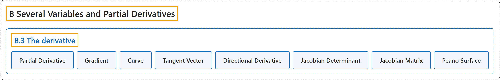

# 8.3 The derivative

## Classification

## Glossary

| Term | Definition | 中文翻译 | Source |
|---|---|---|---|
| **8.3 The derivative** 导数 | (No definition) | （无定义） | [Lebl, 2026, section 8.3](https://www.jirka.org/ra/html/sec_svtheder.html) |
| **Partial Derivative** 偏导数 | "Let $f \colon U \to \mathbb{R}$ be a function on an open set $U \subset \mathbb{R}^n$. If the following limit exists, we write **$\frac{\partial f}{\partial x_j} (x) := \lim_{h\to 0}\frac{f(x_1,\ldots,x_{j-1},x_j+h,x_{j+1},\ldots,x_n)-f(x)}{h} = \lim_{h\to 0}\frac{f(x+h e_j)-f(x)}{h}$**. We call $\frac{\partial f}{\partial x_j} (x)$ the **partial derivative** of $f$ with respect to $x_j$." | 设 $f \colon U \to \mathbb{R}$ 是开集 $U \subset \mathbb{R}^n$ 上的函数。若下列极限存在，就写 **$\frac{\partial f}{\partial x_j} (x) := \lim_{h\to 0}\frac{f(x_1,\ldots,x_{j-1},x_j+h,x_{j+1},\ldots,x_n)-f(x)}{h} = \lim_{h\to 0}\frac{f(x+h e_j)-f(x)}{h}$**。称 $\frac{\partial f}{\partial x_j} (x)$ 为 $f$ 关于 $x_j$ 的**偏导数**。 | [Lebl, 2026, Definition 8.3.8](https://www.jirka.org/ra/html/sec_svtheder.html#sec_svtheder-4-3) |
| **Gradient** 梯度 | "Let $U \subset \mathbb{R}^n$ be open and $f \colon U \to \mathbb{R}$ a differentiable function. We define the **gradient** as **$\nabla f (x) := \sum_{j=1}^n \frac{\partial f}{\partial x_j} (x)\, e_j$**." | 设 $U \subset \mathbb{R}^n$ 是开集，$f \colon U \to \mathbb{R}$ 是可微函数。定义**梯度**为 **$\nabla f (x) := \sum_{j=1}^n \frac{\partial f}{\partial x_j} (x)\, e_j$**。 | [Lebl, 2026, section 8.3](https://www.jirka.org/ra/html/sec_svtheder.html#sec_svtheder-5-2) |
| **Curve** 曲线 | "Suppose **$\gamma \colon (a,b) \subset \mathbb{R} \to \mathbb{R}^n$ is differentiable**. Such a function (and its image) is sometimes called a **curve**, or a **differentiable curve**." | 设 **$\gamma \colon (a,b) \subset \mathbb{R} \to \mathbb{R}^n$ 可微**。这样的函数（及其像）有时称为**曲线**，或**可微曲线**。 | [Lebl, 2026, section 8.3](https://www.jirka.org/ra/html/sec_svtheder.html#sec_svtheder-5-3) |
| **Tangent Vector** 切向量 | "The **vector $\gamma'(t)$** is called a **tangent vector**." | **向量 $\gamma'(t)$** 称为**切向量**。 | [Lebl, 2026, section 8.3](https://www.jirka.org/ra/html/sec_svtheder.html#sec_svtheder-5-3) |
| **Directional Derivative** 方向导数 | "Pick a vector $u \in \mathbb{R}^n$ such that $\lVert u \rVert = 1$, and fix $x \in U$. We define the **directional derivative** as **$D_u f (x) := \frac{d}{dt}\Big|_{t=0} \bigl[ f(x+tu) \bigr] = \lim_{h\to 0} \frac{f(x+hu)-f(x)}{h}$**." | 取满足 $\lVert u \rVert = 1$ 的向量 $u \in \mathbb{R}^n$，固定 $x \in U$。定义**方向导数**为 **$D_u f (x) := \frac{d}{dt}\Big|_{t=0} \bigl[ f(x+tu) \bigr] = \lim_{h\to 0} \frac{f(x+hu)-f(x)}{h}$**。 | [Lebl, 2026, section 8.3](https://www.jirka.org/ra/html/sec_svtheder.html#sec_svtheder-5-8) |
| **Jacobian Determinant** 雅可比行列式 | "Let $U \subset \mathbb{R}^n$ and $f \colon U \to \mathbb{R}^n$ be a differentiable mapping. Define the **Jacobian determinant**, or simply the **Jacobian**, of $f$ at $x$ as **$J_f(x) := \det\bigl( f'(x) \bigr)$**." | 设 $U \subset \mathbb{R}^n$，$f \colon U \to \mathbb{R}^n$ 是可微映射。定义 $f$ 在 $x$ 处的**雅可比行列式**，或简称**雅可比式**，为 **$J_f(x) := \det\bigl( f'(x) \bigr)$**。 | [Lebl, 2026, Definition 8.3.10](https://www.jirka.org/ra/html/sec_svtheder.html#sec_svtheder-6-2) |
| **Jacobian Matrix** 雅可比矩阵 | "The **matrix from Proposition 8.3.9 representing $f'(x)$** is called the **Jacobian matrix**, or sometimes confusingly also called just “the Jacobian.”" | **命题 8.3.9 中表示 $f'(x)$ 的矩阵**称为**雅可比矩阵**，有时也容易混淆地简称为“雅可比式”。 | [Lebl, 2026, Definition 8.3.10](https://www.jirka.org/ra/html/sec_svtheder.html#sec_svtheder-6-2) |
| **Peano Surface** 皮亚诺曲面 | "Define $f(x,y) := ( x-y^2 ) ( 2 y^2 - x)$. **The graph of $f$** is called the **Peano surface**." | 定义 $f(x,y) := ( x-y^2 ) ( 2 y^2 - x)$。**$f$ 的图像**称为**皮亚诺曲面**。 | [Lebl, 2026, Exercise 8.3.11](https://www.jirka.org/ra/html/sec_svtheder.html#exercise_peano) |

## References

Lebl, J. (2026). *Basic analysis I & II: Introduction to real analysis* (May 22, 2026 edition). Retrieved October 29, 2026, from <https://www.jirka.org/ra/html/>
