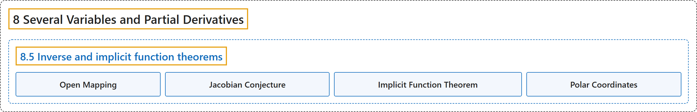

# 8.5 Inverse and implicit function theorems

## Classification

## Glossary

| Term | Definition | 中文翻译 | Source |
|---|---|---|---|
| **8.5 Inverse and implicit function theorems** 反函数定理与隐函数定理 | (No definition) | （无定义） | [Lebl, 2026, section 8.5](https://www.jirka.org/ra/html/sec_svinvfuncthm.html) |
| **Open Mapping** 开映射 | "Suppose $U \subset \mathbb{R}^n$ is open and $f \colon U \to \mathbb{R}^n$ is a continuously differentiable mapping such that $f'(x)$ is invertible for all $x \in U$. Then **for every open set $V \subset U$, the set $f(V)$ is open** ($f$ is said to be an **open mapping**)." | 设 $U \subset \mathbb{R}^n$ 是开集，$f \colon U \to \mathbb{R}^n$ 是连续可微映射，且对所有 $x \in U$，$f'(x)$ 可逆，则**对每个开集 $V \subset U$，集合 $f(V)$ 是开集**（称 $f$ 为**开映射**）。 | [Lebl, 2026, Corollary 8.5.2](https://www.jirka.org/ra/html/sec_svinvfuncthm.html#cor_IVTopenmap) |
| **Jacobian Conjecture** 雅可比猜想 | "As a side note, there is a famous related, and as yet unsolved, problem called the **Jacobian conjecture**. **If $F \colon \mathbb{R}^n \to \mathbb{R}^n$ is polynomial (each component is a polynomial) and $J_F$ (the Jacobian determinant) is a nonzero constant, does $F$ have a polynomial inverse?**" | 顺便一提，有一个与此相关、至今未解决的著名问题，称为**雅可比猜想**：**若 $F \colon \mathbb{R}^n \to \mathbb{R}^n$ 是多项式映射（每个分量都是多项式），且 $J_F$（雅可比行列式）是非零常数，$F$ 是否有多项式逆映射？** | [Lebl, 2026, section 8.5](https://www.jirka.org/ra/html/sec_svinvfuncthm.html#sec_svinvfuncthm-2-15) |
| **Implicit Function Theorem** 隐函数定理 | "Let $U \subset \mathbb{R}^{n+m}$ be an open set and let $f \colon U \to \mathbb{R}^m$ be a $C^1(U)$ mapping. Let $(p,q) \in U$ be a point such that **$f(p,q) = 0$ and such that $\frac{\partial(f_1,\ldots,f_m)}{\partial(y_1,\ldots,y_m)} (p,q) \neq 0$**. Then there exists an open set $W \subset \mathbb{R}^n$ with $p \in W$, an open set $W' \subset \mathbb{R}^m$ with $q \in W'$, where $W \times W' \subset U$, and **a $C^1(W)$ map $g \colon W \to W'$, with $g(p) = q$, and for all $x \in W$, the point $g(x)$ is the unique point in $W'$ such that $f\bigl(x,g(x)\bigr) = 0$**." | 设 $U \subset \mathbb{R}^{n+m}$ 是开集，$f \colon U \to \mathbb{R}^m$ 是 $C^1(U)$ 映射，$(p,q) \in U$ 是满足 **$f(p,q) = 0$ 且 $\frac{\partial(f_1,\ldots,f_m)}{\partial(y_1,\ldots,y_m)} (p,q) \neq 0$** 的点。则存在含 $p$ 的开集 $W \subset \mathbb{R}^n$、含 $q$ 的开集 $W' \subset \mathbb{R}^m$，$W \times W' \subset U$，以及**一个 $C^1(W)$ 映射 $g \colon W \to W'$，$g(p) = q$，并且对所有 $x \in W$，点 $g(x)$ 是 $W'$ 中唯一满足 $f\bigl(x,g(x)\bigr) = 0$ 的点**。 | [Lebl, 2026, Theorem 8.5.6](https://www.jirka.org/ra/html/sec_svinvfuncthm.html#thm_implicit) |
| **Polar Coordinates** 极坐标 | "(**Polar coordinates**) Define a mapping **$F(r,\theta) := \bigl(r \cos(\theta), r \sin(\theta) \bigr)$**." | （**极坐标**）定义映射 **$F(r,\theta) := \bigl(r \cos(\theta), r \sin(\theta) \bigr)$**。 | [Lebl, 2026, Exercise 8.5.8](https://www.jirka.org/ra/html/sec_svinvfuncthm.html#mv_exercise_polarcoordinates) |

## References

Lebl, J. (2026). *Basic analysis I & II: Introduction to real analysis* (May 22, 2026 edition). Retrieved October 29, 2026, from <https://www.jirka.org/ra/html/>
