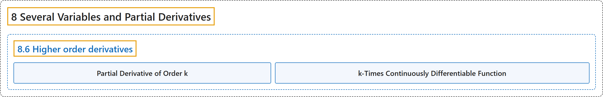

# 8.6 Higher order derivatives

## Classification

## Glossary

| Term | Definition | 中文翻译 | Source |
|---|---|---|---|
| **8.6 Higher order derivatives** 高阶导数 | (No definition) | （无定义） | [Lebl, 2026, section 8.6](https://www.jirka.org/ra/html/sec_mvhighordders.html) |
| **Partial Derivative of Order k** k 阶偏导数 | "Then the partial derivative with respect to that variable is denoted by $\frac{\partial^{k} f}{\partial x_{{\ell}_{k}} \partial x_{{\ell}_{k-1}} \cdots \partial x_{{\ell}_1}} := \frac{\partial \Bigl( \frac{\partial^{k-1} f}{\partial x_{{\ell}_{k-1}} \partial x_{{\ell}_{k-2}} \cdots \partial x_{{\ell}_1}} \Bigr)}{\partial x_{{\ell}_{k}}}$. Such a derivative is called a **partial derivative of order $k$**." | 这时关于该变量的偏导数记作 $\frac{\partial^{k} f}{\partial x_{{\ell}_{k}} \partial x_{{\ell}_{k-1}} \cdots \partial x_{{\ell}_1}} := \frac{\partial \Bigl( \frac{\partial^{k-1} f}{\partial x_{{\ell}_{k-1}} \partial x_{{\ell}_{k-2}} \cdots \partial x_{{\ell}_1}} \Bigr)}{\partial x_{{\ell}_{k}}}$。这样的导数称为 **$k$ 阶偏导数**。 | [Lebl, 2026, section 8.6](https://www.jirka.org/ra/html/sec_mvhighordders.html#sec_mvhighordders-4) |
| **k-Times Continuously Differentiable Function** k 次连续可微函数 | "Suppose $U \subset \mathbb{R}^n$ is an open set and $f \colon U \to \mathbb{R}$ is a function. We say $f$ is a **$k$-times continuously differentiable function**, or a **$C^k$ function**, if **all partial derivatives of all orders up to and including order $k$ exist and are continuous**." | 设 $U \subset \mathbb{R}^n$ 是开集，$f \colon U \to \mathbb{R}$ 是函数。若**直到 $k$ 阶（含 $k$ 阶）的所有偏导数都存在且连续**，则称 $f$ 是 **$k$ 次连续可微函数**，或 **$C^k$ 函数**。 | [Lebl, 2026, Definition 8.6.1](https://www.jirka.org/ra/html/sec_mvhighordders.html#sec_mvhighordders-6) |

## References

Lebl, J. (2026). *Basic analysis I & II: Introduction to real analysis* (May 22, 2026 edition). Retrieved October 29, 2026, from <https://www.jirka.org/ra/html/>
