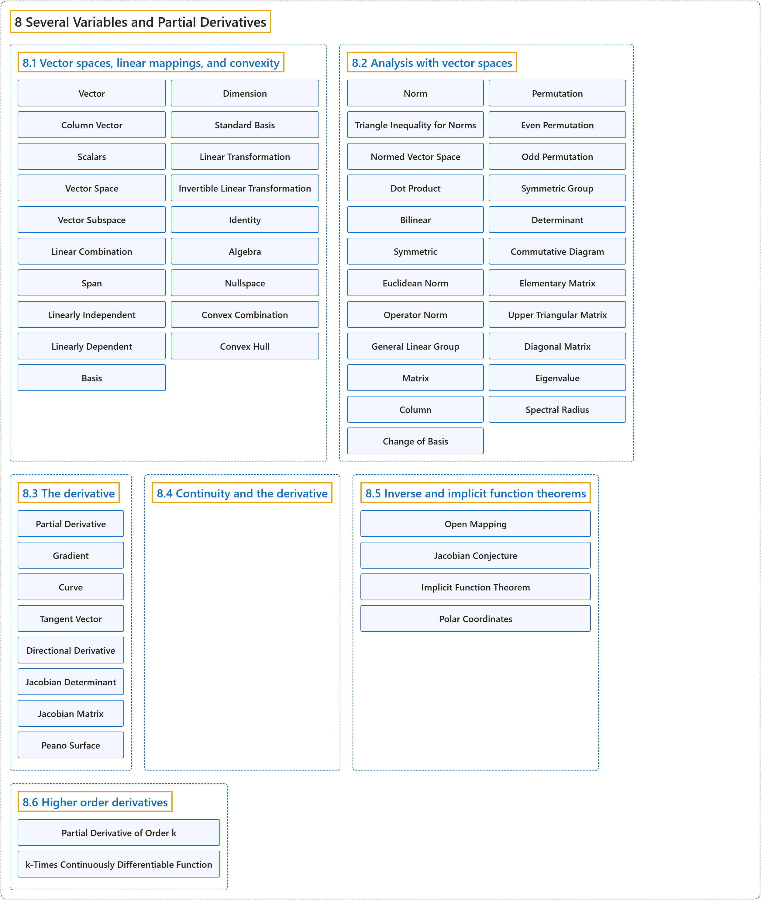

# 8 Several Variables and Partial Derivatives

## Classification

## Glossary

| Term | Definition | 中文翻译 | Source |
|---|---|---|---|
| **8 Several Variables and Partial Derivatives** 多变量与偏导数 | (No definition) | （无定义） | [Lebl, 2026, chapter 8](https://www.jirka.org/ra/html/pd_chapter.html) |
| **[8.1 Vector spaces, linear mappings, and convexity](8-1-vector-spaces-linear-mappings-and-convexity.md)** 向量空间、线性映射与凸性 | (No definition) | （无定义） | [Lebl, 2026, section 8.1](https://www.jirka.org/ra/html/sec_vectorspaces.html) |
| **[8.2 Analysis with vector spaces](8-2-analysis-with-vector-spaces.md)** 向量空间上的分析 | (No definition) | （无定义） | [Lebl, 2026, section 8.2](https://www.jirka.org/ra/html/sec_normsmatsdets.html) |
| **[8.3 The derivative](8-3-the-derivative.md)** 导数 | (No definition) | （无定义） | [Lebl, 2026, section 8.3](https://www.jirka.org/ra/html/sec_svtheder.html) |
| **[8.4 Continuity and the derivative](8-4-continuity-and-the-derivative.md)** 连续性与导数 | (No definition) | （无定义） | [Lebl, 2026, section 8.4](https://www.jirka.org/ra/html/sec_svthedercont.html) |
| **[8.5 Inverse and implicit function theorems](8-5-inverse-and-implicit-function-theorems.md)** 反函数定理与隐函数定理 | (No definition) | （无定义） | [Lebl, 2026, section 8.5](https://www.jirka.org/ra/html/sec_svinvfuncthm.html) |
| **[8.6 Higher order derivatives](8-6-higher-order-derivatives.md)** 高阶导数 | (No definition) | （无定义） | [Lebl, 2026, section 8.6](https://www.jirka.org/ra/html/sec_mvhighordders.html) |

## References

Lebl, J. (2026). *Basic analysis I & II: Introduction to real analysis* (May 22, 2026 edition). Retrieved October 29, 2026, from <https://www.jirka.org/ra/html/>
