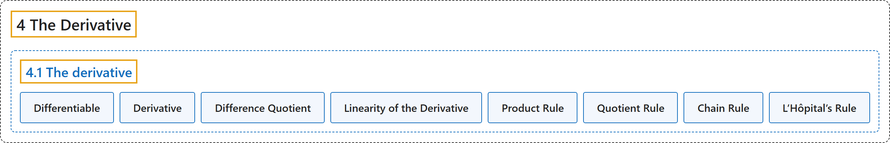

# 4.1 The derivative

## Classification

## Glossary

| Term | Definition | 中文翻译 | Source |
|---|---|---|---|
| **4.1 The derivative** 导数 | (No definition) | （无定义） | [Lebl, 2026, section 4.1](https://www.jirka.org/ra/html/sec_der.html) |
| **Differentiable** 可微 | "Let $I$ be an interval, let $f \colon I \to \mathbb{R}$ be a function, and let $c \in I$. If **the limit $L := \lim_{x \to c} \frac{f(x)-f(c)}{x-c}$ exists**, then we say $f$ is **differentiable at $c$**." | 设 $I$ 是区间，$f \colon I \to \mathbb{R}$ 是函数，$c \in I$。若**极限 $L := \lim_{x \to c} \frac{f(x)-f(c)}{x-c}$ 存在**，则称 $f$ **在 $c$ 处可微**。 | [Lebl, 2026, Definition 4.1.1](https://www.jirka.org/ra/html/sec_der.html#sec_der-3-2) |
| **Derivative** 导数 | "If the limit exists, then we say $f$ is differentiable at $c$, we call **$L$** the **derivative** of $f$ at $c$, and we write $f'(c) := L$." | 若该极限存在，就称 $f$ 在 $c$ 处可微，称 **$L$** 为 $f$ 在 $c$ 处的**导数**，记作 $f'(c) := L$。 | [Lebl, 2026, Definition 4.1.1](https://www.jirka.org/ra/html/sec_der.html#sec_der-3-2) |
| **Difference Quotient** 差商 | "The expression **$\frac{f(x)-f(c)}{x-c}$** is called the **difference quotient**." | 表达式 **$\frac{f(x)-f(c)}{x-c}$** 称为**差商**。 | [Lebl, 2026, Definition 4.1.1](https://www.jirka.org/ra/html/sec_der.html#sec_der-3-2) |
| **Linearity of the Derivative** 导数的线性 | "Let $I$ be an interval, let $f \colon I \to \mathbb{R}$ and $g \colon I \to \mathbb{R}$ be differentiable at $c \in I$, and let $\alpha \in \mathbb{R}$. Define $h \colon I \to \mathbb{R}$ by $h(x) := \alpha f(x)$. Then $h$ is differentiable at $c$ and **$h'(c) = \alpha f'(c)$**. Define $h \colon I \to \mathbb{R}$ by $h(x) := f(x) + g(x)$. Then $h$ is differentiable at $c$ and **$h'(c) = f'(c) + g'(c)$**." | 设 $I$ 是区间，$f \colon I \to \mathbb{R}$ 与 $g \colon I \to \mathbb{R}$ 在 $c \in I$ 处可微，$\alpha \in \mathbb{R}$。定义 $h(x) := \alpha f(x)$，则 $h$ 在 $c$ 处可微且 **$h'(c) = \alpha f'(c)$**；定义 $h(x) := f(x) + g(x)$，则 $h$ 在 $c$ 处可微且 **$h'(c) = f'(c) + g'(c)$**。 | [Lebl, 2026, Proposition 4.1.7](https://www.jirka.org/ra/html/sec_der.html#sec_der-3-16) |
| **Product Rule** 乘积法则 | "Let $I$ be an interval, let $f \colon I \to \mathbb{R}$ and $g \colon I \to \mathbb{R}$ be functions differentiable at $c$. If $h \colon I \to \mathbb{R}$ is defined by $h(x) := f(x) g(x)$, then $h$ is differentiable at $c$ and **$h'(c) = f(c) g'(c) + f'(c) g(c)$**." | 设 $I$ 是区间，函数 $f \colon I \to \mathbb{R}$ 与 $g \colon I \to \mathbb{R}$ 在 $c$ 处可微。若 $h \colon I \to \mathbb{R}$ 定义为 $h(x) := f(x) g(x)$，则 $h$ 在 $c$ 处可微且 **$h'(c) = f(c) g'(c) + f'(c) g(c)$**。 | [Lebl, 2026, Proposition 4.1.8](https://www.jirka.org/ra/html/sec_der.html#sec_der-3-19) |
| **Quotient Rule** 商法则 | "Let $I$ be an interval, let $f \colon I \to \mathbb{R}$ and $g \colon I \to \mathbb{R}$ be differentiable at $c$ and $g(x) \neq 0$ for all $x \in I$. If $h \colon I \to \mathbb{R}$ is defined by $h(x) := \frac{f(x)}{g(x)}$, then $h$ is differentiable at $c$ and **$h'(c) = \frac{f'(c) g(c) - f(c) g'(c)}{{\bigl(g(c)\bigr)}^2}$**." | 设 $I$ 是区间，$f \colon I \to \mathbb{R}$ 与 $g \colon I \to \mathbb{R}$ 在 $c$ 处可微，且对所有 $x \in I$ 有 $g(x) \neq 0$。若 $h(x) := \frac{f(x)}{g(x)}$，则 $h$ 在 $c$ 处可微且 **$h'(c) = \frac{f'(c) g(c) - f(c) g'(c)}{{\bigl(g(c)\bigr)}^2}$**。 | [Lebl, 2026, Proposition 4.1.9](https://www.jirka.org/ra/html/sec_der.html#sec_der-3-24) |
| **Chain Rule** 链式法则 | "Let $I_1, I_2$ be intervals, let $g \colon I_1 \to I_2$ be differentiable at $c \in I_1$, and $f \colon I_2 \to \mathbb{R}$ be differentiable at $g(c)$. If $h \colon I_1 \to \mathbb{R}$ is defined by $h(x) := (f \circ g) (x) = f\bigl(g(x)\bigr)$, then $h$ is differentiable at $c$ and **$h'(c) = f'\bigl(g(c)\bigr)g'(c)$**." | 设 $I_1, I_2$ 是区间，$g \colon I_1 \to I_2$ 在 $c \in I_1$ 处可微，$f \colon I_2 \to \mathbb{R}$ 在 $g(c)$ 处可微。若 $h(x) := (f \circ g) (x) = f\bigl(g(x)\bigr)$，则 $h$ 在 $c$ 处可微且 **$h'(c) = f'\bigl(g(c)\bigr)g'(c)$**。 | [Lebl, 2026, Proposition 4.1.10](https://www.jirka.org/ra/html/sec_der.html#sec_der-4-3) |
| **L’Hôpital’s Rule** 洛必达法则 | "Prove the following simple version of **L’Hôpital’s rule**. Suppose $f \colon (a,b) \to \mathbb{R}$ and $g \colon (a,b) \to \mathbb{R}$ are differentiable functions whose derivatives $f'$ and $g'$ are continuous functions. Suppose that at $c \in (a,b)$, $f(c) = 0$, $g(c)=0$, $g'(x) \neq 0$ for all $x \in (a,b)$, and $g(x) \neq 0$ whenever $x \neq c$. Show that **$\lim_{x \to c} \frac{f(x)}{g(x)} = \lim_{x \to c} \frac{f'(x)}{g'(x)}$**." | 证明下面这个简单版本的**洛必达法则**：设 $f \colon (a,b) \to \mathbb{R}$ 与 $g \colon (a,b) \to \mathbb{R}$ 是导数 $f'$、$g'$ 连续的可微函数，且在 $c \in (a,b)$ 处 $f(c) = 0$，$g(c)=0$，对所有 $x \in (a,b)$ 有 $g'(x) \neq 0$，$x \neq c$ 时 $g(x) \neq 0$。证明 **$\lim_{x \to c} \frac{f(x)}{g(x)} = \lim_{x \to c} \frac{f'(x)}{g'(x)}$**。 | [Lebl, 2026, Exercise 4.1.15](https://www.jirka.org/ra/html/sec_der.html#exercise_simpleLHopital) |

## References

Lebl, J. (2026). *Basic analysis I & II: Introduction to real analysis* (May 22, 2026 edition). Retrieved October 29, 2026, from <https://www.jirka.org/ra/html/>
