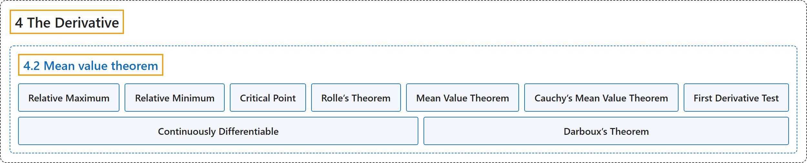

# 4.2 Mean value theorem

## Classification

## Glossary

| Term | Definition | 中文翻译 | Source |
|---|---|---|---|
| **4.2 Mean value theorem** 中值定理 | (No definition) | （无定义） | [Lebl, 2026, section 4.2](https://www.jirka.org/ra/html/sec_mvt.html) |
| **Relative Maximum** 相对极大值 | "Let $S \subset \mathbb{R}$ be a set and let $f \colon S \to \mathbb{R}$ be a function. The function $f$ is said to have a **relative maximum** at $c \in S$ if **there exists a $\delta>0$ such that for all $x \in S$ where $\lvert x-c \rvert < \delta$, we have $f(x) \leq f(c)$**." | 设 $S \subset \mathbb{R}$ 是集合，$f \colon S \to \mathbb{R}$ 是函数。若**存在 $\delta>0$，使得对所有满足 $\lvert x-c \rvert < \delta$ 的 $x \in S$ 有 $f(x) \leq f(c)$**，则称 $f$ 在 $c \in S$ 处有**相对极大值**。 | [Lebl, 2026, Definition 4.2.1](https://www.jirka.org/ra/html/sec_mvt.html#sec_mvt-3-3) |
| **Relative Minimum** 相对极小值 | "The definition of **relative minimum** is **analogous**." | **相对极小值**的定义**类似**。 | [Lebl, 2026, Definition 4.2.1](https://www.jirka.org/ra/html/sec_mvt.html#sec_mvt-3-3) |
| **Critical Point** 临界点 | "For a differentiable function, **a point where $f'(c) = 0$** is called a **critical point**." | 对可微函数，**使 $f'(c) = 0$ 的点**称为**临界点**。 | [Lebl, 2026, section 4.2](https://www.jirka.org/ra/html/sec_mvt.html#sec_mvt-3-6) |
| **Rolle’s Theorem** 罗尔定理 | "Let $f \colon [a,b] \to \mathbb{R}$ be a continuous function differentiable on $(a,b)$ such that **$f(a) = f(b)$**. Then **there exists a $c \in (a,b)$ such that $f'(c) = 0$**." | 设 $f \colon [a,b] \to \mathbb{R}$ 是在 $(a,b)$ 上可微的连续函数，且 **$f(a) = f(b)$**，则**存在 $c \in (a,b)$ 使得 $f'(c) = 0$**。 | [Lebl, 2026, Theorem 4.2.3](https://www.jirka.org/ra/html/sec_mvt.html#thm_rolle) |
| **Mean Value Theorem** 中值定理 | "Let $f \colon [a,b] \to \mathbb{R}$ be a continuous function differentiable on $(a,b)$. Then **there exists a point $c \in (a,b)$ such that $f(b)-f(a) = f'(c)(b-a)$**." | 设 $f \colon [a,b] \to \mathbb{R}$ 是在 $(a,b)$ 上可微的连续函数，则**存在点 $c \in (a,b)$ 使得 $f(b)-f(a) = f'(c)(b-a)$**。 | [Lebl, 2026, Theorem 4.2.4](https://www.jirka.org/ra/html/sec_mvt.html#thm_mvt) |
| **Cauchy’s Mean Value Theorem** 柯西中值定理 | "Let $f \colon [a,b] \to \mathbb{R}$ and $\varphi \colon [a,b] \to \mathbb{R}$ be continuous functions differentiable on $(a,b)$. Then **there exists a point $c \in (a,b)$ such that $\bigl(f(b)-f(a)\bigr)\varphi'(c) = f'(c)\bigl(\varphi(b)-\varphi(a)\bigr)$**." | 设 $f \colon [a,b] \to \mathbb{R}$ 与 $\varphi \colon [a,b] \to \mathbb{R}$ 是在 $(a,b)$ 上可微的连续函数，则**存在点 $c \in (a,b)$ 使得 $\bigl(f(b)-f(a)\bigr)\varphi'(c) = f'(c)\bigl(\varphi(b)-\varphi(a)\bigr)$**。 | [Lebl, 2026, Theorem 4.2.5](https://www.jirka.org/ra/html/sec_mvt.html#thm_cauchymvt) |
| **First Derivative Test** 一阶导数判别法 | "Let $f \colon (a,b) \to \mathbb{R}$ be continuous. Let $c \in (a,b)$ and suppose $f$ is differentiable on $(a,c)$ and $(c,b)$. **If $f'(x) \leq 0$ whenever $x \in (a,c)$ and $f'(x) \geq 0$ whenever $x \in (c,b)$, then $f$ has an absolute minimum at $c$.** If $f'(x) \geq 0$ whenever $x \in (a,c)$ and $f'(x) \leq 0$ whenever $x \in (c,b)$, then $f$ has an absolute maximum at $c$." | 设 $f \colon (a,b) \to \mathbb{R}$ 连续，$c \in (a,b)$，且 $f$ 在 $(a,c)$ 和 $(c,b)$ 上可微。**若 $x \in (a,c)$ 时 $f'(x) \leq 0$，$x \in (c,b)$ 时 $f'(x) \geq 0$，则 $f$ 在 $c$ 处取得绝对最小值**。若 $x \in (a,c)$ 时 $f'(x) \geq 0$，$x \in (c,b)$ 时 $f'(x) \leq 0$，则 $f$ 在 $c$ 处取得绝对最大值。 | [Lebl, 2026, Proposition 4.2.9](https://www.jirka.org/ra/html/sec_mvt.html#firstderminmaxtest) |
| **Continuously Differentiable** 连续可微 | "If $f \colon I \to \mathbb{R}$ is differentiable and **the derivative $f'$ is continuous on $I$**, then we say $f$ is **continuously differentiable**." | 若 $f \colon I \to \mathbb{R}$ 可微且**导数 $f'$ 在 $I$ 上连续**，则称 $f$ **连续可微**。 | [Lebl, 2026, section 4.2](https://www.jirka.org/ra/html/sec_mvt.html#sec_mvt-7-11) |
| **Darboux’s Theorem** 达布定理 | "Let $f \colon [a,b] \to \mathbb{R}$ be differentiable. Suppose $y \in \mathbb{R}$ is such that **$f'(a) < y < f'(b)$ or $f'(a) > y > f'(b)$**. Then **there exists a $c \in (a,b)$ such that $f'(c) = y$**." | 设 $f \colon [a,b] \to \mathbb{R}$ 可微，$y \in \mathbb{R}$ 满足 **$f'(a) < y < f'(b)$ 或 $f'(a) > y > f'(b)$**，则**存在 $c \in (a,b)$ 使得 $f'(c) = y$**。 | [Lebl, 2026, Theorem 4.2.11](https://www.jirka.org/ra/html/sec_mvt.html#thm_darboux) |

## References

Lebl, J. (2026). *Basic analysis I & II: Introduction to real analysis* (May 22, 2026 edition). Retrieved October 29, 2026, from <https://www.jirka.org/ra/html/>
