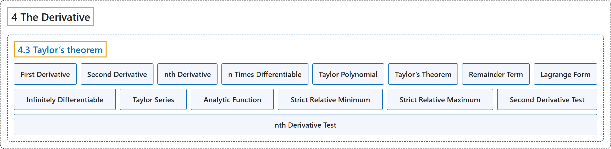

# 4.3 Taylor’s theorem

## Classification

## Glossary

| Term | Definition | 中文翻译 | Source |
|---|---|---|---|
| **4.3 Taylor’s theorem** 泰勒定理 | (No definition) | （无定义） | [Lebl, 2026, section 4.3](https://www.jirka.org/ra/html/sec_taylor.html) |
| **First Derivative** 一阶导数 | "When $f \colon I \to \mathbb{R}$ is differentiable, we obtain a function $f' \colon I \to \mathbb{R}$. The **function $f'$** is called the **first derivative** of $f$." | 当 $f \colon I \to \mathbb{R}$ 可微时，得到函数 $f' \colon I \to \mathbb{R}$。**函数 $f'$** 称为 $f$ 的**一阶导数**。 | [Lebl, 2026, section 4.3](https://www.jirka.org/ra/html/sec_taylor.html#sec_taylor-3-2) |
| **Second Derivative** 二阶导数 | "If $f'$ is differentiable, we denote by $f'' \colon I \to \mathbb{R}$ **the derivative of $f'$**. The function $f''$ is called the **second derivative** of $f$." | 若 $f'$ 可微，用 $f'' \colon I \to \mathbb{R}$ 表示 **$f'$ 的导数**。函数 $f''$ 称为 $f$ 的**二阶导数**。 | [Lebl, 2026, section 4.3](https://www.jirka.org/ra/html/sec_taylor.html#sec_taylor-3-2) |
| **nth Derivative** n 阶导数 | "With a larger number of derivatives the notation would get out of hand; we denote by **$f^{(n)}$** the **$n$th derivative** of $f$." | 导数阶数多了，记号会失控；我们用 **$f^{(n)}$** 表示 $f$ 的 **$n$ 阶导数**。 | [Lebl, 2026, section 4.3](https://www.jirka.org/ra/html/sec_taylor.html#sec_taylor-3-2) |
| **n Times Differentiable** n 次可微 | "When **$f$ possesses $n$ derivatives**, we say $f$ is **$n$ times differentiable**." | 当 **$f$ 有 $n$ 阶导数**时，称 $f$ **$n$ 次可微**。 | [Lebl, 2026, section 4.3](https://www.jirka.org/ra/html/sec_taylor.html#sec_taylor-3-2) |
| **Taylor Polynomial** 泰勒多项式 | "For an $n$ times differentiable function $f$ defined near a point $x_0 \in \mathbb{R}$, define the **$n$th order Taylor polynomial** for $f$ at $x_0$ as **$P_n^{x_0}(x) := \sum_{k=0}^n \frac{f^{(k)}(x_0)}{k!}{(x-x_0)}^k$**." | 对在点 $x_0 \in \mathbb{R}$ 附近有定义的 $n$ 次可微函数 $f$，定义 $f$ 在 $x_0$ 处的 **$n$ 阶泰勒多项式**为 **$P_n^{x_0}(x) := \sum_{k=0}^n \frac{f^{(k)}(x_0)}{k!}{(x-x_0)}^k$**。 | [Lebl, 2026, Definition 4.3.1](https://www.jirka.org/ra/html/sec_taylor.html#sec_taylor-4-3) |
| **Taylor’s Theorem** 泰勒定理 | "Suppose $f \colon [a,b] \to \mathbb{R}$ is a function with $n$ continuous derivatives on $[a,b]$ and such that $f^{(n+1)}$ exists on $(a,b)$. Given distinct points $x_0$ and $x$ in $[a,b]$, **there is a point $c$ between $x_0$ and $x$ such that $f(x)=P_{n}^{x_0}(x)+\frac{f^{(n+1)}(c)}{(n+1)!}{(x-x_0)}^{n+1}$**." | 设 $f \colon [a,b] \to \mathbb{R}$ 在 $[a,b]$ 上有 $n$ 阶连续导数，且 $f^{(n+1)}$ 在 $(a,b)$ 上存在。给定 $[a,b]$ 中不同的点 $x_0$ 与 $x$，**存在介于 $x_0$ 与 $x$ 之间的点 $c$，使得 $f(x)=P_{n}^{x_0}(x)+\frac{f^{(n+1)}(c)}{(n+1)!}{(x-x_0)}^{n+1}$**。 | [Lebl, 2026, Theorem 4.3.2](https://www.jirka.org/ra/html/sec_taylor.html#thm_taylor) |
| **Remainder Term** 余项 | "The term **$R_n^{x_0}(x):= f(x)-P_n^{x_0}(x) = \frac{f^{(n+1)}(c)}{(n+1)!}{(x-x_0)}^{n+1}$** is called the **remainder term**." | 项 **$R_n^{x_0}(x):= f(x)-P_n^{x_0}(x) = \frac{f^{(n+1)}(c)}{(n+1)!}{(x-x_0)}^{n+1}$** 称为**余项**。 | [Lebl, 2026, section 4.3](https://www.jirka.org/ra/html/sec_taylor.html#sec_taylor-4-10) |
| **Lagrange Form** 拉格朗日型 | "**This form** is called the **Lagrange form** of the remainder." | **这种形式**称为余项的**拉格朗日型**。 | [Lebl, 2026, section 4.3](https://www.jirka.org/ra/html/sec_taylor.html#sec_taylor-4-10) |
| **Infinitely Differentiable** 无穷次可微 | "If $f$ is **infinitely differentiable**, that is, if **$f$ can be differentiated any number of times**, then we define the Taylor series:" | 若 $f$ **无穷次可微**，即 **$f$ 可以求任意多次导数**，就定义泰勒级数： | [Lebl, 2026, section 4.3](https://www.jirka.org/ra/html/sec_taylor.html#sec_taylor-4-17) |
| **Taylor Series** 泰勒级数 | "If $f$ is infinitely differentiable, that is, if $f$ can be differentiated any number of times, then we define the **Taylor series**: **$\sum_{k=0}^\infty \frac{f^{(k)}(x_0)}{k!}{(x-x_0)}^k$**." | 若 $f$ 无穷次可微，即 $f$ 可以求任意多次导数，就定义**泰勒级数**：**$\sum_{k=0}^\infty \frac{f^{(k)}(x_0)}{k!}{(x-x_0)}^k$**。 | [Lebl, 2026, section 4.3](https://www.jirka.org/ra/html/sec_taylor.html#sec_taylor-4-17) |
| **Analytic Function** 解析函数 | "Functions $f$ **whose Taylor series at every point $x_0$ converges to $f$ in some open interval containing $x_0$** are called **analytic functions**." | **在每一点 $x_0$ 处的泰勒级数都在某个包含 $x_0$ 的开区间内收敛到 $f$** 的函数 $f$，称为**解析函数**。 | [Lebl, 2026, section 4.3](https://www.jirka.org/ra/html/sec_taylor.html#sec_taylor-4-17) |
| **Strict Relative Minimum** 严格相对极小值 | "By a **strict relative minimum** of $f$ at $c$, we mean that **there exists a $\delta > 0$ such that $f(x) > f(c)$ for all $x \in (c-\delta,c+\delta)$ where $x\neq c$**." | $f$ 在 $c$ 处有**严格相对极小值**，是指**存在 $\delta > 0$，使得对所有 $x \neq c$ 的 $x \in (c-\delta,c+\delta)$ 有 $f(x) > f(c)$**。 | [Lebl, 2026, section 4.3](https://www.jirka.org/ra/html/sec_taylor.html#sec_taylor-4-19) |
| **Strict Relative Maximum** 严格相对极大值 | "A **strict relative maximum** is **defined similarly**." | **严格相对极大值**的定义**类似**。 | [Lebl, 2026, section 4.3](https://www.jirka.org/ra/html/sec_taylor.html#sec_taylor-4-19) |
| **Second Derivative Test** 二阶导数判别法 | "Suppose $f \colon (a,b) \to \mathbb{R}$ is twice continuously differentiable, $x_0 \in (a,b)$, **$f'(x_0) = 0$ and $f''(x_0) > 0$**. Then **$f$ has a strict relative minimum at $x_0$**." | 设 $f \colon (a,b) \to \mathbb{R}$ 二次连续可微，$x_0 \in (a,b)$，**$f'(x_0) = 0$ 且 $f''(x_0) > 0$**，则 **$f$ 在 $x_0$ 处有严格相对极小值**。 | [Lebl, 2026, Proposition 4.3.3](https://www.jirka.org/ra/html/sec_taylor.html#sec_taylor-4-20) |
| **nth Derivative Test** n 阶导数判别法 | "Suppose $n \in \mathbb{N}$, $x_0 \in (a,b)$, and $f \colon (a,b) \to \mathbb{R}$ is $n$ times continuously differentiable, with **$f^{(k)}(x_0) = 0$ for $k=1,2,\ldots,n-1$, and $f^{(n)}(x_0) \neq 0$**. Prove: **If $n$ is odd, then $f$ has neither a relative minimum, nor a maximum at $x_0$. If $n$ is even, then $f$ has a strict relative minimum at $x_0$ if $f^{(n)}(x_0) > 0$ and a strict relative maximum at $x_0$ if $f^{(n)}(x_0) < 0$.**" | 设 $n \in \mathbb{N}$，$x_0 \in (a,b)$，$f \colon (a,b) \to \mathbb{R}$ $n$ 次连续可微，且 **$k=1,2,\ldots,n-1$ 时 $f^{(k)}(x_0) = 0$，$f^{(n)}(x_0) \neq 0$**。证明：**若 $n$ 为奇数，则 $f$ 在 $x_0$ 处既无相对极小值也无极大值；若 $n$ 为偶数，则 $f^{(n)}(x_0) > 0$ 时 $f$ 在 $x_0$ 处有严格相对极小值，$f^{(n)}(x_0) < 0$ 时有严格相对极大值。** | [Lebl, 2026, Exercise 4.3.10](https://www.jirka.org/ra/html/sec_taylor.html#sec_taylor-5-10) |

## References

Lebl, J. (2026). *Basic analysis I & II: Introduction to real analysis* (May 22, 2026 edition). Retrieved October 29, 2026, from <https://www.jirka.org/ra/html/>
