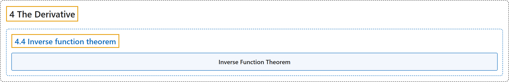

# 4.4 Inverse function theorem

## Classification

## Glossary

| Term | Definition | 中文翻译 | Source |
|---|---|---|---|
| **4.4 Inverse function theorem** 反函数定理 | (No definition) | （无定义） | [Lebl, 2026, section 4.4](https://www.jirka.org/ra/html/sec_ift.html) |
| **Inverse Function Theorem** 反函数定理 | "Let $f \colon (a,b) \to \mathbb{R}$ be a continuously differentiable function, $x_0 \in (a,b)$ a point where **$f'(x_0) \neq 0$**. Then **there exists an open interval $I \subset (a,b)$ with $x_0 \in I$, the restriction $f|_{I}$ is injective with a continuously differentiable inverse $g \colon J \to I$** defined on an interval $J := f(I)$, and $g'(y) = \frac{1}{f'\bigl( g(y) \bigr)} \qquad \text{for all } y \in J.$" | 设 $f \colon (a,b) \to \mathbb{R}$ 连续可微，$x_0 \in (a,b)$ 是满足 **$f'(x_0) \neq 0$** 的点，则**存在包含 $x_0$ 的开区间 $I \subset (a,b)$，使限制 $f|_{I}$ 是单射，且有连续可微的反函数 $g \colon J \to I$**，定义在区间 $J := f(I)$ 上，并且 $g'(y) = \frac{1}{f'\bigl( g(y) \bigr)} \qquad \text{for all } y \in J.$ | [Lebl, 2026, Theorem 4.4.2](https://www.jirka.org/ra/html/sec_ift.html#sec_ift-3-6) |

## References

Lebl, J. (2026). *Basic analysis I & II: Introduction to real analysis* (May 22, 2026 edition). Retrieved October 29, 2026, from <https://www.jirka.org/ra/html/>
