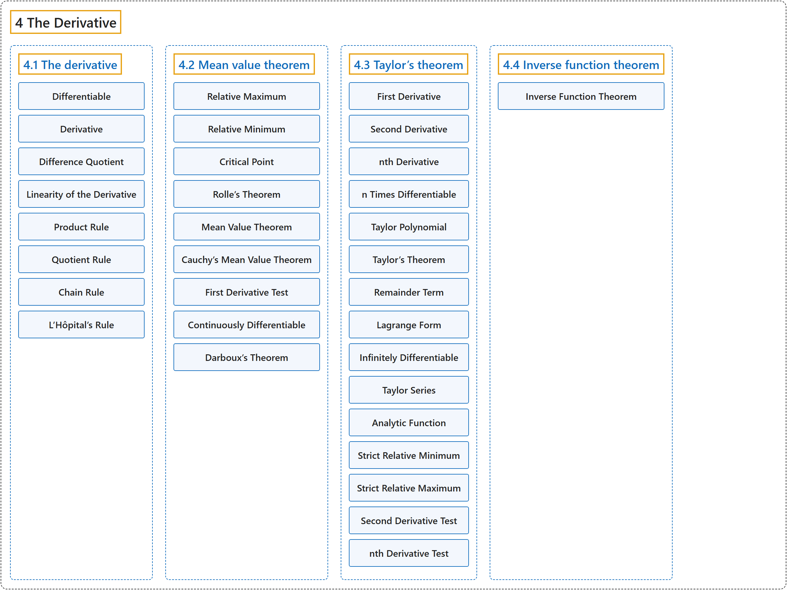

# 4 The Derivative

## Classification

## Glossary

| Term | Definition | 中文翻译 | Source |
|---|---|---|---|
| **4 The Derivative** 导数 | (No definition) | （无定义） | [Lebl, 2026, chapter 4](https://www.jirka.org/ra/html/der_chapter.html) |
| **[4.1 The derivative](4-1-the-derivative.md)** 导数 | (No definition) | （无定义） | [Lebl, 2026, section 4.1](https://www.jirka.org/ra/html/sec_der.html) |
| **[4.2 Mean value theorem](4-2-mean-value-theorem.md)** 中值定理 | (No definition) | （无定义） | [Lebl, 2026, section 4.2](https://www.jirka.org/ra/html/sec_mvt.html) |
| **[4.3 Taylor’s theorem](4-3-taylors-theorem.md)** 泰勒定理 | (No definition) | （无定义） | [Lebl, 2026, section 4.3](https://www.jirka.org/ra/html/sec_taylor.html) |
| **[4.4 Inverse function theorem](4-4-inverse-function-theorem.md)** 反函数定理 | (No definition) | （无定义） | [Lebl, 2026, section 4.4](https://www.jirka.org/ra/html/sec_ift.html) |

## References

Lebl, J. (2026). *Basic analysis I & II: Introduction to real analysis* (May 22, 2026 edition). Retrieved October 29, 2026, from <https://www.jirka.org/ra/html/>
