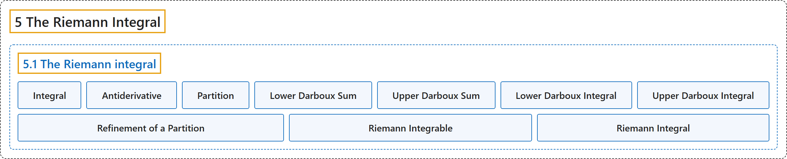

# 5.1 The Riemann integral

## Classification

## Glossary

| Term | Definition | 中文翻译 | Source |
|---|---|---|---|
| **5.1 The Riemann integral** 黎曼积分 | (No definition) | （无定义） | [Lebl, 2026, section 5.1](https://www.jirka.org/ra/html/sec_rint.html) |
| **Integral** 积分 | "An **integral** is **a way to “sum” the values of a function**." | **积分**是**对函数值“求和”的一种方式**。 | [Lebl, 2026, section 5.1](https://www.jirka.org/ra/html/sec_rint.html#sec_rint-2) |
| **Antiderivative** 原函数 | "There is sometimes confusion among students of calculus between the integral and the **antiderivative**. The integral is (informally) the area under the curve, nothing else. That **we can compute an antiderivative using the integral** is a nontrivial result we must prove." | 学微积分的学生有时会混淆积分与**原函数**。积分（非正式地说）就是曲线下的面积，别无其他。**可以用积分求出原函数**，是一个必须证明的非平凡结果。 | [Lebl, 2026, section 5.1](https://www.jirka.org/ra/html/sec_rint.html#sec_rint-2) |
| **Partition** 划分 | "A **partition** $P$ of $[a,b]$ is **a finite set of numbers $\{ x_0,x_1,x_2,\ldots,x_n \}$ such that $a = x_0 < x_1 < x_2 < \cdots < x_{n-1} < x_n = b$**." | $[a,b]$ 的**划分** $P$ 是**满足 $a = x_0 < x_1 < x_2 < \cdots < x_{n-1} < x_n = b$ 的有限数集 $\{ x_0,x_1,x_2,\ldots,x_n \}$**。 | [Lebl, 2026, Definition 5.1.1](https://www.jirka.org/ra/html/sec_rint.html#sec_rint-3-3) |
| **Lower Darboux Sum** 下达布和 | "Suppose $f \colon [a,b] \to \mathbb{R}$ is bounded and $P$ is a partition of $[a,b]$. Define $m_i := \inf \, \bigl\{ f(x) : x_{i-1} \leq x \leq x_i \bigr\}$, $L(P,f) := \sum_{i=1}^n m_i \Delta x_i$. We call **$L(P,f)$** the **lower Darboux sum**." | 设 $f \colon [a,b] \to \mathbb{R}$ 有界，$P$ 是 $[a,b]$ 的划分。定义 $m_i := \inf \, \bigl\{ f(x) : x_{i-1} \leq x \leq x_i \bigr\}$，$L(P,f) := \sum_{i=1}^n m_i \Delta x_i$。称 **$L(P,f)$** 为**下达布和**。 | [Lebl, 2026, Definition 5.1.1](https://www.jirka.org/ra/html/sec_rint.html#sec_rint-3-3) |
| **Upper Darboux Sum** 上达布和 | "Define $M_i := \sup \, \bigl\{ f(x) : x_{i-1} \leq x \leq x_i \bigr\}$, $U(P,f) := \sum_{i=1}^n M_i \Delta x_i$. We call $L(P,f)$ the lower Darboux sum and **$U(P,f)$** the **upper Darboux sum**." | 定义 $M_i := \sup \, \bigl\{ f(x) : x_{i-1} \leq x \leq x_i \bigr\}$，$U(P,f) := \sum_{i=1}^n M_i \Delta x_i$。称 $L(P,f)$ 为下达布和，**$U(P,f)$** 为**上达布和**。 | [Lebl, 2026, Definition 5.1.1](https://www.jirka.org/ra/html/sec_rint.html#sec_rint-3-3) |
| **Lower Darboux Integral** 下达布积分 | "As the sets of lower and upper Darboux sums are bounded, we define **$\underline{\int_a^b} f(x)\,dx := \sup \, \bigl\{ L(P,f) : P \text{ a partition of } [a,b] \bigr\}$**. We call $\underline{\int}$ the **lower Darboux integral**." | 由于上、下达布和构成的集合有界，定义 **$\underline{\int_a^b} f(x)\,dx := \sup \, \bigl\{ L(P,f) : P \text{ a partition of } [a,b] \bigr\}$**。称 $\underline{\int}$ 为**下达布积分**。 | [Lebl, 2026, Definition 5.1.3](https://www.jirka.org/ra/html/sec_rint.html#sec_rint-3-10) |
| **Upper Darboux Integral** 上达布积分 | "We define **$\overline{\int_a^b} f(x)\,dx := \inf \, \bigl\{ U(P,f) : P \text{ a partition of } [a,b] \bigr\}$**. We call $\underline{\int}$ the lower Darboux integral and $\overline{\int}$ the **upper Darboux integral**." | 定义 **$\overline{\int_a^b} f(x)\,dx := \inf \, \bigl\{ U(P,f) : P \text{ a partition of } [a,b] \bigr\}$**。称 $\underline{\int}$ 为下达布积分，$\overline{\int}$ 为**上达布积分**。 | [Lebl, 2026, Definition 5.1.3](https://www.jirka.org/ra/html/sec_rint.html#sec_rint-3-10) |
| **Refinement of a Partition** 划分的加细 | "Let $P = \{ x_0, x_1, \ldots, x_n \}$ and $\widetilde{P} = \{ \widetilde{x}_0, \widetilde{x}_1, \ldots, \widetilde{x}_{\ell} \}$ be partitions of $[a,b]$. We say $\widetilde{P}$ is a **refinement** of $P$ if **as sets $P \subset \widetilde{P}$**." | 设 $P = \{ x_0, x_1, \ldots, x_n \}$ 与 $\widetilde{P} = \{ \widetilde{x}_0, \widetilde{x}_1, \ldots, \widetilde{x}_{\ell} \}$ 是 $[a,b]$ 的划分。若**作为集合 $P \subset \widetilde{P}$**，则称 $\widetilde{P}$ 是 $P$ 的**加细**。 | [Lebl, 2026, Definition 5.1.6](https://www.jirka.org/ra/html/sec_rint.html#sec_rint-3-15) |
| **Riemann Integrable** 黎曼可积 | "Let $f \colon [a,b] \to \mathbb{R}$ be a bounded function such that **$\underline{\int_a^b} f(x)\,dx = \overline{\int_a^b} f(x)\,dx$**. Then $f$ is said to be **Riemann integrable**." | 设 $f \colon [a,b] \to \mathbb{R}$ 是满足 **$\underline{\int_a^b} f(x)\,dx = \overline{\int_a^b} f(x)\,dx$** 的有界函数，则称 $f$ **黎曼可积**。 | [Lebl, 2026, Definition 5.1.9](https://www.jirka.org/ra/html/sec_rint.html#sec_rint-4-3) |
| **Riemann Integral** 黎曼积分 | "When $f \in \mathcal{R}\bigl([a,b]\bigr)$, we define **$\int_a^b f(x)\,dx := \underline{\int_a^b} f(x)\,dx = \overline{\int_a^b} f(x)\,dx$**. The number $\int_a^b f$ is called the **Riemann integral** of $f$, or sometimes simply the integral of $f$." | 当 $f \in \mathcal{R}\bigl([a,b]\bigr)$ 时，定义 **$\int_a^b f(x)\,dx := \underline{\int_a^b} f(x)\,dx = \overline{\int_a^b} f(x)\,dx$**。数 $\int_a^b f$ 称为 $f$ 的**黎曼积分**，有时简称 $f$ 的积分。 | [Lebl, 2026, Definition 5.1.9](https://www.jirka.org/ra/html/sec_rint.html#sec_rint-4-3) |

## References

Lebl, J. (2026). *Basic analysis I & II: Introduction to real analysis* (May 22, 2026 edition). Retrieved October 29, 2026, from <https://www.jirka.org/ra/html/>
