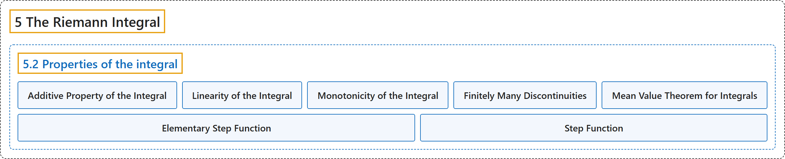

# 5.2 Properties of the integral

## Classification

## Glossary

| Term | Definition | 中文翻译 | Source |
|---|---|---|---|
| **5.2 Properties of the integral** 积分的性质 | (No definition) | （无定义） | [Lebl, 2026, section 5.2](https://www.jirka.org/ra/html/sec_rintprop.html) |
| **Additive Property of the Integral** 积分的可加性 | "**Adding a bunch of things in two parts and then adding those two parts should be the same as adding everything all at once.** The corresponding property for integrals is called the **additive property of the integral**." | **把一堆东西分两部分相加、再把两部分相加，应当与一次全部相加相同**。积分的相应性质称为**积分的可加性**。 | [Lebl, 2026, section 5.2](https://www.jirka.org/ra/html/sec_rintprop.html#sec_rintprop-3-2) |
| **Linearity of the Integral** 积分的线性 | "Let $f$ and $g$ be in $\mathcal{R}\bigl([a,b]\bigr)$ and $\alpha \in \mathbb{R}$. $\alpha f$ is in $\mathcal{R}\bigl([a,b]\bigr)$ and **$\int_a^b \alpha f(x) \,dx = \alpha \int_a^b f(x) \,dx$**. $f+g$ is in $\mathcal{R}\bigl([a,b]\bigr)$ and **$\int_a^b \bigl( f(x)+g(x) \bigr) \,dx = \int_a^b f(x) \,dx + \int_a^b g(x) \,dx$**." | 设 $f$ 与 $g$ 属于 $\mathcal{R}\bigl([a,b]\bigr)$，$\alpha \in \mathbb{R}$。$\alpha f$ 属于 $\mathcal{R}\bigl([a,b]\bigr)$ 且 **$\int_a^b \alpha f(x) \,dx = \alpha \int_a^b f(x) \,dx$**；$f+g$ 属于 $\mathcal{R}\bigl([a,b]\bigr)$ 且 **$\int_a^b \bigl( f(x)+g(x) \bigr) \,dx = \int_a^b f(x) \,dx + \int_a^b g(x) \,dx$**。 | [Lebl, 2026, Proposition 5.2.4](https://www.jirka.org/ra/html/sec_rintprop.html#prop_integrallinear) |
| **Monotonicity of the Integral** 积分的单调性 | "Let $f \colon [a,b] \to \mathbb{R}$ and $g \colon [a,b] \to \mathbb{R}$ be bounded, and **$f(x) \leq g(x)$ for all $x \in [a,b]$**. Then $\underline{\int_a^b} f \leq \underline{\int_a^b} g$ and $\overline{\int_a^b} f \leq \overline{\int_a^b} g$. Moreover, if $f$ and $g$ are in $\mathcal{R}\bigl([a,b]\bigr)$, then **$\int_a^b f \leq \int_a^b g$**." | 设 $f \colon [a,b] \to \mathbb{R}$ 与 $g \colon [a,b] \to \mathbb{R}$ 有界，且**对所有 $x \in [a,b]$ 有 $f(x) \leq g(x)$**，则 $\underline{\int_a^b} f \leq \underline{\int_a^b} g$ 且 $\overline{\int_a^b} f \leq \overline{\int_a^b} g$。此外，若 $f$ 与 $g$ 属于 $\mathcal{R}\bigl([a,b]\bigr)$，则 **$\int_a^b f \leq \int_a^b g$**。 | [Lebl, 2026, Proposition 5.2.6](https://www.jirka.org/ra/html/sec_rintprop.html#sec_rintprop-4-8) |
| **Finitely Many Discontinuities** 有限个间断点 | "We say a function $f \colon [a,b] \to \mathbb{R}$ has **finitely many discontinuities** if **there exists a finite set $S = \{ x_1, x_2, \ldots, x_n \} \subset [a,b]$, and $f$ is continuous at all points of $[a,b] \setminus S$**." | 若**存在有限集 $S = \{ x_1, x_2, \ldots, x_n \} \subset [a,b]$，使 $f$ 在 $[a,b] \setminus S$ 的所有点处连续**，则称函数 $f \colon [a,b] \to \mathbb{R}$ 有**有限个间断点**。 | [Lebl, 2026, section 5.2](https://www.jirka.org/ra/html/sec_rintprop.html#sec_rintprop-5-8) |
| **Mean Value Theorem for Integrals** 积分中值定理 | "Prove the **mean value theorem for integrals**: If $f \colon [a,b] \to \mathbb{R}$ is continuous, then **there exists a $c \in [a,b]$ such that $\int_a^b f = f(c)(b-a)$**." | 证明**积分中值定理**：若 $f \colon [a,b] \to \mathbb{R}$ 连续，则**存在 $c \in [a,b]$ 使得 $\int_a^b f = f(c)(b-a)$**。 | [Lebl, 2026, Exercise 5.2.4](https://www.jirka.org/ra/html/sec_rintprop.html#sec_rintprop-7-4) |
| **Elementary Step Function** 初等阶梯函数 | "If $I \subset \mathbb{R}$ is a bounded interval, then the function **$\varphi_I(x) := \begin{cases} 1 & \text{if } x \in I, \\ 0 & \text{otherwise,} \end{cases}$** is called an **elementary step function**." | 若 $I \subset \mathbb{R}$ 是有界区间，则函数 **$\varphi_I(x) := \begin{cases} 1 & \text{if } x \in I, \\ 0 & \text{otherwise,} \end{cases}$** 称为**初等阶梯函数**。 | [Lebl, 2026, Exercises 5.2](https://www.jirka.org/ra/html/sec_rintprop.html#sec_rintprop-7-12) |
| **Step Function** 阶梯函数 | "A function $f$ is called a **step function** if it can be written as **$f(x) = \sum_{k=1}^n \alpha_k \varphi_{I_k} (x)$** for some real numbers $\alpha_1,\alpha_2, \ldots, \alpha_n$ and some bounded intervals $I_1,I_2,\ldots,I_n$." | 若函数 $f$ 能写成 **$f(x) = \sum_{k=1}^n \alpha_k \varphi_{I_k} (x)$**，其中 $\alpha_1,\alpha_2, \ldots, \alpha_n$ 是实数，$I_1,I_2,\ldots,I_n$ 是有界区间，则称 $f$ 为**阶梯函数**。 | [Lebl, 2026, Exercises 5.2](https://www.jirka.org/ra/html/sec_rintprop.html#sec_rintprop-7-14) |

## References

Lebl, J. (2026). *Basic analysis I & II: Introduction to real analysis* (May 22, 2026 edition). Retrieved October 29, 2026, from <https://www.jirka.org/ra/html/>
