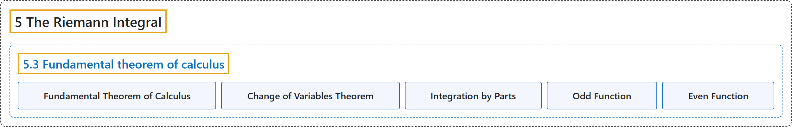

# 5.3 Fundamental theorem of calculus

## Classification

## Glossary

| Term | Definition | 中文翻译 | Source |
|---|---|---|---|
| **5.3 Fundamental theorem of calculus** 微积分基本定理 | (No definition) | （无定义） | [Lebl, 2026, section 5.3](https://www.jirka.org/ra/html/sec_ftc.html) |
| **Fundamental Theorem of Calculus** 微积分基本定理 | "In this section we discuss and prove the **fundamental theorem of calculus**. The entirety of integral calculus is built upon this theorem, ergo the name. The theorem **relates the seemingly unrelated concepts of integral and derivative**. It tells us how to compute the antiderivative of a function using the integral and vice versa." | 本节讨论并证明**微积分基本定理**。整个积分学都建立在这个定理之上，因而得名。这个定理**把看似无关的积分与导数两个概念联系起来**，告诉我们如何用积分求函数的原函数，反之亦然。 | [Lebl, 2026, section 5.3](https://www.jirka.org/ra/html/sec_ftc.html#sec_ftc-2-2) |
| **Change of Variables Theorem** 换元定理 | "Let $g \colon [a,b] \to \mathbb{R}$ be a continuously differentiable function, let $f \colon [c,d] \to \mathbb{R}$ be continuous, and suppose $g\bigl([a,b]\bigr) \subset [c,d]$. Then **$\int_a^b f\bigl(g(x)\bigr)\, g'(x)\, dx = \int_{g(a)}^{g(b)} f(u)\, du$**." | 设 $g \colon [a,b] \to \mathbb{R}$ 连续可微，$f \colon [c,d] \to \mathbb{R}$ 连续，且 $g\bigl([a,b]\bigr) \subset [c,d]$，则 **$\int_a^b f\bigl(g(x)\bigr)\, g'(x)\, dx = \int_{g(a)}^{g(b)} f(u)\, du$**。 | [Lebl, 2026, Theorem 5.3.5](https://www.jirka.org/ra/html/sec_ftc.html#sec_ftc-5-3) |
| **Integration by Parts** 分部积分 | "Prove **integration by parts**. That is, suppose $F$ and $G$ are continuously differentiable functions on $[a,b]$. Then prove **$\int_a^b F(x)G'(x)\,dx = F(b)G(b)-F(a)G(a) - \int_a^b F'(x)G(x)\,dx$**." | 证明**分部积分**：设 $F$ 与 $G$ 是 $[a,b]$ 上的连续可微函数，证明 **$\int_a^b F(x)G'(x)\,dx = F(b)G(b)-F(a)G(a) - \int_a^b F'(x)G(x)\,dx$**。 | [Lebl, 2026, Exercise 5.3.5](https://www.jirka.org/ra/html/sec_ftc.html#sec_ftc-6-5) |
| **Odd Function** 奇函数 | "A function $f$ is an **odd function** if **$f(x) = -f(-x)$**, and $f$ is an even function if $f(x) = f(-x)$." | 若 **$f(x) = -f(-x)$**，则函数 $f$ 是**奇函数**；若 $f(x) = f(-x)$，则 $f$ 是偶函数。 | [Lebl, 2026, Exercise 5.3.10](https://www.jirka.org/ra/html/sec_ftc.html#sec_ftc-6-11) |
| **Even Function** 偶函数 | "A function $f$ is an odd function if $f(x) = -f(-x)$, and $f$ is an **even function** if **$f(x) = f(-x)$**." | 若 $f(x) = -f(-x)$，则函数 $f$ 是奇函数；若 **$f(x) = f(-x)$**，则 $f$ 是**偶函数**。 | [Lebl, 2026, Exercise 5.3.10](https://www.jirka.org/ra/html/sec_ftc.html#sec_ftc-6-11) |

## References

Lebl, J. (2026). *Basic analysis I & II: Introduction to real analysis* (May 22, 2026 edition). Retrieved October 29, 2026, from <https://www.jirka.org/ra/html/>
