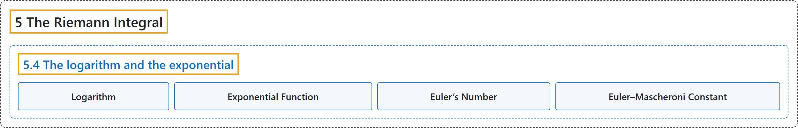

# 5.4 The logarithm and the exponential

## Classification

## Glossary

| Term | Definition | 中文翻译 | Source |
|---|---|---|---|
| **5.4 The logarithm and the exponential** 对数与指数 | (No definition) | （无定义） | [Lebl, 2026, section 5.4](https://www.jirka.org/ra/html/sec_logandexp.html) |
| **Logarithm** 对数 | "Having proved that there is **a unique function with these properties**, we simply define the **logarithm**, sometimes called the **natural logarithm**: $\ln(x) := L(x)$." | 证明了**具有这些性质的函数唯一**之后，就直接定义**对数**，有时称为**自然对数**：$\ln(x) := L(x)$。 | [Lebl, 2026, section 5.4](https://www.jirka.org/ra/html/sec_logandexp.html#sec_logandexp-3-6) |
| **Exponential Function** 指数函数 | "Having proved **$E$ is unique**, we define the **exponential function** as $\exp(x) := E(x)$." | 证明了 **$E$ 唯一**之后，定义**指数函数**为 $\exp(x) := E(x)$。 | [Lebl, 2026, section 5.4](https://www.jirka.org/ra/html/sec_logandexp.html#sec_logandexp-4-6) |
| **Euler’s Number** 欧拉数 | "Define the number $e$, called **Euler’s number** or the **base of the natural logarithm**, as **$e := \exp(1)$**." | 定义数 $e$，称为**欧拉数**或**自然对数的底**，为 **$e := \exp(1)$**。 | [Lebl, 2026, section 5.4](https://www.jirka.org/ra/html/sec_logandexp.html#sec_logandexp-4-11) |
| **Euler–Mascheroni Constant** 欧拉–马斯刻若尼常数 | "Prove that the limit **$\gamma := \lim_{n\to\infty} \left( \left( \sum_{k=1}^{n} \frac{1}{k} \right) - \ln (n) \right)$** exists. This constant $\gamma$ is known as the **Euler–Mascheroni constant**." | 证明极限 **$\gamma := \lim_{n\to\infty} \left( \left( \sum_{k=1}^{n} \frac{1}{k} \right) - \ln (n) \right)$** 存在。这个常数 $\gamma$ 称为**欧拉–马斯刻若尼常数**。 | [Lebl, 2026, Exercise 5.4.6](https://www.jirka.org/ra/html/sec_logandexp.html#sec_logandexp-5-6) |

## References

Lebl, J. (2026). *Basic analysis I & II: Introduction to real analysis* (May 22, 2026 edition). Retrieved October 29, 2026, from <https://www.jirka.org/ra/html/>
