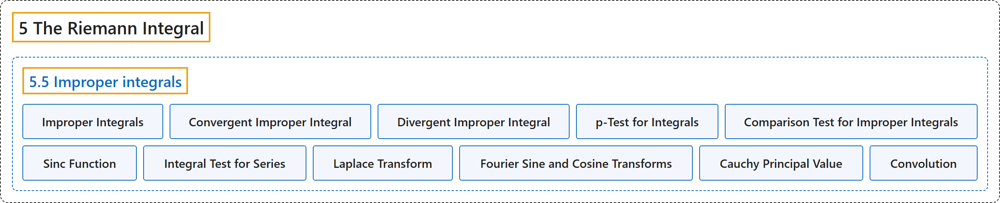

# 5.5 Improper integrals

## Classification

## Glossary

| Term | Definition | 中文翻译 | Source |
|---|---|---|---|
| **5.5 Improper integrals** 反常积分 | (No definition) | （无定义） | [Lebl, 2026, section 5.5](https://www.jirka.org/ra/html/sec_impropriemann.html) |
| **Improper Integrals** 反常积分 | "For such intervals or functions, the Riemann integral is not defined, but we will write down the integral anyway in the spirit of Lemma 5.2.8. These integrals are called **improper integrals** and are **limits of integrals rather than integrals themselves**." | 对这样的区间或函数，黎曼积分没有定义，但我们仍按引理 5.2.8 的精神写出积分。这些积分称为**反常积分**，它们是**积分的极限，而不是积分本身**。 | [Lebl, 2026, section 5.5](https://www.jirka.org/ra/html/sec_impropriemann.html#sec_impropriemann-2-2) |
| **Convergent Improper Integral** 收敛的反常积分 | "Suppose $f \colon [a,\infty) \to \mathbb{R}$ is a function such that $f$ is Riemann integrable on $[a,c]$ for all $c < \infty$. We define $\int_a^\infty f := \lim_{c \to \infty} \int_a^c f$ if the limit exists. **If the limit exists**, we say the improper integral **converges**." | 设 $f \colon [a,\infty) \to \mathbb{R}$ 对所有 $c < \infty$ 在 $[a,c]$ 上黎曼可积。若极限存在，定义 $\int_a^\infty f := \lim_{c \to \infty} \int_a^c f$。**若极限存在**，就说该反常积分**收敛**。 | [Lebl, 2026, Definition 5.5.1](https://www.jirka.org/ra/html/sec_impropriemann.html#sec_impropriemann-2-3) |
| **Divergent Improper Integral** 发散的反常积分 | "**If the limit does not exist**, we say the improper integral **diverges**." | **若极限不存在**，就说该反常积分**发散**。 | [Lebl, 2026, Definition 5.5.1](https://www.jirka.org/ra/html/sec_impropriemann.html#sec_impropriemann-2-3) |
| **p-Test for Integrals** 积分的 p 判别法 | "The improper integral $\int_1^\infty \frac{1}{x^p} \,dx$ **converges to $\frac{1}{p-1}$ if $p > 1$ and diverges if $0 < p \leq 1$**. The improper integral $\int_0^1 \frac{1}{x^p} \,dx$ **converges to $\frac{1}{1-p}$ if $0 < p < 1$ and diverges if $p \geq 1$**." | 反常积分 $\int_1^\infty \frac{1}{x^p} \,dx$ **当 $p > 1$ 时收敛到 $\frac{1}{p-1}$，当 $0 < p \leq 1$ 时发散**。反常积分 $\int_0^1 \frac{1}{x^p} \,dx$ **当 $0 < p < 1$ 时收敛到 $\frac{1}{1-p}$，当 $p \geq 1$ 时发散**。 | [Lebl, 2026, Proposition 5.5.2](https://www.jirka.org/ra/html/sec_impropriemann.html#impropriemann_ptest) |
| **Comparison Test for Improper Integrals** 反常积分的比较判别法 | "Let $f \colon [a,\infty) \to \mathbb{R}$ and $g \colon [a,\infty) \to \mathbb{R}$ be functions that are Riemann integrable on $[a,b]$ for all $b > a$. Suppose that for all $x \geq a$, **$\bigl\lvert f(x) \bigr\rvert \leq g(x)$**. **If $\int_a^\infty g$ converges, then $\int_a^\infty f$ converges**, and in this case $\left\lvert \int_a^\infty f \right\rvert \leq \int_a^\infty g$. **If $\int_a^\infty f$ diverges, then $\int_a^\infty g$ diverges.**" | 设 $f \colon [a,\infty) \to \mathbb{R}$ 与 $g \colon [a,\infty) \to \mathbb{R}$ 对所有 $b > a$ 在 $[a,b]$ 上黎曼可积，且对所有 $x \geq a$ 有 **$\bigl\lvert f(x) \bigr\rvert \leq g(x)$**。**若 $\int_a^\infty g$ 收敛，则 $\int_a^\infty f$ 收敛**，并且 $\left\lvert \int_a^\infty f \right\rvert \leq \int_a^\infty g$；**若 $\int_a^\infty f$ 发散，则 $\int_a^\infty g$ 发散。** | [Lebl, 2026, Proposition 5.5.5](https://www.jirka.org/ra/html/sec_impropriemann.html#sec_impropriemann-2-14) |
| **Sinc Function** sinc 函数 | "An example to keep in mind for improper integrals is the **sinc function**. This function comes up quite often in both pure and applied mathematics. Define **$\operatorname{sinc}(x) := \begin{cases} \frac{\sin(x)}{x} & \text{if } x \neq 0 , \\ 1 & \text{if } x = 0 . \end{cases}$**" | 关于反常积分，值得记住的一个例子是 **sinc 函数**。这个函数在纯粹数学和应用数学中都经常出现。定义 **$\operatorname{sinc}(x) := \begin{cases} \frac{\sin(x)}{x} & \text{if } x \neq 0 , \\ 1 & \text{if } x = 0 . \end{cases}$** | [Lebl, 2026, Example 5.5.12](https://www.jirka.org/ra/html/sec_impropriemann.html#sec_impropriemann-2-26) |
| **Integral Test for Series** 级数的积分判别法 | "Suppose $f \colon [k,\infty) \to \mathbb{R}$ is a decreasing nonnegative function where $k \in \mathbb{Z}$. Then **$\sum_{n=k}^\infty f(n)$ converges if and only if $\int_k^\infty f$ converges**." | 设 $f \colon [k,\infty) \to \mathbb{R}$ 是递减的非负函数，$k \in \mathbb{Z}$，则 **$\sum_{n=k}^\infty f(n)$ 收敛当且仅当 $\int_k^\infty f$ 收敛**。 | [Lebl, 2026, Proposition 5.5.13](https://www.jirka.org/ra/html/sec_impropriemann.html#sec_impropriemann-3-3) |
| **Laplace Transform** 拉普拉斯变换 | "Show that the **Laplace transform** of $f$ exists. That is, for every $s > a$ the following integral converges: **$F(s) := \int_{0}^\infty f(t) e^{-st} \,dt$**." | 证明 $f$ 的**拉普拉斯变换**存在，即对每个 $s > a$，下列积分收敛：**$F(s) := \int_{0}^\infty f(t) e^{-st} \,dt$**。 | [Lebl, 2026, Exercise 5.5.6](https://www.jirka.org/ra/html/sec_impropriemann.html#sec_impropriemann-4-6) |
| **Fourier Sine and Cosine Transforms** 傅里叶正弦与余弦变换 | "Show that the **Fourier sine and cosine transforms** exist. That is, for every $\omega \geq 0$ the following integrals converge **$F^s(\omega) := \frac{1}{\pi} \int_{-\infty}^\infty f(t) \sin(\omega t) \,dt , \qquad F^c(\omega) := \frac{1}{\pi} \int_{-\infty}^\infty f(t) \cos(\omega t) \,dt$**." | 证明**傅里叶正弦与余弦变换**存在，即对每个 $\omega \geq 0$，下列积分收敛：**$F^s(\omega) := \frac{1}{\pi} \int_{-\infty}^\infty f(t) \sin(\omega t) \,dt , \qquad F^c(\omega) := \frac{1}{\pi} \int_{-\infty}^\infty f(t) \cos(\omega t) \,dt$**。 | [Lebl, 2026, Exercise 5.5.7](https://www.jirka.org/ra/html/sec_impropriemann.html#sec_impropriemann-4-7) |
| **Cauchy Principal Value** 柯西主值 | "Suppose $f \colon [a,b] \to \mathbb{R}$ is a function and $a < c < b$, where $f$ is Riemann integrable on the intervals $[a,c-\epsilon]$ and $[c+\epsilon,b]$ for all $\epsilon > 0$. Define the **Cauchy principal value** of $\int_a^b f$ as **$p.v.\!\int_a^b f := \lim_{\epsilon\to 0^+} \left( \int_a^{c-\epsilon} f + \int_{c+\epsilon}^b f \right)$**, if the limit exists." | 设 $f \colon [a,b] \to \mathbb{R}$ 是函数，$a < c < b$，且对所有 $\epsilon > 0$，$f$ 在区间 $[a,c-\epsilon]$ 与 $[c+\epsilon,b]$ 上黎曼可积。若极限存在，定义 $\int_a^b f$ 的**柯西主值**为 **$p.v.\!\int_a^b f := \lim_{\epsilon\to 0^+} \left( \int_a^{c-\epsilon} f + \int_{c+\epsilon}^b f \right)$**。 | [Lebl, 2026, Exercises 5.5](https://www.jirka.org/ra/html/sec_impropriemann.html#sec_impropriemann-4-13) |
| **Convolution** 卷积 | "Let $f \colon \mathbb{R} \to \mathbb{R}$ and $g \colon \mathbb{R} \to \mathbb{R}$ be continuous functions, where $g(x) = 0$ for all $x \notin [a,b]$ for some interval $[a,b]$. Show that the **convolution** **$(g * f)(x) := \int_{-\infty}^\infty f(t)g(x-t)\,dt$** is well-defined for all $x \in \mathbb{R}$." | 设 $f \colon \mathbb{R} \to \mathbb{R}$ 与 $g \colon \mathbb{R} \to \mathbb{R}$ 是连续函数，且对某个区间 $[a,b]$，当 $x \notin [a,b]$ 时 $g(x) = 0$。证明**卷积** **$(g * f)(x) := \int_{-\infty}^\infty f(t)g(x-t)\,dt$** 对所有 $x \in \mathbb{R}$ 有定义。 | [Lebl, 2026, Exercise 5.5.14](https://www.jirka.org/ra/html/sec_impropriemann.html#sec_impropriemann-4-15) |

## References

Lebl, J. (2026). *Basic analysis I & II: Introduction to real analysis* (May 22, 2026 edition). Retrieved October 29, 2026, from <https://www.jirka.org/ra/html/>
