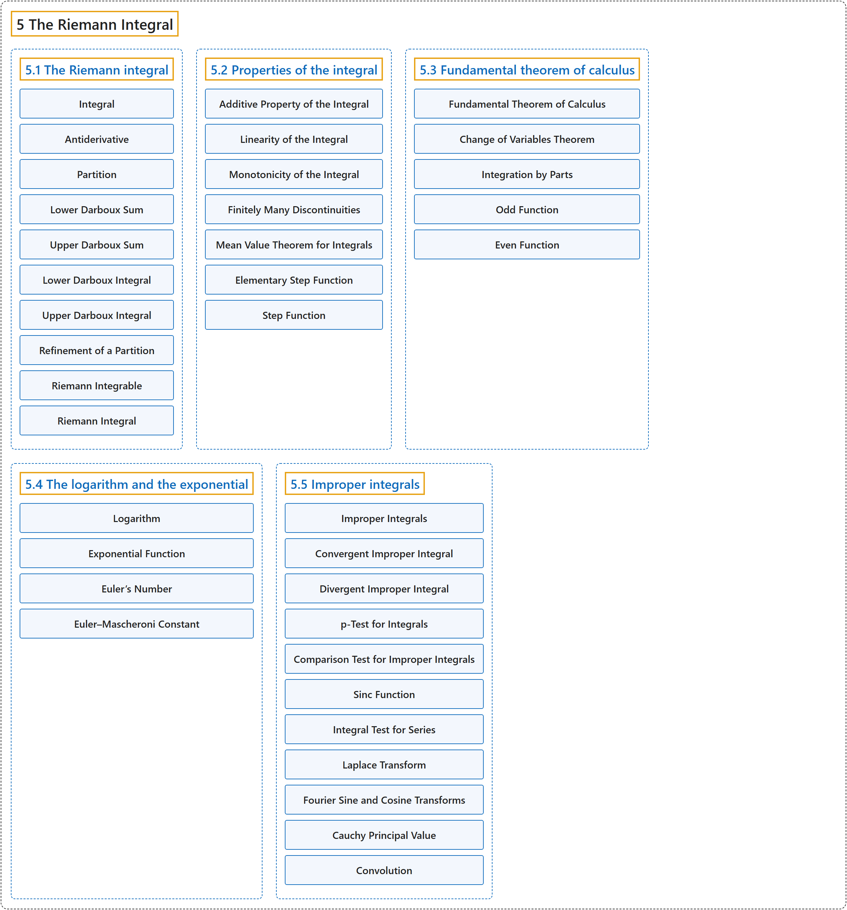

# 5 The Riemann Integral

## Classification

## Glossary

| Term | Definition | 中文翻译 | Source |
|---|---|---|---|
| **5 The Riemann Integral** 黎曼积分 | (No definition) | （无定义） | [Lebl, 2026, chapter 5](https://www.jirka.org/ra/html/int_chapter.html) |
| **[5.1 The Riemann integral](5-1-the-riemann-integral.md)** 黎曼积分 | (No definition) | （无定义） | [Lebl, 2026, section 5.1](https://www.jirka.org/ra/html/sec_rint.html) |
| **[5.2 Properties of the integral](5-2-properties-of-the-integral.md)** 积分的性质 | (No definition) | （无定义） | [Lebl, 2026, section 5.2](https://www.jirka.org/ra/html/sec_rintprop.html) |
| **[5.3 Fundamental theorem of calculus](5-3-fundamental-theorem-of-calculus.md)** 微积分基本定理 | (No definition) | （无定义） | [Lebl, 2026, section 5.3](https://www.jirka.org/ra/html/sec_ftc.html) |
| **[5.4 The logarithm and the exponential](5-4-the-logarithm-and-the-exponential.md)** 对数与指数 | (No definition) | （无定义） | [Lebl, 2026, section 5.4](https://www.jirka.org/ra/html/sec_logandexp.html) |
| **[5.5 Improper integrals](5-5-improper-integrals.md)** 反常积分 | (No definition) | （无定义） | [Lebl, 2026, section 5.5](https://www.jirka.org/ra/html/sec_impropriemann.html) |

## References

Lebl, J. (2026). *Basic analysis I & II: Introduction to real analysis* (May 22, 2026 edition). Retrieved October 29, 2026, from <https://www.jirka.org/ra/html/>
