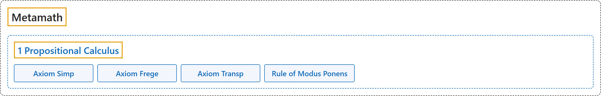

# 1 Propositional Calculus

## Classification

## Glossary

| Term | Definition | 中文翻译 | Source |
|---|---|---|---|
| **[Metamath](index.md)** Metamath | "An axiom is **a fundamental assumption that provides a starting point for reasoning**. The axioms for (essentially) all of mathematics can be conveniently divided into **three groups: propositional calculus, predicate calculus, and set theory**." | 公理是**为推理提供起点的基本假设**。（基本上）全部数学的公理可以方便地分为**三组：命题演算、谓词演算和集合论**。 | [Megill, 2026, "The Axioms" section](https://us.metamath.org/mpeuni/mmset.html#axioms) |
| **[1 Propositional Calculus](1-propositional-calculus.md)** 命题演算 | "Our system of **propositional calculus** consists of **three axioms and the modus ponens inference rule**." | 我们的**命题演算**系统由**三条公理和肯定前件推理规则**组成。 | [Megill, 2026, "The Axioms" section](https://us.metamath.org/mpeuni/mmset.html#axioms) |
| **[Axiom Simp](https://us.metamath.org/mpeuni/ax-1.html)** 简化公理 | "⊢ (𝜑 → (𝜓 → 𝜑))" | 若 𝜑 成立，则无论 𝜓 如何，𝜑 都成立。 | [Megill, 2026, "The Axioms" section](https://us.metamath.org/mpeuni/mmset.html#axioms) |
| **[Axiom Frege](https://us.metamath.org/mpeuni/ax-2.html)** 弗雷格公理 | "⊢ ((𝜑 → (𝜓 → 𝜒)) → ((𝜑 → 𝜓) → (𝜑 → 𝜒)))" | 蕴涵对蕴涵可以分配：若 𝜑 推出“𝜓 推出 𝜒”，则“𝜑 推出 𝜓”推出“𝜑 推出 𝜒”。 | [Megill, 2026, "The Axioms" section](https://us.metamath.org/mpeuni/mmset.html#axioms) |
| **[Axiom Transp](https://us.metamath.org/mpeuni/ax-3.html)** 换位公理 | "⊢ ((¬ 𝜑 → ¬ 𝜓) → (𝜓 → 𝜑))" | 若“非 𝜑”推出“非 𝜓”，则 𝜓 推出 𝜑（逆否）。 | [Megill, 2026, "The Axioms" section](https://us.metamath.org/mpeuni/mmset.html#axioms) |
| **[Rule of Modus Ponens](https://us.metamath.org/mpeuni/ax-mp.html)** 肯定前件规则 | "⊢ 𝜑 & ⊢ (𝜑 → 𝜓) ⇒ ⊢ 𝜓" | 由 𝜑 和“𝜑 推出 𝜓”，得到 𝜓。 | [Megill, 2026, "The Axioms" section](https://us.metamath.org/mpeuni/mmset.html#axioms) |

## References

Megill, N. (2026). *Metamath Proof Explorer home page* (last updated January 19, 2026). Metamath. Retrieved October 29, 2026, from <https://us.metamath.org/mpeuni/mmset.html>
