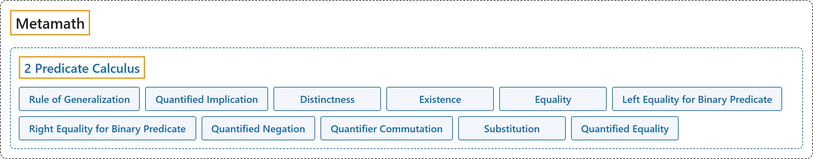

# 2 Predicate Calculus

## Classification

## Glossary

| Term | Definition | 中文翻译 | Source |
|---|---|---|---|
| **[Metamath](index.md)** Metamath | "An axiom is **a fundamental assumption that provides a starting point for reasoning**. The axioms for (essentially) all of mathematics can be conveniently divided into **three groups: propositional calculus, predicate calculus, and set theory**." | 公理是**为推理提供起点的基本假设**。（基本上）全部数学的公理可以方便地分为**三组：命题演算、谓词演算和集合论**。 | [Megill, 2026, "The Axioms" section](https://us.metamath.org/mpeuni/mmset.html#axioms) |
| **[2 Predicate Calculus](2-predicate-calculus.md)** 谓词演算 | "The axioms of **predicate calculus** express **the logical properties of these new symbols that are universally true**, independent from any theory (like set theory) making use of them." | **谓词演算**的公理表达**这些新符号普遍成立的逻辑性质**，与使用它们的任何理论（如集合论）无关。 | [Megill, 2026, "The Axioms" section](https://us.metamath.org/mpeuni/mmset.html#axioms) |
| **[Rule of Generalization](https://us.metamath.org/mpeuni/ax-gen.html)** 概括规则 | "⊢ 𝜑 ⇒ ⊢ ∀𝑥 𝜑" | 由 𝜑，得到“对一切 𝑥，𝜑”。 | [Megill, 2026, "The Axioms" section](https://us.metamath.org/mpeuni/mmset.html#axioms) |
| **[Quantified Implication](https://us.metamath.org/mpeuni/ax-4.html)** 量化蕴涵 | "⊢ (∀𝑥 (𝜑 → 𝜓) → (∀𝑥 𝜑 → ∀𝑥 𝜓))" | 若对一切 𝑥 都有 𝜑 推出 𝜓，则“对一切 𝑥，𝜑”推出“对一切 𝑥，𝜓”。 | [Megill, 2026, "The Axioms" section](https://us.metamath.org/mpeuni/mmset.html#axioms) |
| **[Distinctness](https://us.metamath.org/mpeuni/ax-5.html)** 不出现 | "⊢ (𝜑 → ∀𝑥 𝜑), where 𝑥 does not occur in 𝜑" | 𝑥 不出现在 𝜑 中时，𝜑 推出“对一切 𝑥，𝜑”。 | [Megill, 2026, "The Axioms" section](https://us.metamath.org/mpeuni/mmset.html#axioms) |
| **[Existence](https://us.metamath.org/mpeuni/ax-6.html)** 存在 | "⊢ ¬ ∀𝑥 ¬ 𝑥 = 𝑦" | 并非对一切 𝑥 都有 𝑥 ≠ 𝑦，即存在等于 𝑦 的 𝑥。 | [Megill, 2026, "The Axioms" section](https://us.metamath.org/mpeuni/mmset.html#axioms) |
| **[Equality](https://us.metamath.org/mpeuni/ax-7.html)** 相等 | "⊢ (𝑥 = 𝑦 → (𝑥 = 𝑧 → 𝑦 = 𝑧))" | 若 𝑥 = 𝑦 且 𝑥 = 𝑧，则 𝑦 = 𝑧。 | [Megill, 2026, "The Axioms" section](https://us.metamath.org/mpeuni/mmset.html#axioms) |
| **[Left Equality for Binary Predicate](https://us.metamath.org/mpeuni/ax-8.html)** 二元谓词的左相等 | "⊢ (𝑥 = 𝑦 → (𝑥 ∈ 𝑧 → 𝑦 ∈ 𝑧))" | 若 𝑥 = 𝑦 且 𝑥 ∈ 𝑧，则 𝑦 ∈ 𝑧。 | [Megill, 2026, "The Axioms" section](https://us.metamath.org/mpeuni/mmset.html#axioms) |
| **[Right Equality for Binary Predicate](https://us.metamath.org/mpeuni/ax-9.html)** 二元谓词的右相等 | "⊢ (𝑥 = 𝑦 → (𝑧 ∈ 𝑥 → 𝑧 ∈ 𝑦))" | 若 𝑥 = 𝑦 且 𝑧 ∈ 𝑥，则 𝑧 ∈ 𝑦。 | [Megill, 2026, "The Axioms" section](https://us.metamath.org/mpeuni/mmset.html#axioms) |
| **[Quantified Negation](https://us.metamath.org/mpeuni/ax-10.html)** 量化否定 | "⊢ (¬ ∀𝑥 𝜑 → ∀𝑥 ¬ ∀𝑥 𝜑)" | 若并非对一切 𝑥 都有 𝜑，则对一切 𝑥，“并非对一切 𝑥 都有 𝜑”。 | [Megill, 2026, "The Axioms" section](https://us.metamath.org/mpeuni/mmset.html#axioms) |
| **[Quantifier Commutation](https://us.metamath.org/mpeuni/ax-11.html)** 量词交换 | "⊢ (∀𝑥 ∀𝑦 𝜑 → ∀𝑦 ∀𝑥 𝜑)" | “对一切 𝑥、对一切 𝑦”可以交换为“对一切 𝑦、对一切 𝑥”。 | [Megill, 2026, "The Axioms" section](https://us.metamath.org/mpeuni/mmset.html#axioms) |
| **[Substitution](https://us.metamath.org/mpeuni/ax-12.html)** 代入 | "⊢ (𝑥 = 𝑦 → (∀𝑦 𝜑 → ∀𝑥 (𝑥 = 𝑦 → 𝜑)))" | 若 𝑥 = 𝑦 且对一切 𝑦 有 𝜑，则对一切 𝑥，𝑥 = 𝑦 推出 𝜑。 | [Megill, 2026, "The Axioms" section](https://us.metamath.org/mpeuni/mmset.html#axioms) |
| **[Quantified Equality](https://us.metamath.org/mpeuni/ax-13.html)** 量化相等 | "⊢ (¬ 𝑥 = 𝑦 → (𝑦 = 𝑧 → ∀𝑥 𝑦 = 𝑧))" | 若 𝑥 ≠ 𝑦 且 𝑦 = 𝑧，则对一切 𝑥，𝑦 = 𝑧。 | [Megill, 2026, "The Axioms" section](https://us.metamath.org/mpeuni/mmset.html#axioms) |

## References

Megill, N. (2026). *Metamath Proof Explorer home page* (last updated January 19, 2026). Metamath. Retrieved October 29, 2026, from <https://us.metamath.org/mpeuni/mmset.html>
