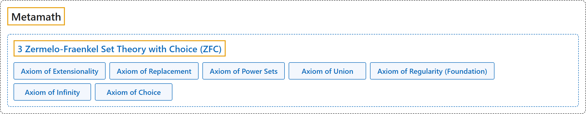

# 3 Zermelo-Fraenkel Set Theory with Choice (ZFC)

## Classification

## Glossary

| Term | Definition | 中文翻译 | Source |
|---|---|---|---|
| **[Metamath](index.md)** Metamath | "An axiom is **a fundamental assumption that provides a starting point for reasoning**. The axioms for (essentially) all of mathematics can be conveniently divided into **three groups: propositional calculus, predicate calculus, and set theory**." | 公理是**为推理提供起点的基本假设**。（基本上）全部数学的公理可以方便地分为**三组：命题演算、谓词演算和集合论**。 | [Megill, 2026, "The Axioms" section](https://us.metamath.org/mpeuni/mmset.html#axioms) |
| **[3 Zermelo-Fraenkel Set Theory with Choice (ZFC)](3-zfc.md)** 带选择公理的策梅洛-弗兰克尔集合论（ZFC） | "**Set theory** uses the formalism of propositional and predicate calculus **to assert properties of arbitrary mathematical objects called "sets."**" | **集合论**用命题演算和谓词演算的形式体系，**来断言称为“集合”的任意数学对象的性质**。 | [Megill, 2026, "The Axioms" section](https://us.metamath.org/mpeuni/mmset.html#axioms) |
| **[Axiom of Extensionality](https://us.metamath.org/mpeuni/ax-ext.html)** 外延公理 | "⊢ (∀𝑧 (𝑧 ∈ 𝑥 ↔ 𝑧 ∈ 𝑦) → 𝑥 = 𝑦)" | 两个集合的元素完全相同，它们就相等。 | [Megill, 2026, "The Axioms" section](https://us.metamath.org/mpeuni/mmset.html#axioms) |
| **[Axiom of Replacement](https://us.metamath.org/mpeuni/ax-rep.html)** 替换公理 | "⊢ (∀𝑤 ∃𝑦 ∀𝑧 (∀𝑦 𝜑 → 𝑧 = 𝑦) → ∃𝑦 ∀𝑧 (𝑧 ∈ 𝑦 ↔ ∃𝑤 (𝑤 ∈ 𝑥 ∧ ∀𝑦 𝜑)))" | 集合在一个函数关系下的像也是集合。 | [Megill, 2026, "The Axioms" section](https://us.metamath.org/mpeuni/mmset.html#axioms) |
| **[Axiom of Power Sets](https://us.metamath.org/mpeuni/ax-pow.html)** 幂集公理 | "⊢ ∃𝑦 ∀𝑧 (∀𝑤 (𝑤 ∈ 𝑧 → 𝑤 ∈ 𝑥) → 𝑧 ∈ 𝑦)" | 存在一个集合，包含 𝑥 的所有子集。 | [Megill, 2026, "The Axioms" section](https://us.metamath.org/mpeuni/mmset.html#axioms) |
| **[Axiom of Union](https://us.metamath.org/mpeuni/ax-un.html)** 并集公理 | "⊢ ∃𝑦 ∀𝑧 (∃𝑤 (𝑧 ∈ 𝑤 ∧ 𝑤 ∈ 𝑥) → 𝑧 ∈ 𝑦)" | 存在一个集合，包含 𝑥 的各元素的所有元素。 | [Megill, 2026, "The Axioms" section](https://us.metamath.org/mpeuni/mmset.html#axioms) |
| **[Axiom of Regularity (Foundation)](https://us.metamath.org/mpeuni/ax-reg.html)** 正则公理（基础公理） | "⊢ (∃𝑦 𝑦 ∈ 𝑥 → ∃𝑦 (𝑦 ∈ 𝑥 ∧ ∀𝑧 (𝑧 ∈ 𝑦 → ¬ 𝑧 ∈ 𝑥)))" | 每个非空集合 𝑥 都有一个元素 𝑦，𝑦 与 𝑥 没有公共元素。 | [Megill, 2026, "The Axioms" section](https://us.metamath.org/mpeuni/mmset.html#axioms) |
| **[Axiom of Infinity](https://us.metamath.org/mpeuni/ax-inf.html)** 无穷公理 | "⊢ ∃𝑦 (𝑥 ∈ 𝑦 ∧ ∀𝑧 (𝑧 ∈ 𝑦 → ∃𝑤 (𝑧 ∈ 𝑤 ∧ 𝑤 ∈ 𝑦)))" | 存在一个包含 𝑥 的集合 𝑦，𝑦 的每个元素都属于 𝑦 的另一个元素，所以 𝑦 是无穷的。 | [Megill, 2026, "The Axioms" section](https://us.metamath.org/mpeuni/mmset.html#axioms) |
| **[Axiom of Choice](https://us.metamath.org/mpeuni/ax-ac.html)** 选择公理 | "⊢ ∃𝑦 ∀𝑧 ∀𝑤 ((𝑧 ∈ 𝑤 ∧ 𝑤 ∈ 𝑥) → ∃𝑣 ∀𝑢 (∃𝑡 ((𝑢 ∈ 𝑤 ∧ 𝑤 ∈ 𝑡) ∧ (𝑢 ∈ 𝑡 ∧ 𝑡 ∈ 𝑦)) ↔ 𝑢 = 𝑣))" | 可以从 𝑥 的每个非空元素中恰好选出一个元素。 | [Megill, 2026, "The Axioms" section](https://us.metamath.org/mpeuni/mmset.html#axioms) |

## References

Megill, N. (2026). *Metamath Proof Explorer home page* (last updated January 19, 2026). Metamath. Retrieved October 29, 2026, from <https://us.metamath.org/mpeuni/mmset.html>
