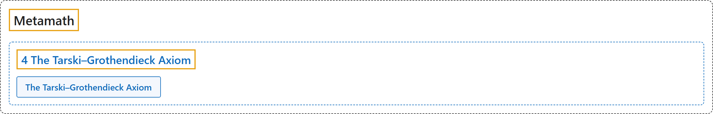

# 4 The Tarski–Grothendieck Axiom

## Classification

## Glossary

| Term | Definition | 中文翻译 | Source |
|---|---|---|---|
| **[Metamath](index.md)** Metamath | "An axiom is **a fundamental assumption that provides a starting point for reasoning**. The axioms for (essentially) all of mathematics can be conveniently divided into **three groups: propositional calculus, predicate calculus, and set theory**." | 公理是**为推理提供起点的基本假设**。（基本上）全部数学的公理可以方便地分为**三组：命题演算、谓词演算和集合论**。 | [Megill, 2026, "The Axioms" section](https://us.metamath.org/mpeuni/mmset.html#axioms) |
| **[4 The Tarski–Grothendieck Axiom](4-tarski-grothendieck-axiom.md)** 塔斯基-格罗滕迪克公理 | "The main important missing piece is the ability to do category theory, which requires **huge sets (inaccessible cardinals)** larger than those postulated by the ZFC axioms. The Tarski–Grothendieck Axiom **postulates the existence of such sets**." | 主要缺少的一块是做范畴论的能力，范畴论需要比 ZFC 公理所假定的更大的**巨大集合（不可达基数）**。塔斯基-格罗滕迪克公理**假定这样的集合存在**。 | [Megill, 2026, "The Axioms" section](https://us.metamath.org/mpeuni/mmset.html#axioms) |
| **[The Tarski–Grothendieck Axiom](https://us.metamath.org/mpeuni/ax-groth.html)** 塔斯基-格罗滕迪克公理 | "⊢ ∃𝑦 (𝑥 ∈ 𝑦 ∧ ∀𝑧 ∈ 𝑦 (∀𝑤 (𝑤 ⊆ 𝑧 → 𝑤 ∈ 𝑦) ∧ ∃𝑤 ∈ 𝑦 ∀𝑣 (𝑣 ⊆ 𝑧 → 𝑣 ∈ 𝑤)) ∧ ∀𝑧 (𝑧 ⊆ 𝑦 → (𝑧 ≈ 𝑦 ∨ 𝑧 ∈ 𝑦)))" | 每个集合 𝑥 都属于某个格罗滕迪克宇宙 𝑦：𝑦 对子集和幂集封闭，𝑦 的每个子集要么与 𝑦 等势，要么是 𝑦 的元素。 | [Megill, 2026, "The Axioms" section](https://us.metamath.org/mpeuni/mmset.html#axioms) |

## References

Megill, N. (2026). *Metamath Proof Explorer home page* (last updated January 19, 2026). Metamath. Retrieved October 29, 2026, from <https://us.metamath.org/mpeuni/mmset.html>
