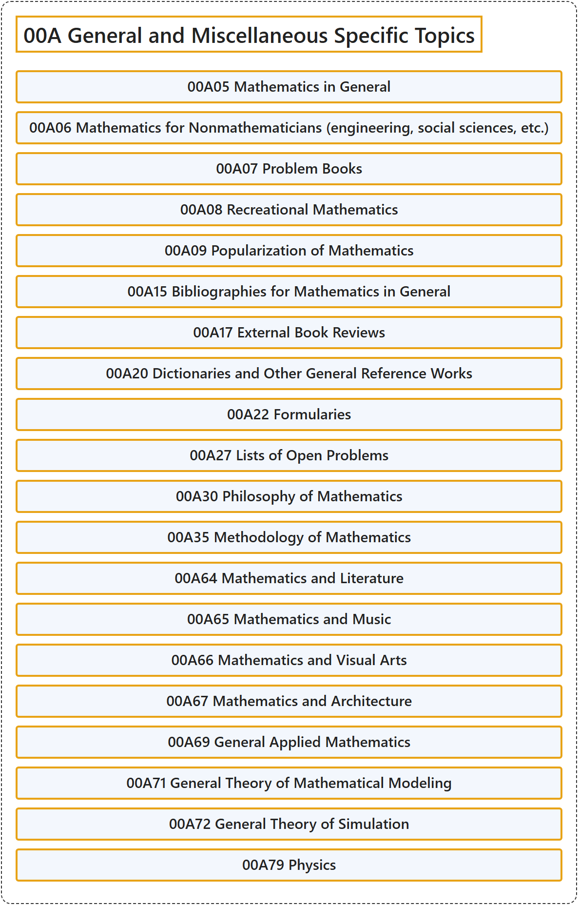

# 00A General and Miscellaneous Specific Topics

## Classification

## Glossary

| Term | Definition | 中文翻译 | Source |
|---|---|---|---|
| **00A General and Miscellaneous Specific Topics** 一般及杂项专题 | (No definition) | （无定义） | [Associate Editors of Mathematical Reviews and zbMATH, 2020](https://msc2020.org/) |
| **00A05 Mathematics in General** 一般数学 | (No definition) | （无定义） | [Associate Editors of Mathematical Reviews and zbMATH, 2020](https://msc2020.org/) |
| **00A06 Mathematics for Nonmathematicians (engineering, social sciences, etc.)** 面向非数学专业者的数学（工程、社会科学等） | (No definition) | （无定义） | [Associate Editors of Mathematical Reviews and zbMATH, 2020](https://msc2020.org/) |
| **00A07 Problem Books** 习题集 | (No definition) | （无定义） | [Associate Editors of Mathematical Reviews and zbMATH, 2020](https://msc2020.org/) |
| **00A08 Recreational Mathematics** 趣味数学 | (No definition) | （无定义） | [Associate Editors of Mathematical Reviews and zbMATH, 2020](https://msc2020.org/) |
| **00A09 Popularization of Mathematics** 数学普及 | (No definition) | （无定义） | [Associate Editors of Mathematical Reviews and zbMATH, 2020](https://msc2020.org/) |
| **00A15 Bibliographies for Mathematics in General** 一般数学文献目录 | (No definition) | （无定义） | [Associate Editors of Mathematical Reviews and zbMATH, 2020](https://msc2020.org/) |
| **00A17 External Book Reviews** 外部书评 | (No definition) | （无定义） | [Associate Editors of Mathematical Reviews and zbMATH, 2020](https://msc2020.org/) |
| **00A20 Dictionaries and Other General Reference Works** 词典及其他一般参考著作 | (No definition) | （无定义） | [Associate Editors of Mathematical Reviews and zbMATH, 2020](https://msc2020.org/) |
| **00A22 Formularies** 公式集 | (No definition) | （无定义） | [Associate Editors of Mathematical Reviews and zbMATH, 2020](https://msc2020.org/) |
| **00A27 Lists of Open Problems** 未解决问题列表 | (No definition) | （无定义） | [Associate Editors of Mathematical Reviews and zbMATH, 2020](https://msc2020.org/) |
| **00A30 Philosophy of Mathematics** 数学哲学 | (No definition) | （无定义） | [Associate Editors of Mathematical Reviews and zbMATH, 2020](https://msc2020.org/) |
| **00A35 Methodology of Mathematics** 数学方法论 | (No definition) | （无定义） | [Associate Editors of Mathematical Reviews and zbMATH, 2020](https://msc2020.org/) |
| **00A64 Mathematics and Literature** 数学与文学 | (No definition) | （无定义） | [Associate Editors of Mathematical Reviews and zbMATH, 2020](https://msc2020.org/) |
| **00A65 Mathematics and Music** 数学与音乐 | (No definition) | （无定义） | [Associate Editors of Mathematical Reviews and zbMATH, 2020](https://msc2020.org/) |
| **00A66 Mathematics and Visual Arts** 数学与视觉艺术 | (No definition) | （无定义） | [Associate Editors of Mathematical Reviews and zbMATH, 2020](https://msc2020.org/) |
| **00A67 Mathematics and Architecture** 数学与建筑 | (No definition) | （无定义） | [Associate Editors of Mathematical Reviews and zbMATH, 2020](https://msc2020.org/) |
| **00A69 General Applied Mathematics** 一般应用数学 | (No definition) | （无定义） | [Associate Editors of Mathematical Reviews and zbMATH, 2020](https://msc2020.org/) |
| **00A71 General Theory of Mathematical Modeling** 数学建模的一般理论 | (No definition) | （无定义） | [Associate Editors of Mathematical Reviews and zbMATH, 2020](https://msc2020.org/) |
| **00A72 General Theory of Simulation** 模拟的一般理论 | (No definition) | （无定义） | [Associate Editors of Mathematical Reviews and zbMATH, 2020](https://msc2020.org/) |
| **00A79 Physics** 物理学 | (No definition) | （无定义） | [Associate Editors of Mathematical Reviews and zbMATH, 2020](https://msc2020.org/) |

## References

Associate Editors of Mathematical Reviews and zbMATH. (2020). *MSC2020: Mathematics Subject Classification system*. Retrieved October 27, 2026, from <https://msc2020.org/>
